# Claude Web

**English** · [简体中文](README.zh-CN.md)

**A visual workbench for the Claude Code CLI.** It takes Claude Code out of the command line and puts it in a graphical interface: conversations, tool calls folded into one line per turn, code diff review, permission approvals, files / Git / editor, split view, and remote access from your phone, all in one window.

The same program comes in two forms: a **desktop app** (Windows / macOS) and a **web version** (run a local server and open it in your browser). The features are identical and the data is shared. Besides Claude Code, the same interface can drive other CLI agents such as Codex, Gemini CLI, Qwen Code, Kimi and OpenCode. The interface comes in **English and Chinese** and follows your computer's language by default ([how to change it](#interface-language)).

> **Unofficial project.** Claude Web is a community-built open-source tool. It has no affiliation with Anthropic and is not endorsed by Anthropic. "Claude" and "Claude Code" are trademarks of Anthropic. To use it you need your own Claude Code login (a Claude subscription) or a key for a third-party API / relay (a third-party API reseller or proxy service). Costs and usage are billed to your own account.

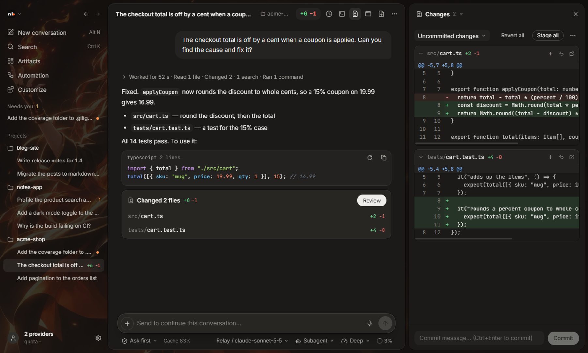

**When subagents and workflows run, you can watch them in a 3D net cafe under Automation › Running**: your main conversation is the admin behind the front desk, and every subagent is a guest. They walk in, sit down at a PC and type, wander off to the sofa or the snack shelf when idle, and check out at the front desk when they're done ([details](#15-running-watch-subagents-work-in-the-net-cafe)).

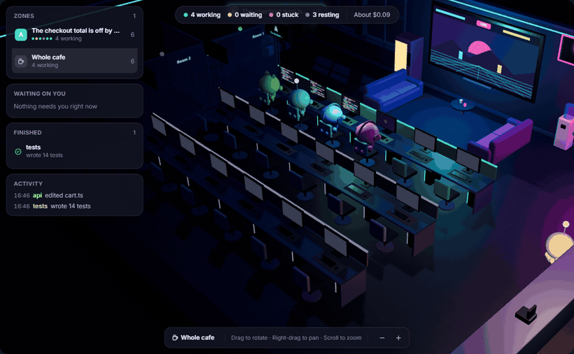

---

## Table of contents

- [What it does](#what-it-does)
- [Desktop app or web version?](#desktop-app-or-web-version)
- [Install](#install)
- [Walkthrough](#walkthrough)
  - [1. Sign in to Claude](#1-sign-in-to-claude)
  - [2. Pick a project and start your first conversation](#2-pick-a-project-and-start-your-first-conversation)
  - [3. Permission prompts and permission modes](#3-permission-prompts-and-permission-modes)
  - [4. Changes, Git, files: the right panel](#4-changes-git-files-the-right-panel)
  - [5. The split-view workbench](#5-the-split-view-workbench)
  - [6. Connect a third-party API / relay](#6-connect-a-third-party-api--relay)
  - [7. Manage several conversations at once](#7-manage-several-conversations-at-once)
  - [8. Use it from your phone](#8-use-it-from-your-phone)
  - [9. Other CLI agents (Codex / Gemini …)](#9-other-cli-agents-codex--gemini-)
  - [10. Conversations from other agents on this computer](#10-conversations-from-other-agents-on-this-computer)
  - [11. Model gateway (multi-account failover / protocol conversion)](#11-model-gateway-multi-account-failover--protocol-conversion)
  - [12. Config for other agents (MCP / instruction files / models)](#12-config-for-other-agents-mcp--instruction-files--models)
  - [13. Conversations on other computers](#13-conversations-on-other-computers)
  - [14. Automation: scheduled tasks, bots, goals, multi-agent orchestration](#14-automation-scheduled-tasks-bots-goals-multi-agent-orchestration)
  - [15. Running: watch subagents work in the net cafe](#15-running-watch-subagents-work-in-the-net-cafe)
- [Character themes](#character-themes)
- [Openings (desktop app)](#openings-desktop-app)
- [Interface language](#interface-language)
- [Custom styles (custom.css)](#custom-styles-customcss)
- [Keyboard shortcuts](#keyboard-shortcuts)
- [Where your data lives](#where-your-data-lives)
- [FAQ](#faq)
- [How it works](#how-it-works)
- [Security and privacy](#security-and-privacy)
- [Running from source and development](#running-from-source-and-development)
- [Contributing](#contributing)
- [License and credits](#license-and-credits)

---

## What it does

| | |
| --- | --- |
| **Conversations** | Streaming output and thinking; a finished turn folds into one line like "Worked for 27 s · Read 2 files · Ran 1 command", and opening it shows a step-by-step timeline; Markdown / code highlighting / math / Mermaid diagrams |
| **Code changes** | A "Changed N files" card at the end of each turn; the right panel's **Changes** shows each file's diff (unified or side by side), and lets you stage, revert and commit |
| **Permissions** | When approval is needed, a card sits above the input box: Allow once (press Enter with the box empty) / Deny (whatever you've typed in the box becomes the reason) / Always allow; questions and plan approvals show up here too |
| **Workbench** | By default you only see the sidebar, the conversation and the right panel. When you need more: Ctrl+D to split (up to 6), tabs, groups; conversations, the editor (Monaco), diffs, terminals and the built-in browser can all go into a split |
| **Files / Git / search** | File tree, project-wide search and replace (ripgrep), Git stage / commit / branches / stash / worktree, Issue and PR boards |
| **Managing conversations** | Pin, archive, fork (start a new branch from any message), edit and resend, interject, export to HTML |
| **Needs you** | The top of the sidebar lists every conversation waiting for you to approve or answer; each row ends with its state: waiting, running, error, or the lines it changed |
| **Running work** | Automation › Running shows the subagents, workflows and background commands of every conversation, as a list grouped by conversation or as a 3D net cafe where every subagent is a guest who checks out at the front desk when done; Finished looks back at past runs; characters can be "made" from a photo or a single sentence; the Stop button in the input box only stops the current turn, background work keeps running |
| **Web access** | The agent searches, opens pages, clicks, fills forms and takes screenshots in the built-in browser, with no search key needed; on Windows it can also operate specific desktop apps once you allow it |
| **Automation** | One page from the sidebar with five tabs: Running, Scheduled tasks (cron), Bots (on-duty teammates on your computer), Goals (give it a goal and it keeps working turn after turn) and multi-agent Orchestration |
| **Customize** | Skills, connectors (MCP), plugins and Artifact types on one page from the sidebar |
| **Providers** | Each conversation can use a different provider (official account / Anthropic-compatible relay / OpenAI / Gemini …), and the model menu lists them flat as "Provider / model"; keys are stored encrypted; each model's context window can be set individually; subagents can use a different (cheaper) model |
| **Multiple agents** | Besides Claude it can drive CLI agents such as Codex, Gemini, Qwen and Kimi, with the same interface |
| **Remote** | Pair by scanning a QR code and use it from your phone's browser, even away from your home Wi-Fi; SSH tunnels to remote machines; bots for Telegram / Discord / Slack / DingTalk / Feishu |
| **Usage** | Subscription quota ring, per-turn time and cost ledger, context usage |
| **English / 中文** | The whole interface (web, the desktop app's menus and tray, the phone page, exported HTML) comes in English and Chinese; it follows your computer by default and you can change it in settings |

## Desktop app or web version?

**Use either one; the features are the same.** The only difference is the shell:

| | Desktop app | Web version |
| --- | --- | --- |
| How to open it | Installer, double-click | Run `npm start`, then open `http://127.0.0.1:3090` in a browser |
| Needs Node.js | No (built in) | Yes, Node.js 22.13+ |
| Tray / system notifications / start at login | ✅ | Browser notifications |
| Multiple windows | ✅ | Multiple browser tabs |
| Shortcuts | Ctrl (⌘ on macOS) based | Some use Alt instead, to avoid combinations the browser takes |
| Phone access | Turn it on in settings, then open it in your phone's browser; the computer is kept awake while it's on | Same; turn off sleep yourself in your system's power settings |

Both read and write the same data (`~/.claude` and `~/.claude-web`), so you can mix them.

## Install

### Desktop app (download an installer)

Download from [Releases](https://github.com/ypyik0669/claude-web/releases/latest):

| System | File |
| --- | --- |
| Windows 10 / 11 (x64) | `ClaudeWeb-<version>-win-x64.exe` (installer) or `ClaudeWeb-<version>-portable.exe` (no install needed) |
| macOS, Apple Silicon (M1 and later) | `ClaudeWeb-<version>-mac-arm64.dmg` |
| macOS, Intel | `ClaudeWeb-<version>-mac-x64.dmg` |

The `.zip`, `.yml` and `.blockmap` files are used by auto-update; you don't need to download them. For what to expect the first time you open it, see "About the installer warnings" below. For what changed in each version, see the [changelog](CHANGELOG.md).

### Web version (from source)

You need [Node.js 22.13+](https://nodejs.org/) (it uses the built-in `node:sqlite`) and Git:

```bash
git clone https://github.com/ypyik0669/claude-web.git
cd claude-web
npm install
npm run build
npm start
```

Then open <http://127.0.0.1:3090> in your browser. On Windows you can also just double-click `启动.cmd` in the repo (the Windows launcher script; its file name is in Chinese).

### Desktop app (build it yourself)

```bash
npm install
npm run build:desktop        # Windows: dist-desktop/ClaudeWeb-<version>-win-x64.exe (installer) and -portable.exe (no install needed)
npm run build:desktop:mac    # macOS: can only be built on a Mac; build arm64 and x64 on a machine with the matching chip
npm run build:desktop:linux  # Linux
```

### About the installer warnings

- **Windows**: the installer is not code-signed. When SmartScreen says "Windows protected your PC", click **More info → Run anyway**.
- **macOS**: pick the package for your chip: `mac-arm64.dmg` for Apple Silicon (M1 and later), `mac-x64.dmg` for Intel (Apple menu in the top left → About This Mac, and look at the "Chip" line). Open the dmg and drag **Claude Web** into "Applications". The installer is not signed by Apple, so the **first time you open it** you need to **right-click → Open → Open** it in "Applications"; if you get "is damaged and can't be opened", run this once in a terminal:

  ```bash
  xattr -cr "/Applications/Claude Web.app"
  ```

## Walkthrough

### 1. Sign in to Claude

Claude Web drives the Claude Code on your computer, and the login is shared with the command line (`~/.claude`).

- **Already using Claude Code in the command line**: nothing to do, just open it and go.
- **Not signed in yet**: the first-run guide has two steps: ① Connect a model (skipped automatically if you're already signed in or already have a provider) ② Choose a project folder. For sign-in, click **Sign in with Claude account** on the first step: it opens a terminal tab running Claude Code; pick a sign-in method when prompted (or type `/login`), and when you're signed in, go back to the guide and click **Already signed in? Check again**. You can also click **Skip for now**, and the start page will remind you that you're not signed in.
- **No Claude subscription, using an API key or a relay**: fill in the key right there in the guide's Connect a model step, or jump to [step 6](#6-connect-a-third-party-api--relay).

### 2. Pick a project and start your first conversation

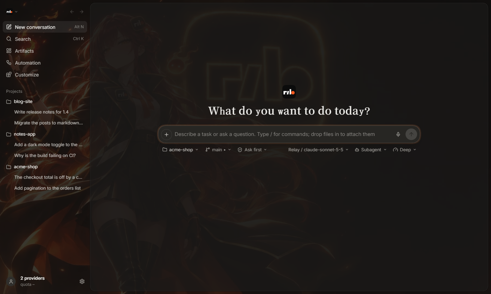

The start page is just the app's logo, "What do you want to do today?", the input box and one line under it. A few starter suggestions show up while the project has no conversation yet, and a getting-started checklist only the very first time; recent tasks, scheduled tasks and archived conversations are in the sidebar and under Automation. If you used Claude Web before this layout, a one-time "Where things moved" card under the box tells you where everything went.

1. On the line under the box, the **folder** chip at the left end picks your project folder (recently used ones are listed first; "Open folder…" picks another). The sidebar groups conversations by project; the folder button on the "Projects" title row also adds a project; projects can be dragged to reorder (a project's right-click menu, a long press on a phone, has "Move to top / Move up / Move down").
2. Describe the task in the input box. <kbd>Enter</kbd> sends, <kbd>Shift</kbd>+<kbd>Enter</kbd> adds a new line. Afterwards, **New conversation** at the top of the sidebar (<kbd>Ctrl</kbd>+<kbd>N</kbd>, <kbd>Alt</kbd>+<kbd>N</kbd> in the web version) brings you back here.
3. The box itself has **＋** on the left and send on the right; everything else is on the line under it:
   - **＋**: add files, folders and images (you can also drag them in or paste a screenshot), reference another conversation, set a goal, "Chat only" (a new conversation with no tools), and switch on abilities such as controlling Chrome;
   - **Folder · branch** (new conversations only): switch project, switch local branch, or have it work in a separate copy (git worktree);
   - **Permissions** (see the next step);
   - **Model** (on the right): the models of every provider are in this one menu;
   - **Subagent** (only in Claude conversations): the main task uses the main model, and subagents (the ones sent out by Task and workflows) use the model you pick here. Pick a cheaper one to save quota; the default is "Same as main model" (see [step 6](#6-connect-a-third-party-api--relay));
   - **Thinking effort** (it shows the current level): Fast / Balanced / Deep / Deeper / Max, each with a one-line description; the last row, "Deep orchestration", splits a task into subtasks done at the same time by several subagents.

   In a conversation the same line reads: permissions, then this conversation's turns, steps, speed and cache hits on the left; model, subagent, thinking effort and a small ring on the right. The ring is context usage in percent; hover over it (tap it on a phone) for this conversation's usage.
4. Type `/` to bring up the command list (`/compact`, `/model`, custom skills …), and press <kbd>Tab</kbd> to complete.

While the reply is in progress, each tool call (reading files, editing code, running commands) unfolds step by step; when the turn is done it folds into a one-line summary, and opening it shows the full timeline. The changes are in the "Changed N files" card at the end; its **Review** button, or a click on a file, opens them in the right panel's Changes. While it runs you can press <kbd>Esc</kbd> to interrupt at any time, or keep typing to **interject**, and it will see your message at the next step.

### 3. Permission prompts and permission modes

When Claude wants to run a command or edit a file, a card sits above the input box (and that step in the message stream shows "Waiting for you"): **Allow once** (press <kbd>Enter</kbd> when the input box is empty), **Deny** (write the reason in the input box and press <kbd>Enter</kbd>, and it will try another way), or **Always allow** this kind of operation. An <kbd>Enter</kbd> pressed in the instant the card appears doesn't count, so you don't approve by accident. A plan card needs a button click or <kbd>Ctrl</kbd>+<kbd>Enter</kbd>.

The permissions chip on the line under the input box decides how often you're asked (<kbd>Shift</kbd>+<kbd>Tab</kbd> in an empty box steps through the modes, all but "Allow everything"; **Settings → Conversations → Default permissions** sets the default for new conversations):

| Mode | What it does |
| --- | --- |
| Ask first | Asks you before every file edit and every command (recommended) |
| Accept edits | Edits files directly; asks you before running commands |
| Plan only | Reads code and writes a plan first, and only acts once you give the go-ahead |
| Auto | Claude decides for itself which operations need to ask you |
| Allowed only | No prompts; anything not allowed in advance is skipped |
| Allow everything | Runs everything without asking; only use it in an environment where it doesn't matter if things break |

### 4. Changes, Git, files: the right panel

The top row of a conversation has the title, project and branch, and on the right: **+N −M** (how many lines this conversation changed; click it to open Changes), five tool buttons for the right panel, **Tasks · Terminal · Changes · Browser · Files** (<kbd>Ctrl</kbd>+<kbd>1</kbd>–<kbd>5</kbd> in the desktop app, <kbd>Ctrl</kbd>+<kbd>Shift</kbd>+<kbd>1</kbd>–<kbd>5</kbd> in both), and **⋯**. The right panel shows one panel at a time (<kbd>Ctrl</kbd>+<kbd>J</kbd> shows or hides it); the picker at its top left switches between those five, this conversation's Artifacts, the other panels you have open, and "More panels" (Goals, Orchestration, Usage, Details, Issues & PRs, Net cafe):

- **Changes** (it used to be called Review): uncommitted changes / staged / changes from this conversation / a recent commit; view diffs file by file, stage, revert, write a commit message and commit. **Git** in the panel's ··· has branches, pull and push, history, stash and worktree, and offers a one-click fix when something goes wrong;
- **Files**: the project file tree (right-click to create / rename / move to the trash) and project-wide search and replace (regex, case, whole word, include / exclude); files generated by this conversation are listed at the top;
- **Terminal**: when the panel is hidden, the terminal keeps running in the background;
- **Browser**: the built-in browser, for your own browsing, and it's also where the agent browses (see "Web access" below);
- **Tasks**: this conversation's background tasks (a shrunken graph, with a stop button for each task), the plan checklist and subagents.

The conversation header's **⋯** has Rename, Fork, Export…, Steps view and More (side chat, thinking language, view mode, this conversation's usage, background tasks, keep the computer awake, pin, open in File Explorer / VS Code, end the process, quote in the input box, copy ID…), then the Conversation info column (<kbd>Ctrl</kbd>+<kbd>I</kbd>), **Issues & PRs** (a GitHub / GitLab board; it needs `gh auth login` or `glab auth login` on this computer, and can check out a PR straight into a review conversation) and Android screen, then Hand off to another agent…, Archive and Delete. The command palette (<kbd>Ctrl</kbd>+<kbd>K</kbd>) finds all of these too.

The top of the sidebar has five entries: **New conversation** · **Search** (the command palette: conversations, Artifacts, commands and settings) · **Artifacts** (the pages, documents, images and data Claude made in recent conversations) · **Automation** (Running, Scheduled tasks, Bots, Goals and Orchestration, see [14](#14-automation-scheduled-tasks-bots-goals-multi-agent-orchestration) and [15](#15-running-watch-subagents-work-in-the-net-cafe)) · **Customize** (Skills, Connectors, Plugins and Artifact types). The logo at the top left is the app menu. Your account row is at the bottom of the sidebar; its menu has Settings, Usage and ledger, Language ›, Theme ›, Keyboard shortcuts, Help and feedback ›, What's new, and signing in to or out of your Claude account. Looking for something by the name it had in the old layout (Background, Extensions, Config center, Overview…)? Type that name into <kbd>Ctrl</kbd>+<kbd>K</kbd>.

#### Web access: search and the built-in browser

In every conversation, the agent (Claude, Codex and Gemini alike) can **search the web**, and can use the **built-in browser** to open pages, read content, click, fill forms and take screenshots. Just ask: "search for the latest way to use xxx", "open this address and see what error it shows".

- **Search is done inside the built-in browser**: it opens a search site's results page (a page you can't see) and reads the results. That is the same kind of request as searching in a browser yourself, so **no key of any kind is needed** and it doesn't go through a third-party search proxy. By default it tries DuckDuckGo, Bing, Yahoo and Baidu in turn, and uses whichever gives relevant results; you can also pick one under **Settings → Web and browser** (Google is available there too). Which one works depends on your network; "Try it" on the same page shows you. When a site asks for verification ("prove you're not a robot"), open it in the browser in the right panel, verify once, and searching will work after that. If you'd rather use a search API, that page also takes a Brave Search key.
- The pages it opens show up in the right panel's "Browser", and the agent in each conversation uses its own tab (marked), so you can see what it's doing. When it works in a background tab it won't steal the panel you're looking at; the browser only comes to the front the first time it opens, when it needs a screenshot, or when the panel is collapsed.
- **Mouse and keyboard on web pages**: for buttons, links and inputs that can be listed on the page, the agent clicks and fills by element; for what can't be listed (canvases, maps, dragging, menus that only appear on hover, sliders) it works from screenshots by position: click, double-click, right-click, drag, scroll wheel, typing, key presses. It only acts on its own tab inside the built-in browser.
- Opening pages, clicking and typing go through permission approval just like running commands (with "Ask first", you're asked each time); only searching doesn't ask. (This is for Claude conversations; Codex, Gemini and the others follow their own approval rules.)
- Clicking, form filling, screenshots and by-position actions need the **desktop app**; in the web version and on a phone, the agent can only search and read the text of pages (and then the computer fetches the Bing / DuckDuckGo results page directly, which is easy to rate-limit).
- Web page content is handed to the model as reference material and is marked "not instructions"; but still don't let it act freely on pages where you're signed in to important accounts. With "Keep cookies" set to "Separate" under Settings → Web and browser (or the built-in browser's ⋯ menu), it can't see the accounts you've signed in to in the built-in browser.
- The only search tool the model has is the one above (the one that ships with the runtime goes through someone else's hosted search proxy, so it isn't used here). One exception: when a conversation runs on the official Claude Code (for example the provider has "only accepts the official binary" ticked), its built-in search is executed on Anthropic's side and still works as usual.

#### Computer control (Windows)

When what you want to operate isn't in a web page (Notepad, File Explorer, some desktop app), use **Computer control**: the agent looks at screenshots and uses the mouse and keyboard on **the apps you allow**.

- Turn on "Computer control" in the **＋** of the start page's input box before sending the first message (it's only on for that one Claude conversation; for the next new conversation, turn it on again if you need it).
- Before it uses any app, a card asks you: it shows the app's name and what it says it wants to do. **Only clicking "Allow control" on the card counts as consent**; pressing Enter doesn't count, and permission modes like "Allow everything" or "Auto" won't consent for you. If you don't want to allow it, click "Don't allow", or just tell it why in the input box.
- Once allowed: it can see a screenshot of the **whole main screen** (other windows are in the picture too), but the keyboard and mouse only go through while an app you allowed is in front; when another app is in front, the action is rejected and it's told why. Claude Web's own window can never be operated by it. The authorization is only valid for that one conversation and is taken back when the conversation ends.
- If you move the mouse or type yourself, its actions get interrupted or miss, so try not to compete with it while it works; to make it stop, click Stop in the conversation.
- For now only **Windows** is supported (it looks at the computer running Claude Web, and only the main display); on macOS and Linux that row in the `+` menu says "Not available right now". You don't need it for the web: searching, opening pages, clicking and screenshots all happen in the built-in browser.

### 5. The split-view workbench

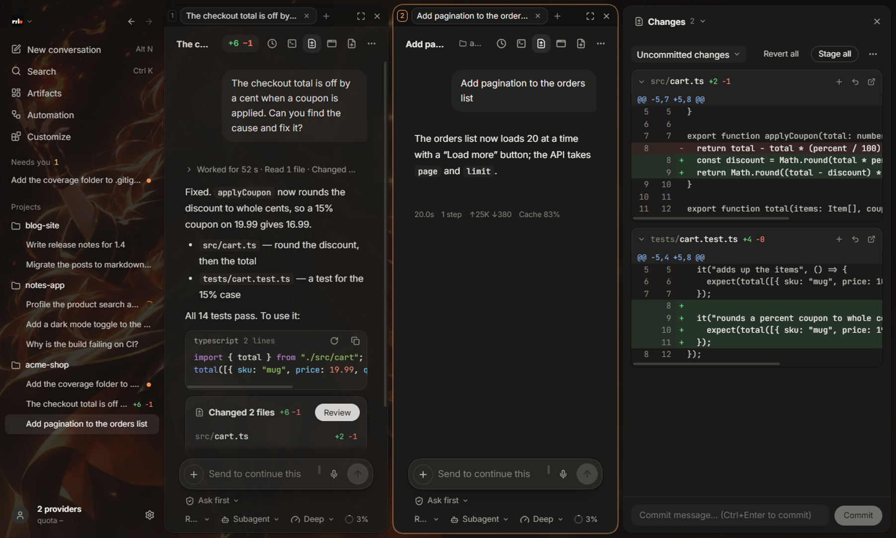

By default the interface is just the sidebar, the conversation and the right panel. Workbench tools such as splits, tabs and groups only appear when you use them:

- <kbd>Ctrl</kbd>+<kbd>D</kbd> splits to the right, <kbd>Ctrl</kbd>+<kbd>Shift</kbd>+<kbd>D</kbd> splits downward, up to 6 splits; once split, each split gets a tab strip at its top, and it folds away again when you close down to one;
- **Drag** a conversation from the left sidebar to the edge of a split to open it on that side;
- Clicking a file path in a conversation opens it in an editor tab (Monaco, autosave, <kbd>Ctrl</kbd>+<kbd>S</kbd> to save manually);
- <kbd>Ctrl</kbd>+<kbd>T</kbd> creates a group; a group is an independent set of split layouts, handy for keeping tasks apart; <kbd>Ctrl</kbd>+<kbd>Alt</kbd>+<kbd>1</kbd>–<kbd>9</kbd> jumps to a group;
- <kbd>Ctrl</kbd>+<kbd>Shift</kbd>+<kbd>Enter</kbd> maximizes the current split, and pressing it again restores it;
- To always show the tab strip, the group bar and the right panel's icon bar: **Settings → Notifications and window → Show workbench tools**.

### 6. Connect a third-party API / relay

**The fastest way**: Settings → Models → Sources → **Quick add** (the "Connect a model" step when you first open the app is the same thing). Pick a source (Relay / DeepSeek / Kimi / Zhipu GLM / Qwen / SiliconFlow / OpenRouter / Gemini), for a relay also enter its address, paste your API key and click **Connect**. The model list and API format are read automatically, and it's only saved once the test passes; a wrong key, insufficient balance or a wrong address is reported directly.

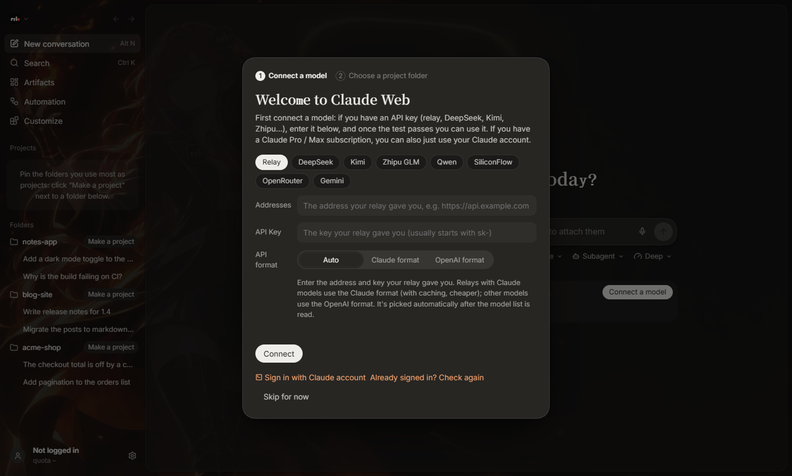

When you need more options (specifying a model mapping, how it runs, cache settings), use the full form:

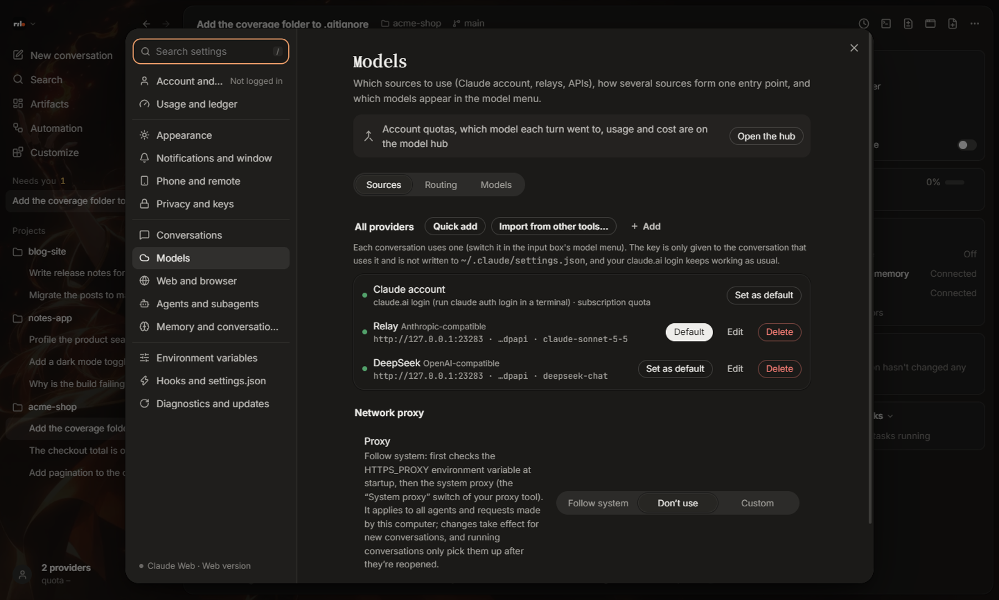

Settings (<kbd>Ctrl</kbd>+<kbd>,</kbd>, or the account menu at the bottom of the sidebar) is a dialog with 14 pages in four groups: Account and login, Usage and ledger · Appearance, Notifications and window, Phone and remote, Privacy and keys · Conversations, Models, Web and browser, Agents and subagents, Memory and conversation library · Environment variables, Hooks and settings.json, Diagnostics and updates. The search box at its top finds any setting. On a phone it is a page of its own. Models has three tabs: **Sources** (the Claude account, providers and relays, the network proxy), **Routing** (the local model gateway, see [11](#11-model-gateway-multi-account-failover--protocol-conversion)) and **Models** (which models the menu lists); "Open the hub" at its top opens the full model hub (account quotas, which model each turn went to, usage and cost).

1. Open **Settings** (<kbd>Ctrl</kbd>+<kbd>,</kbd>) → **Models** → **Sources** → **+ Add**;
2. Choose a type (Anthropic-compatible / OpenAI / Gemini …), fill in **Base URL** and **API Key**, and optionally specify models;
3. Click **Test connection**: it first fetches the model list, then really runs one round of conversation. If the relay only lets the official Claude Code client through, it automatically makes this provider run on the official Claude Code;
4. Back in the input box, click the model chip and pick one of this provider's models from the menu (the chip shows `Provider / model`). You can also switch in the middle of a conversation, and the history is kept.

The key is only injected into that conversation's own process and is never written to `~/.claude/settings.json`; it's stored encrypted locally (DPAPI on Windows, Keychain on macOS).

**Using several relays / accounts together**: the model chip is one unified menu, with every model of every provider flattened into a single list of `Provider / model` (models of the official account show just their name, like `Fable 5.1`), and picking one switches provider and model at the same time:


- The search box at the top filters by provider name or model name, <kbd>↑</kbd> <kbd>↓</kbd> select, <kbd>Enter</kbd> confirms, <kbd>Esc</kbd> closes;
- The star at the end of a row marks a favorite, and favorites are pinned to the top; the 5 most recently used get a section of their own;
- Each provider gets a section whose header shows the number of models and the time of the last fetch (or the error if the fetch failed); other agents (Codex, Gemini …) are a section each too;
- Near the bottom, "Subagent model ›" and "Thinking effort ›" open those two menus (they are also the chips next to the model);
- "Refresh all models" at the bottom requests `/v1/models` once per provider (it only lists models, runs no conversation and costs no tokens), and after startup lists older than 24 hours are also refreshed in the background; "Manage sources" opens **Settings → Models → Sources**, and "Manage models…" its **Models** tab;
- The menu only lists providers the current agent can use: Claude Code takes every type, Codex and other ACP agents use OpenAI-compatible / the model gateway, and Gemini CLI uses Gemini / the model gateway;
- In a conversation, picking another model of the same provider just switches the model; picking another provider restarts the conversation's process invisibly (the history is kept) and uses the model you picked; picking another agent's model hands the conversation over to it to continue. Conversations on other computers can only change the model;
- If you chat a lot on a model with a big window and then switch to one with a smaller window, and the conversation is already past 80% of the new model's window, it is first compacted with the current model before switching, and the conversation gets a line saying so.

**Choosing a separate model for subagents**: the **Subagent** chip next to the model on the line under the box (or "Subagent model ›" near the bottom of the model menu) opens the same kind of model menu, with "Same as main model" as the top row; any provider's models can be picked. The main task keeps using the main model and subagents (the ones sent out by Task and workflows) use the one you picked; for example, Sonnet for the main task and Haiku for subagents saves quite a bit of quota. Switch on "Same for new conversations" at the bottom of the menu, and the subagents of every new conversation from then on (including IM bots and scheduled tasks) use it, whatever provider the main conversation is on. When you change it on a running conversation, it restarts invisibly once the current turn finishes and then switches; subagents already sent out aren't affected.

**Several Claude accounts**: under **Settings → Account and login → Other Claude accounts**, click **Add account**. A terminal opens and runs `claude setup-token`; sign in to the account you want to add in the browser (sign out of the other one first, or use a private window) and authorize, and the token it prints at the end fills in by itself. Name it and save (saving sends one very short message as a test). Each account then has its own section in the model menu ("Work / Opus 5.5"), so every conversation can run on a different account; when one runs out of quota, pick a model of another and the conversation carries on. An account can be made the default for new conversations, and IM bots and scheduled tasks can use it too. The login in `~/.claude` stays the "Claude account".

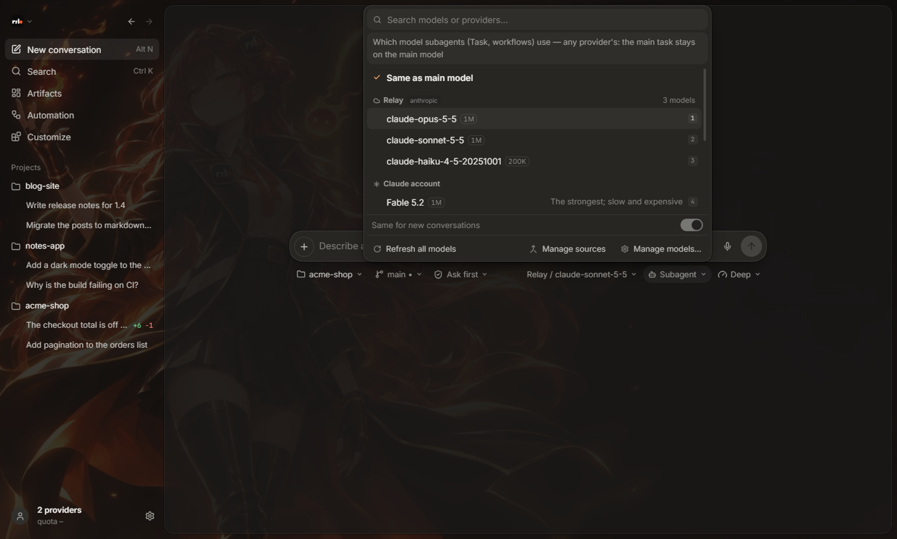

**Each model's context window**: under **Settings → Models → Sources → Edit**, "Context window" has one row per model. Leave it empty to use the default (Claude on a relay is 1 million, Haiku 200k, GPT 272k, Gemini about 1.05 million; if the relay's model list states a size, that's used, and an unknown model gets 200k). To change it, just type a value (`272000`, `272k` and `1m` all work). Auto-compaction and the small context ring next to the input box both use this number.

The **Models** tab of **Settings → Models** has two views: "By model" is a table with one row per model, listing the providers that offer it (click a provider chip to make it that provider's default model), the favorite star and the show switch; "By provider" is the grouped view. At the top is each provider's fetch status and its own refresh button.

### 7. Manage several conversations at once

**Needs you**, under the five entries at the top of the sidebar, lists every conversation waiting for you to approve a permission, answer a question or approve an orchestration; click one to jump to it. Each conversation row ends with just its state: an orange dot when it's waiting for you, a red dot on an error, a spinner while it runs, or +N −M for the lines it changed (the last update time is in the row's tooltip).

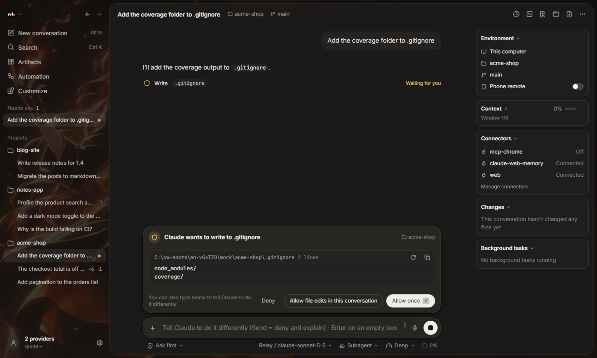

What every conversation is running in the background (subagents, workflows, background commands) is on **Automation › Running**, see [15](#15-running-watch-subagents-work-in-the-net-cafe).

The list itself:

- Hover over a project header for **Show** and **＋** (a new conversation in that project). Show has six rows: Group by › (folders, project, date, no grouping), Sort by › (last updated, created, name), Show › (archived conversations, other agents' conversations, how many per group, Source ›, Computers ›), New section, Restore defaults and View all;
- Right-click a project header for its menu (on a phone, a long press): a new conversation there or in a separate copy, a terminal there, Move to top / up / down, Project page…, rename, open in File Explorer / VS Code, remove from the sidebar;
- Forks sit one level in under the conversation they came from; when there are more than three they fold behind the arrow at the start of the row;
- To act on several conversations at once, Shift+click them, or pick **Choose** in a row's menu (right-click, or the ··· that shows on hover; a long press on a phone);
- Press <kbd>/</kbd> in the sidebar to filter the list in place; <kbd>Ctrl</kbd>+<kbd>K</kbd> searches everything.

The Overview of earlier versions is still there for those who want it: <kbd>Ctrl</kbd>+<kbd>Shift</kbd>+<kbd>M</kbd>, or "Overview" in the command palette, opens it in the right panel (all open conversations grouped into Needs you / Running / Error / Idle, with permission requests approvable on the cards).

When the window isn't in the foreground, the desktop app pops a system notification when a conversation finishes or needs approval, and the taskbar / Dock icon shows the number of pending items.

### 8. Use it from your phone

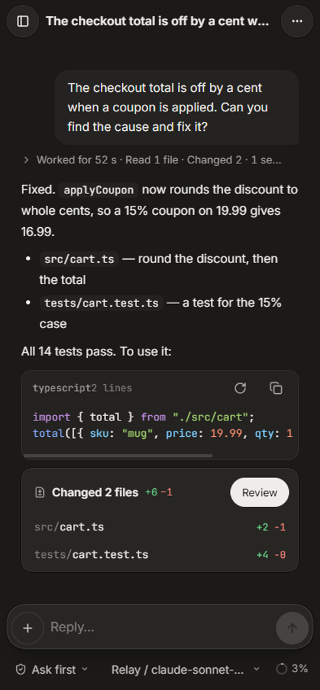

1. On your computer, open **Settings → Phone and remote** and turn on "Local network / phone access" (default port 3091);
2. Click **Generate pairing code**, which shows a 6-digit code and a QR code (valid for 10 minutes);
3. With your phone on the same Wi-Fi, scan the code to open the page and enter the pairing code;
4. After pairing, the phone remembers this computer, and you can add it to your home screen to use it like an app. Paired devices can be renamed or revoked on the same page.

On a phone a conversation's header is just ☰ · the title · ⋯. ☰ opens the sidebar as a drawer (with a search box at its top). ⋯ opens a sheet with a grid of six panels (Changes · Tasks · Terminal · Files · Browser · Artifacts) and Rename, Fork, Export…, View mode › and More ›; a panel opens as a sheet from the bottom (drag it up for the full screen). Press and hold a message for its actions (copy, edit, rerun, fork, read aloud). The new-conversation page's project sheet also picks the branch. Phones show no keyboard hints.

**Using it away from home**: once "Use it from anywhere" on the same page is turned on (it's on by default when remote access is on), the QR code is by default the "works anywhere" one. Your phone scans it to open a web page (the phone page) and pairs once; after that the phone can reach this computer on mobile data or another Wi-Fi, with no app to install and no account to register:

- The two sides find each other through a public matchmaking server (MQTT), and all messages are encrypted; if a direct connection works it's used, and if it can't be made (common on mobile data) it falls back to a slower relayed path: text and approvals work, but file preview and upload don't, and the phone says so.
- Your computer must be on and Claude Web must be running. The desktop app keeps the computer awake by default, but a laptop still sleeps when you close the lid.
- To use it from an iPhone home screen icon: first "Add to Home Screen" in Safari, then open the pairing from the home screen icon (the home screen and Safari have separate storage); or on the computer click "Copy pairing link" and paste it into "Paste pairing link" on the phone page.
- The original local-network QR code is still there ("Local network only (no internet needed)") and works without an internet connection.

For the risks, see "Security and privacy" below. You can also set up Telegram / Feishu and other bots (the bots part of **Settings → Phone and remote**) to get notifications, approve and give instructions from a chat app; to connect to Claude Web on another machine you can use an SSH tunnel ("More options" on the same page).

<br clear="right">

### 9. Other CLI agents (Codex / Gemini …)

**Settings → Agents and subagents → Other agents** shows whether Codex, Gemini, Qwen, Kimi and others are installed and signed in, and opens a terminal for one-click install / sign-in. After that, just pick their models in the model menu (one section per agent), and conversations, tool cards and permission approvals work just like with Claude. In the middle of a conversation you can also **hand it off** to another agent (the conversation header's ⋯ → "Hand off to another agent…"), and what's been done so far is condensed into a summary and carried over.

### 10. Conversations from other agents on this computer

If you've also used CLIs such as Codex or OpenCode on this computer (or their desktop apps / plugins), Claude Web can put their own conversation records in the sidebar too, so you can browse, search and continue them together with Claude's conversations.

**Adding them is optional.** At startup it only does a light check (is it installed, does the data folder exist); it starts no process and reads none of your records. Once something is detected, a line appears at the bottom of the sidebar, above your account: "Also list the conversations in Codex here?" (not on the very first screen: it waits until this computer has a conversation):

- Click **List them**: only then does it start reading that agent's conversation list and building a full-text index;
- Click **×** (maybe later): you won't be prompted again;
- You can add or remove them at any time in **Settings → Memory and conversation library**. **Removing** only stops showing them here and doesn't delete any of the agent's own records.

Once added, you can:

| Action | What it does |
| --- | --- |
| Browse / continue | Open one to see the full history and tool cards; sending a message continues in the **original conversation**, and the new turn is also written back to the agent's own record, so you can pick up again in the command line |
| Search | <kbd>Ctrl+K</kbd> full-text searches all sources (Chinese text works too); `agent:codex` searches only one agent, and `in:<folder fragment>` filters by working folder |
| Filter | **Show** on a project header: Show › Source › (or Computers ›) filters, Show › Archived conversations shows the archived ones; Shift+click, or Choose in a row's menu, picks several |
| Rename / archive / delete / fork | Right-click a conversation (or the ··· at the end of the row when you hover; a long press on a phone). Only operations the agent's official interface supports are offered: Codex supports them all; OpenCode can only delete; other agents are read-only |
| Sub-tasks | Subagents and forked conversations sit one level in under their root conversation (more than three fold behind the arrow at the start of the row) |
| Quote / hand off to another agent | Right-click "Quote in the input box" brings another conversation's content into the current one; "Hand off to another agent" continues with a different agent |

**A backup is made before anything is deleted**: the full history is exported to `~/.claude-web/library-trash/<conversation id>.json`, the delete only really happens once the backup is written successfully, and the backup is kept for 30 days. Deleting needs a second confirmation; bulk operations archive by default instead of deleting.

Conversation id rules: Claude conversations keep their original UUID, and other sources are `<agent>-<native id>`, for example `codex-01a0…`, `opencode-ses_…`.

### 11. Model gateway (multi-account failover / protocol conversion)

A local HTTP gateway: it offers agents the **Anthropic**, **OpenAI** (Chat Completions, and the Responses API that Codex uses) and **Gemini** interfaces at once, with the providers and accounts you add behind it. What it's for:

- **Automatic multi-account switching**: put a relay's main account and backup account in one group; when the main one is rate-limited (429), out of quota, returns 5xx or can't be reached, it switches to the next automatically. A rate-limited account cools down until the reset time given by `retry-after`, or if there's no hint, starts at 60 seconds and doubles (up to 30 minutes); an account whose key is invalid (401/403) is disabled, and you click "Restore" once it's fixed.
- **Protocol conversion**: let Codex use Claude, let Claude Code use OpenAI-compatible models, and so on. Supported directions: Anthropic in → OpenAI / Gemini out, OpenAI in → Anthropic / Gemini out, Codex (Responses) in → Anthropic out, Gemini in → Anthropic out; the same protocol is passed through as is (a relay's client fingerprint check still passes).
- **Claude subscription accounts**: add a `sk-ant-oat…` setup token or the OAuth JSON from Claude Code; its requests are sent in the Claude Code shape (Bearer + OAuth beta + the Claude Code system prefix). Health, quota, cooldown, an optional per-account proxy and a daily request cap are shown on the account row.
- **Gemini web and WorkBuddy accounts**: add Gemini cookies (one per line, in batches) or a WorkBuddy cockpit JSON / QR login. Each family runs a pinned MIT sidecar on this computer — downloaded and SHA256-checked on first use, or bundled with the installer — supervised with health checks and restarts. Their models appear in `/v1/models`, and their pools can be gateway members next to Claude accounts and providers.
- **Daily tasks for account upkeep** (in a source's details): check-in, keepalive, growth tasks, cat travel, lottery, activity, quota refresh and account check, by cron or interval, with run-now and a history; missed runs are caught up within seven days.

Steps:

1. **Settings → Models → Routing**: turn on "Enable the local model gateway" (the first time, a gateway key is generated). The address (`…/v1`) and the key, with "Copy" for other apps, are right there.
2. Add accounts in the model hub ("Open Upstream" on the same tab, or "Open the hub" at the top of Settings → Models): **Add a source** → sign in to an account (a Claude subscription account, Gemini cookies or a WorkBuddy login) or enter an API address. Each source is a card; open it for its accounts, daily tasks and diagnostics. New accounts go into the default group by themselves: no pools, groups or keys to set up.
3. Under **Settings → Models → Sources**, create a new provider, choose the type "Model gateway" and pick the group. After that, new conversations (Claude, Codex, Gemini and so on) just pick its models in the model menu, and the address and key are injected automatically when the conversation starts.
4. The hub has the rest when you want it: account pools and failover order, the Smart routing card (route groups), the Share drawer (keys and key groups, the LAN listener) and the activity view. "Test" sends a minimal request and shows which member it actually went through.

Notes:

- The gateway only accepts loopback connections from this computer by default; the optional LAN listener serves only `/v1` and `/v1beta` to keys whose key group allows LAN and whose IP is on the allowlist. Keys are stored hashed, shown masked, and read out only when you click "Copy"; they never appear in logs.
- A **key group** can restrict the route groups, models (glob allow/deny), source IPs, RPM, concurrency and a daily token budget of the keys that use it.
- Once a streaming reply has started flowing to the agent, it won't switch members (an error halfway is reported as is).
- Even if Codex and Gemini CLI are signed in to their own accounts, conversations opened through the gateway are forced through the gateway (their own config files aren't changed); other ACP agents such as Qwen Code only get environment variables injected, and under an OAuth login they may still use their own account.
- The request the "Test" button sends doesn't carry the Claude Code fingerprint: a relay that only accepts the official client may reject the test, but real conversations go through.
- After regenerating the gateway key, running conversations need to be reopened.
- Every request gets a row in the ledger (the account row at the bottom of the sidebar → **Usage and ledger** → Ledger; choose "Gateway" under "Source" to see just those), including the actual member, the number of switches, time to first byte and tokens. The hub's request log keeps 12 fields per request and never the prompt or a key.
- **Subscription logins are used only when you add them here.** The app never reads the login of your installed Claude Code / ChatGPT / Google client behind your back; Claude accounts are added explicitly, and Gemini/web logins live in their own sidecars.
- The gateway itself doesn't use the system proxy (`HTTPS_PROXY`); a Claude account can have its own `http(s)://` or `socks5://` proxy, and a relay provider can be reached through a relay/private network.

### 12. Config for other agents (MCP / instruction files / models)

**Settings → Agents and subagents → Other agents**: on the card for Codex, Gemini, Qwen or OpenCode, click **Config files**:

| Section | What it does |
| --- | --- |
| Instruction files | The global and current-workspace `AGENTS.md` / `GEMINI.md` / `QWEN.md` and the config file itself; click "Open" to edit in an editor tab; ones that don't exist can be created in one click |
| MCP servers | List, add (you can fill in from the common catalog) and delete. Codex / Gemini / Qwen use their own `mcp add / remove` commands (user level); OpenCode has no non-interactive command, so the `mcp` key of `opencode.json` is edited directly |
| Sync to multiple agents | The source is either an MCP server already configured in Claude Code or an entry in the common catalog; tick the agents to sync to, and success / failure reasons are reported one by one; same names aren't overwritten by default, and ticking "Overwrite same name" replaces them |
| Settings | Only keys verified to exist are exposed: Codex's model / reasoning effort / approval policy / sandbox, Gemini's model / default approval mode, and Qwen's and OpenCode's model. Changes are written immediately, touching only that one key, and comments and everything else stay as they were |
| Backups | Before every write, the original file is backed up to `~/.claude-web/config-backups/<agent>/`, and you can restore from there in one click |

Values of env / header entries are always shown as `••••••` in lists; when syncing from Claude, the server reads the original config and writes the secrets over directly, without going through the browser. Codex only supports stdio and HTTP (not SSE), and custom headers are written to `[mcp_servers.<name>.http_headers]` after `codex mcp add`.

### 13. Conversations on other computers

If you have a Claude Web running at home, at the office and on a server, you can see the conversations of **all computers** in the sidebar of any one of them (with the computer's name), open them, continue them, approve permissions and interrupt them directly; you can also continue a conversation from another computer with an agent on this one.

**Adding a computer** (Settings → Phone and remote → Other computers → Add a computer), in one of two ways:

1. **Address + pairing code** (same local network or any address you can reach directly): on **that** computer, turn on "Local network / phone access" and click "Generate pairing code", then on **this** one enter the address it shows (such as `http://192.168.1.20:3091`) and the 6-digit code. This computer pairs on your behalf and receives a device token (stored encrypted, never shown in the interface).
2. **SSH host**: first add the host under SSH tunnels in "More options" on the same page and fill in the remote token, then pick it under "Other computers". The connection goes through an SSH tunnel, and if the tunnel drops it's reopened automatically.

Once added:

| Where | What you see |
| --- | --- |
| Sidebar | Conversations from other computers are grouped by computer in the "Other computers" section; the Show menu gets Show › Computers › for filtering by computer ("All computers / This computer / Office desktop …") |
| Conversation | Opening, sending messages, approving, interrupting, renaming, archiving and deleting all happen on that computer; the header's tools are only Tasks and Browser, so check files / Git / search on that computer |
| Conversation menu | "Continue with an agent on this computer…" in the header's ⋯: reads the full history on that computer and creates a new conversation on **this** computer with a handoff note (it asks you for a local working folder, since that computer's path most likely doesn't exist here); the original conversation is unchanged |
| Overview (<kbd>Ctrl</kbd>+<kbd>Shift</kbd>+<kbd>M</kbd>) | A "Running on other computers" column; open one to take over |
| Offline | When that computer is shut down / offline, its conversations show the last list greyed out (read-only), and this computer's own list isn't affected; it reconnects automatically when it's back |

In the "Other computers" list you can see the status (Online / Offline / Token expired), latency and conversation count, and rename, disable and remove. If that computer revokes this one under "Paired devices", it shows "Token expired" here; click "Re-pair" and enter a new pairing code, and the conversation ids don't change.

Notes: the connection is initiated by this computer; the only addition to what this computer exposes is that `/api/health` also returns a hash of a server id (used to recognize "did I just add myself"), and it contains no token or conversation content. Two computers can add each other, but there are no multiple hops (A can't see the C that B added). Attachments (files / folders) live on this computer, so the other computer can't read them when you send them to a conversation there; paste the content directly instead.

### 14. Automation: scheduled tasks, bots, goals, multi-agent orchestration

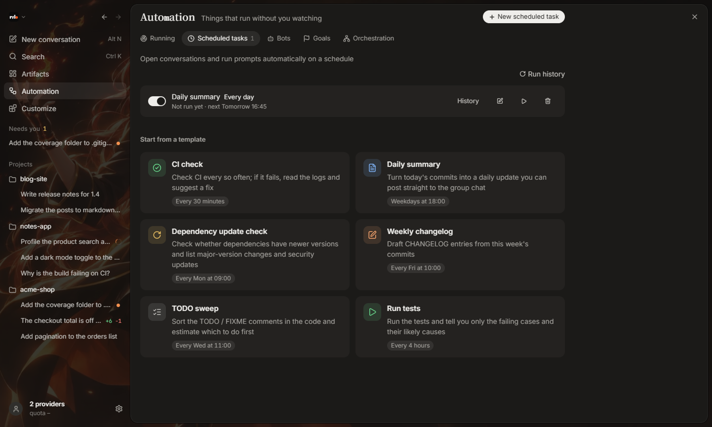

**Automation** in the sidebar opens one page with five tabs (it covers the conversation; click a conversation in the sidebar or press <kbd>Esc</kbd> to go back). It opens on the tab you used last, and the number on it in the sidebar counts what waits for you there (the bots' inbox, orchestrations to approve):

- **Running**: the subagents, workflows and background commands of every conversation, see [15](#15-running-watch-subagents-work-in-the-net-cafe);
- **Scheduled tasks**: automatically open a conversation and send a prompt on a cron schedule or interval (shown as "Weekdays at 09:00" and the like); "New scheduled task" at the top right, or start from a template below; "Run history" shows each run's result and its conversation;
- **Bots**: on-duty teammates that live on your computer, with an inbox of what they bring you; their settings (how many run at once, a daily budget, the default source, staying on duty with no window open…) are behind the ⚙ next to the "Bots" heading of their list;
- **Goals**: give it a one-sentence goal and it keeps going, turn after turn, until it's done or stuck (`/goal <goal>` in the input box works too); a thin strip "Goal: … · Turn N" appears below the conversation header;
- **Orchestration**: see below.

**Multi-agent orchestration**: split a job into steps, hand each step to the agent you choose (Claude / Codex / Gemini / OpenCode / any ACP agent), run steps with no dependencies in parallel, and stop at key points to wait for your approval. It lives on the **Orchestration** tab of the Automation page (you can also open it in the right panel from its picker's "More panels", or from the command palette's "New orchestration" and "Run orchestration…").

1. **Build a workflow**: click + to create one, or start from a template ("Plan → Implement → Review", "Three-way comparison", "Fix a bug + tests"). Each node is one of three kinds:
   - **Task**: pick the agent, permissions and workspace (the shared working folder, or a separate git worktree that's merged back automatically when done); tick "Keep going until done" and it advances turn by turn under the goal protocol until the agent reports it's finished;
   - **Compare**: the same prompt goes to several agents, each working in its own worktree, and you can name a "judge" agent to give a recommendation first;
   - **Approval**: stops and waits for you to approve or reject (you can write comments).
   Set the dependencies and the execution graph above previews them live. In a prompt you can use `{{input}}` (the input you fill in at run time), `{{nodes.<id>.output}}` (an upstream node's last reply) and `{{nodes.<id>.approval}}` (the approval comments); click a variable under the prompt to insert it.
2. **Run**: click ▶ and fill in this run's input. Every task node is an ordinary conversation, and shows up as usual in the sidebar and permission approvals, and you can step in to interject or interrupt at any time.
3. **While it waits for you**: when an approval or a comparison is ready, the node turns yellow, and the sidebar's "Needs you" (and the number on Automation) and desktop notifications remind you; if an IM chat is bound to one of the conversations in this run, that chat also gets the reminder, and you can click "Approve / Reject" right there (other chats don't get it and can't approve).
4. **Compare**: the candidates show their replies, change stats and full diffs side by side; after you click "Pick and merge", the new changes in the winner's worktree are committed first, then merged into the branch the run started from with `merge --no-ff`. **Orchestration won't wreck your stuff**: if you have a merge / rebase in progress, or changes in the staging area, it refuses outright; on a merge conflict it only undoes its own merge; if the merge doesn't succeed, the node goes back to "Waiting for your pick" and all worktrees and branches are kept as they were. After a successful merge, it only deletes worktrees with no uncommitted changes and losing branches nobody has touched; anything with changes is kept and listed on the node.
5. **Failure / restart**: a failed node can be "Retry"-ed on its own, and the skipped downstream nodes are redone with it; a retry uses a new worktree (the name gets a suffix such as `-attempt2`) and the old ones are all kept. If the service restarts while a run is in progress, that run is marked "Interrupted by a service restart", and clicking "Resume" continues from the nodes that weren't finished (completed outputs are kept). When you delete a run record you can choose to "also clean up worktrees and branches": it only deletes the clean, merged ones and lists the rest for you.

Worktrees live outside the repository, in `~/.claude-web/worktrees/<repo name>-<hash>/` (so your tests and builds don't scan them and they don't appear in git status), and branch names are `cw/<run id>/<node>-<agent>`. The number of nodes that run at the same time is set under **Settings → Conversations → More options → Orchestration concurrency limit** (default 3).

### 15. Running: watch subagents work in the net cafe

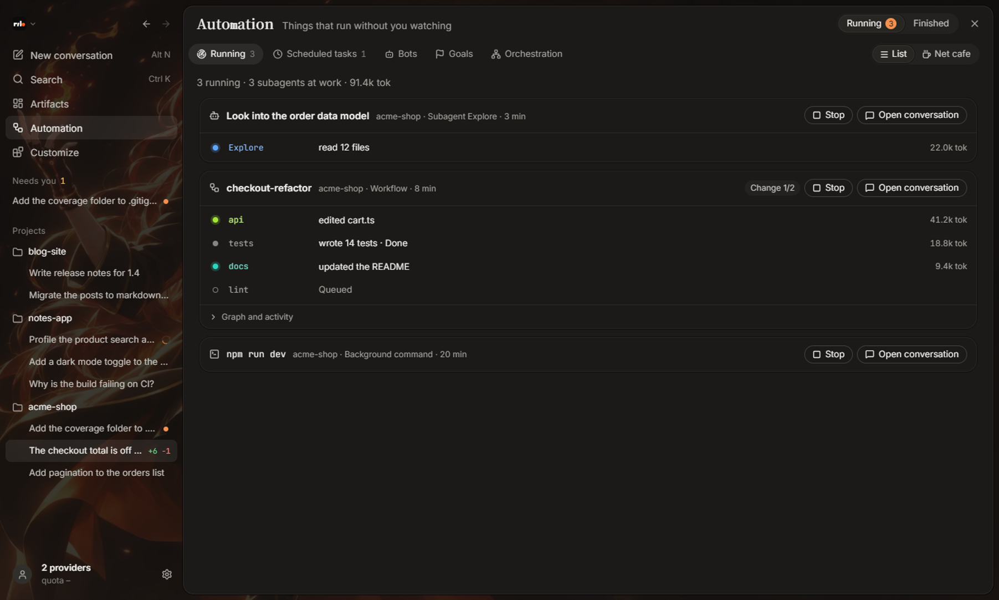

When a conversation sends out subagents, runs a workflow (turn on "Deep orchestration" in the thinking effort chip next to the model, and a bigger task will write its own workflow and hand it out to several subagents), or starts a background command, a small pill like "Background · 1 workflow · 2 running" appears above the input box; click it to open **Automation › Running** on that conversation. The line under the tabs sums it up ("3 running · 3 subagents at work · 91.4k tok"), and the switch at the right end of the tab row shows it two ways (it remembers your choice):

- **List**: one group for each thing a conversation runs: a workflow with a row per subagent (what it's doing, its tokens), a single subagent, a background command. Each group has Stop and Open conversation, and a workflow's "Graph and activity" unfolds its node graph and activity feed. Click a subagent's row and its own conversation opens beside the list: what it read, which commands it ran, what it changed.
- **Net cafe**: the same things in a 3D net cafe. Every conversation with background work gets a zone (a row of PCs); its main conversation is **the admin** behind the front desk, and every subagent is a **guest**:
  - new guests walk in through the door and sit down at a PC; while they work, code scrolls on their screens and dots show over their heads;
  - when idle they wander off to the sofa, the window or the snack shelf, and go straight back when there's work;
  - a guest that needs you raises a hand with a "!" over its head, and one that is stuck gets a blue screen;
  - when done, a guest walks to the front desk to **check out** (a little receipt with roughly what it cost) and leaves;
  - background commands run in the glass rooms along the side.

  Drag to rotate, right-drag to pan, scroll to zoom; the zones are listed on the left, and Day / night and the Character library are at the top right. Click a guest for its card: status, time, cost, tool calls, its latest steps, Open conversation and Stop.
- **Finished** (the Running / Finished switch at the top right of the page): the finished workflows, subagents and background commands of every conversation, day by day and searchable; a past run can be replayed in its graph or in the net cafe.
- **The right panel** has a small net cafe too ("Net cafe" in its picker's "More panels"), which follows the current conversation.
- **Stop**: the Stop button in the input box **only stops the current turn**; background workflows, subagents and commands keep running. To stop them, use Stop on their group in Running, on a guest's card, or in the right panel's Tasks. A conversation that still has background work after its turn ends won't be closed by idle cleanup; when a workflow finishes, the result starts a turn by itself to tell you.

#### Making a character

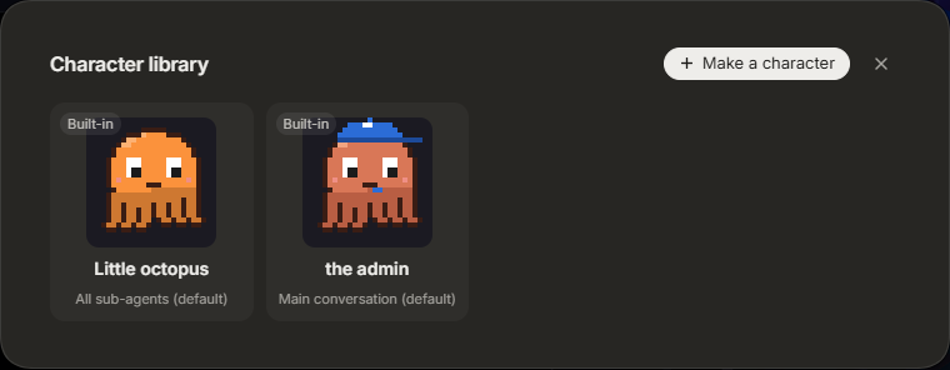

By default guests are little octopuses, and the admin wears a blue cap. In the net cafe, top right **Character library → Make a character**, give it a photo or describe what you want ("a programmer in black-framed glasses and a blue hoodie"), and Claude draws a 24×24 pixel character and shows you a few frames: front, back, walking, sitting, typing:


If you're not happy, keep talking ("bigger eyes", "switch to a red shirt"); once you like it, save it and assign it to the admin, all guests, a type of subagent (such as Explore), or a subagent with a particular name. You can also just say "make me a net cafe character that looks like this photo" in any conversation: this is a skill that ships with the app, and it works on both the Claude and ccb runtimes. Characters are stored in `~/.claude-web/characters/`, one JSON file per character.

## Character themes

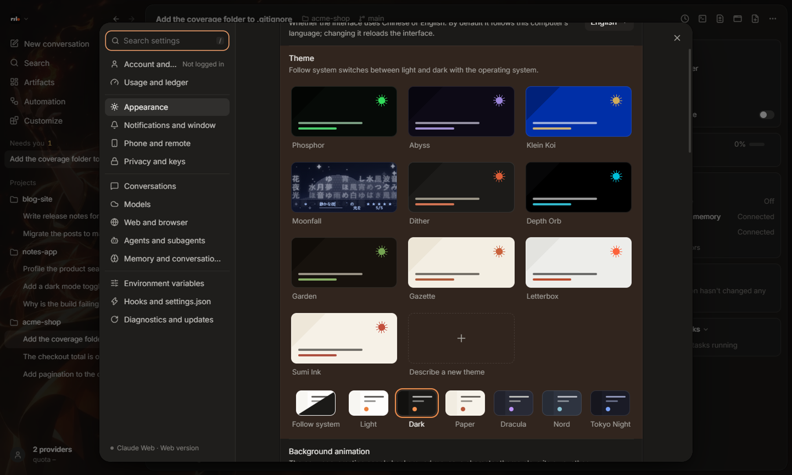

Besides the classic colour themes there are ten **character themes**: each one brings its own colours, a living ASCII-art backdrop and its own set of little animations for what Claude is doing. **Settings → Appearance** shows them as cards; point at a card and it comes alive, click it to put it on (or **Theme › Character themes…** in the account menu at the bottom of the sidebar).

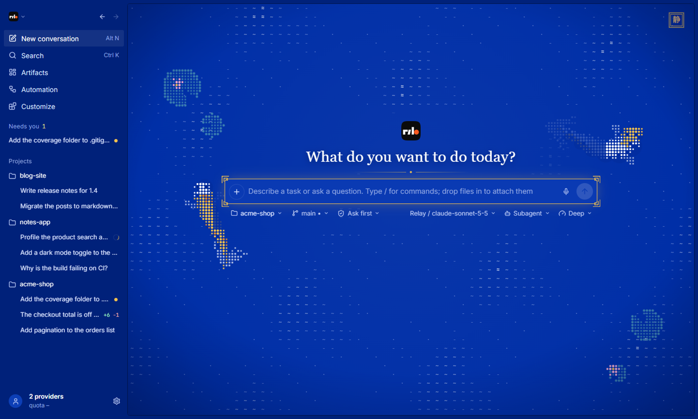

- **The ten**: Phosphor (green terminal rain), Abyss (a halftone jellyfish in deep water), Klein Koi (koi in a blue pond), Moonfall (character rain under the moon), Dither (a ringed planet in four dithering algorithms), Depth Orb (a cloud of points with a lens split), Garden (your projects grow as plants: one per project folder, sized by how many conversations it has), Gazette, Letterbox and Sumi Ink (the three light ones).
- **The backdrop** fills the start page, follows the pointer, answers clicks and typing, and reacts to what Claude is doing (thinking, reading, running agents…). On the start page it shows when **Settings → Appearance → Background animation** is on (it's off by default, and the page is then a still colour). In a conversation the backdrop is faint, or switch it off there: **Settings → Appearance → Faint background in conversations**. With "reduce motion" on in your system, it draws one still picture.
- **Animations instead of spinners**: every step has its own: editing is a pen writing, thinking really thinks, reading turns pages, tests fill in one by one, git commits line up… sixteen of them, drawn differently by each theme.

**Make your own by describing it.** Click **＋ Describe a new theme** (or just say "make me a character theme: …" in any conversation): Claude writes the theme, checks it (format, contrast, every animation), **runs it once in your window** and looks at a picture of the result before showing you, and you keep talking until you like it. Right-click one of your themes for **Change it** or **Delete**. Themes live in `~/.claude-web/themes/<id>/` (`theme.json`, `backdrop.js`, `theme.css`); a backdrop that is not built in runs in a sandbox with no network, and is taken down (back to the default) if it throws errors or gets too slow.

## Openings (desktop app)

The desktop app plays a short opening when it starts (by default the first time each day; the other times it's the 1.6-second logo). Pick it under **Settings → Appearance → Opening and background**:

- **Built in**: **Claude Web-chan** (the default: a film of about 10 seconds, then the logo lights up in the dark), **Ignite**, **Starmap** and **Code rain** (drawn, no video, about 4 seconds) and **Net cafe opens** (the 3D net cafe; it needs WebGL). Point at a card for a small preview; "Play it now" plays it in your window.
- **Your own**: use a video of your own, import an opening pack from a folder (a video, or a web page that runs offline in a sandbox), **Install from GitHub** (you see the author, the license and the size before anything is installed), or **Have Claude make one** (a new conversation with the opening-pack skill; Claude plays each draft in your window and looks at it before showing you).
- **Keep as background afterwards**: when it ends, the opening can stay behind the app: Claude Web-chan's loop shows through the start page and the empty spaces (Strength sets how much), Starmap leaves drifting stars, Code rain falling characters, the others embers. It pauses while the window is minimized or another app is in front.
- "When to play" (every time / first time each day / never), "Length" (full / short) and "Sound" (off by default) are on the same page. The web version plays no opening, but shows the background too.

## Interface language

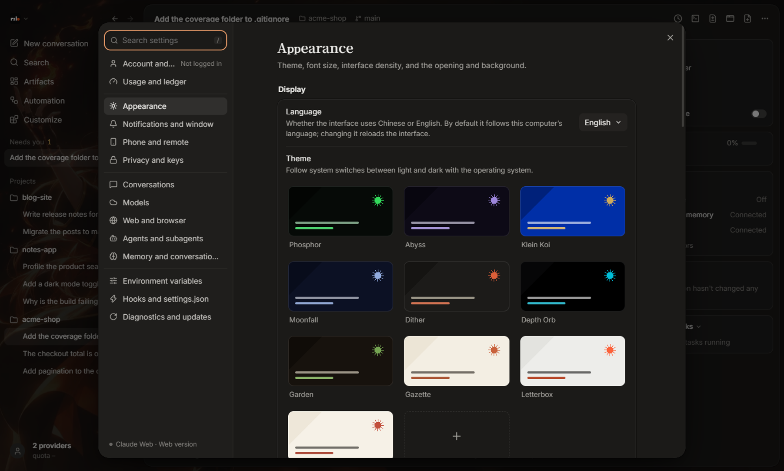

The whole interface comes in **Chinese** and **English**, and **by default it follows your computer's language**: English if your computer is English, Chinese if it's Chinese (other languages are shown in English for now). To change it: **Settings → Appearance → Language** (or **Language ›** in the account menu at the bottom of the sidebar), and pick "Follow system / 中文 / English"; the interface reloads once.

- The web version follows the browser's language and the desktop app follows the system language; the language you pick is stored on this computer (`~/.claude-web/meta.json`), and all windows on the computer and the phone page switch together.
- The desktop app's menus, tray and update prompts, and a small part of the server's text (fixed at startup), only change after you restart the app.
- Which language Claude replies in within a conversation is up to you and the model and has nothing to do with the interface language; exported HTML follows the interface language at the time of export.

## Custom styles (custom.css)

Put your own CSS in `~/.claude-web/custom.css`. It's loaded after the built-in styles in every window (desktop app, browser, phone), a save shows up at once without a restart, and the desktop app's updates never overwrite it. **Settings → Appearance → Custom styles** creates the file (with a list of the hooks you can rely on), opens it in the editor, and switches it off if something breaks.

The hooks stay the same in later versions: `html[data-theme]` and `html[lang]`, `.chat[data-state]` (starting / running / waiting / idle / history / closed / error), every plan's `data-done` / `data-total` and `--progress`, each plan item's `data-status`, the plan's title row `.tasks-plan .plan-head` and its bar `.plan-prog`, and the colour / radius variables (`--accent`, `--ink-1`…`--ink-4`, `--surface-0`…`--surface-3`, `--r-sm` / `--r-md` / `--r-lg`). For example, a thicker plan progress bar:

```css
.tasks-plan .plan-prog { height: 6px; }
.tasks-plan .plan-prog > i { background: var(--accent); }
```

## Keyboard shortcuts

On the desktop app, <kbd>Ctrl</kbd> is <kbd>⌘</kbd> on macOS. Press <kbd>Ctrl</kbd>+<kbd>/</kbd> (or <kbd>F1</kbd>; <kbd>?</kbd> in the web version), or pick Keyboard shortcuts in the account menu, for the full list.

| Action | Desktop app | Web version |
| --- | --- | --- |
| New conversation | Ctrl+N | Alt+N |
| Command palette / full-text search | Ctrl+K | Ctrl+K |
| Settings | Ctrl+, | Ctrl+, |
| Send / new line | Enter / Shift+Enter | Enter / Shift+Enter |
| Interrupt the current turn | Esc | Esc |
| Find in conversation | Ctrl+F | Ctrl+F |
| Sidebar | Ctrl+B | Ctrl+B |
| Split right / down | Ctrl+D / Ctrl+Shift+D | Same |
| Close tab | Ctrl+W | Alt+W |
| New group | Ctrl+T | Alt+T |
| Switch group | Ctrl+Tab | Alt+PageDown |
| Jump to group 1–9 | Ctrl+Alt+1–9 | Ctrl+Alt+1–9 |
| Maximize / restore split | Ctrl+Shift+Enter | Same |
| Zoom the whole interface in / out / reset | Ctrl+= / Ctrl+- / Ctrl+0 (remembered; Settings → Appearance → Interface zoom) | The browser's own zoom |
| Right panel: show / hide | Ctrl+J | Ctrl+J |
| Right panel: Tasks · Terminal · Changes · Browser · Files | Ctrl+1–5 (Ctrl+Shift+1–5 works too) | Ctrl+Shift+1–5 |
| Terminal | Ctrl+` | Ctrl+` |
| Conversation info column | Ctrl+I | Ctrl+I |
| Conversation / Steps view | Alt+J | Alt+J |
| Overview | Ctrl+Shift+M | Ctrl+Shift+M |

## Where your data lives

| Location | Contents |
| --- | --- |
| `~/.claude/` | Claude Code's own data: login state, settings, conversation records (shared with the command line) |
| `~/.claude-web/` | This app's data: the project list, pins / archive, providers (keys encrypted), drafts, scheduled tasks, the usage ledger, attachments, the shared memory database, the conversation library index (`library.db`) and delete backups (`library-trash/`), orchestration workflows (`meta.json`), net cafe characters (`characters/`), run records (`orchestra/`) and worktrees (`worktrees/`), backups of other agents' config files (`config-backups/`), and settings for the model gateway and other computers (`meta.json`, keys encrypted) |
| Desktop app logs | Windows: `%APPDATA%\claude-web\`; macOS: `~/Library/Application Support/claude-web/` (`server.log`, `main.log`) |

**Settings → Diagnostics and updates** (or **Help and feedback › Export a diagnostic bundle…** in the account menu) packs the logs and a redacted copy of your config in one click, to make troubleshooting easier.

## FAQ

**macOS says "is damaged and can't be opened"**
This is caused by the missing Apple signature. Run `xattr -cr "/Applications/Claude Web.app"` and then open it again.

**It says you're not signed in / sending a message does nothing**
In the notice on the start page, click **Sign in with Claude account** (or press <kbd>Ctrl</kbd>+<kbd>`</kbd> to open a terminal and type `/login`); **Settings → Account and login** shows the sign-in state, and "More options" there has the runtime's version and doctor, so you can see the exact error.

**A relay says "client version too old" or "request may have been rewritten by a third-party relay"**
Under **Settings → Models → Sources**, click "Edit" on that provider and then "Test connection", and it automatically switches to running on the official Claude Code. For "version too old", just update to the latest Claude Web (the bundled Claude Code is upgraded along with it).

**On macOS, git / gh / codex and other commands can't be found**
At startup the app reads the PATH of your login shell (zsh / bash). If a command is installed somewhere unusual, add it to the PATH in `~/.zshrc` and restart the app.

**The interface language isn't the one I want**
Under **Settings → Appearance → Language**, pick "中文" or English (the default is "Follow system"). The desktop app's menus and tray only change after you restart the app.

**The window is black / flickers**
That's a graphics driver issue. Turn on **Settings → Notifications and window → More options → Software rendering (desktop version)** and restart; after two crashes in a row the app also switches by itself.

**Auto-update**
The desktop app checks this repository's GitHub Releases for a new version after it starts and every 4 hours (under **Settings → Diagnostics and updates** you can check manually, or turn off the automatic check). The Windows installer version and the macOS app download in the background and then pop up a window asking whether to restart and update; choose "Later" and it installs by itself the next time you quit. The macOS app updates itself only when it's in "Applications" and opened from there (not straight from the dmg or Downloads); when it can't, and for the Windows portable version, a window gives you a download link when there's a new version: on macOS, download the new dmg and drag the app into "Applications" to replace it, and for the portable version, swap in the new exe. A version marked "must update" can't be skipped. If you built the package yourself from source, after `git pull` just run `npm install && npm run build:desktop` again and install over it. None of your data is lost. See the [changelog](CHANGELOG.md) for what changed in each version.

## How it works

- One Node process (`server/`) drives the Claude Code on your computer with the [Claude Agent SDK](https://github.com/anthropics/claude-agent-sdk-typescript), and pushes all messages to the React frontend (`web/`) over a single WebSocket; the desktop app (`desktop/`) is just an Electron shell, running the same server and web page inside.
- The **runtime** defaults to our own engine, claude-web-engine (bundled in the desktop installer; when you install from source, `npm install` downloads it from this repository's [engine release](https://github.com/ypyik0669/claude-web/releases/tag/engine-v2.8.4-cw.8), no account needed). It's modified from 2.8.4 of [claude-code-best](https://github.com/claude-code-best/claude-code) (ccb, a community build of Claude Code that also supports OpenAI / Gemini / Grok interfaces), so that "Thinking effort", "Deep orchestration" and "Auto" work on every interface and every model; when it can't be found, it automatically falls back to the official Claude Code that ships with the Agent SDK. Relays that only let the official client through are detected automatically, and the matching provider runs on the official Claude Code.
- Codex goes through `codex app-server` (JSON-RPC), and Gemini / Qwen / Kimi and others go through [ACP](https://agentclientprotocol.com/); their events are all normalized into the same message format, so the interface, tool cards, permission approvals and ledger are the same for every agent.
- Conversation records are still each CLI's own (`~/.claude/projects`, `~/.codex/sessions` …), so the command line and Claude Web can take turns on the same conversation.

For more detail on the architecture, protocols and the pitfalls hit along the way, see [CLAUDE.md](CLAUDE.md) and the [docs/notes/](docs/notes/) it indexes.

## Security and privacy

- The service **only listens on `127.0.0.1` by default**. Local-network / phone access has to be turned on by hand in settings, and every device has to exchange a one-time pairing code for a device token, which you can revoke at any time.
- Provider keys, IM bot tokens and device tokens are all **stored encrypted** (DPAPI on Windows, Keychain on macOS) and always masked in the interface and logs; a key is only injected into the process of the conversation that uses it, and isn't written to the CLI's own config such as `~/.claude/settings.json`.
- The model gateway only accepts loopback connections from this computer.
- **Using it away from home**:
  - The matchmaking and the slow relayed path go through public MQTT servers. They can see the hashed channel names, the size and timing of the encrypted data, and both sides' IPs, but not the content; before a direct connection is made it also asks public STUN servers, which can see both sides' IPs. None of these services are run for this project, and they may rate-limit or go offline; the list can be changed under "More options" (a changed list is written into the QR code, which the phone picks up when it scans; after changing it, phones that are already paired have to scan again).
  - **Every computer paired on one phone can read the access tokens of the other computers on that phone**: the "works anywhere" phone page has a single URL, the interfaces of all the paired computers run inside it, and they share the storage the phone's browser gives that URL. So only pair computers that trust each other to the same phone. Pairing with the "local network only" QR code isn't affected (each computer is its own URL). If the phone page's own files are modified in the cache they aren't used (each file's SHA-256 is written into the phone page's Service Worker, and on a mismatch it fetches from the site again); but tokens can't be protected this way, and the interface files each computer caches on the phone get no such check either: a tampered computer can change another computer's interface cache. If you suspect a computer, delete it on the phone (the phone clears every computer's interface cache at the same time and fetches them fresh at the next connection), then revoke this phone on the other computers and pair again.
  - By default the phone page is hosted on the project maintainer's own server (`https://cw.y0p66y9.me/`, which opens from mainland China without a VPN), on a host name used only for it, so no other page shares its site origin. The same server runs an MQTT server (`wss://cw.y0p66y9.me/mqtt`) that, like the public ones, only carries encrypted data. The old `https://claude-web-shell.github.io/` is still there; you can switch back to it under "More options → Phone page address".
  - The remaining risk is that the phone page gets swapped out: whoever swaps it can steal the device tokens stored on the phone and connect to your computer from outside. It could be swapped by whoever administers that server (the project maintainer) or can log in to it, or through an npm package used in the build.
  - The phone page loads no third-party scripts and, once cached, only updates on a new version, but what it gets at update time is whatever is on the site. If that worries you, deploy your own copy (`deploy/shell-site/` has the steps) and switch to it under "More options → Phone page address" (already-paired phones have to pair again at the new address). When self-hosting you can remove the deployment workflow's daily automatic run, and only publish a tag by hand after you've looked at that version.
  - If you find a token may have leaked, revoke that device on the computer, and the channel it's already connected on is cut right away.
- **Claude Web itself doesn't collect or report any data.** Model requests go directly from your machine to the provider you chose; the telemetry behavior of the individual CLIs (Claude Code, Codex …) follows their own settings.
- If you find a security issue, report it privately through GitHub's **Security → Report a vulnerability**, and please don't open a public issue.

## Running from source and development

```bash
npm install
npm run site:install     # install the site's separate dependencies (also needed for typecheck and tests)
npm run dev              # dev mode: server hot reload + Vite (http://localhost:5173)
npm run typecheck        # type-check server + web + desktop + site
npm test                 # unit tests
npm run build:all        # build server / web / desktop
npm run e2e              # end-to-end checks (temp folder, mock agent, costs no tokens)
npm run desktop          # start the desktop app from source
npm run build:desktop    # build the Windows installer (on Windows)
npm run build:desktop:mac  # build the macOS installer (on macOS only)
```

On every push, GitHub Actions runs type checks, unit tests, builds and end-to-end checks on Windows, macOS and Linux. Pushing a `v*` tag (such as `git tag v0.2.0 && git push origin v0.2.0`) builds the Windows, macOS arm64 and x64 installers, **really launches the installer once as a smoke test**, and then publishes them to Releases.

There's also a UI smoke test: `npm run build:all && node scripts/ui-smoke.cjs`. It uses Electron in a temp folder to click through almost every entry point, and any console error counts as a failure. The built-in browser has its own: `node scripts/browser-smoke.cjs` (a real `<webview>` plus a small local website, running through every kind of web action the agent can do).

For the architecture, protocols and the pitfalls hit along the way, see [CLAUDE.md](CLAUDE.md) (for people writing code with an AI agent: `AGENTS.md` points to the same file).

```
server/   Node service: session driving, conversation library, providers / model gateway, files / Git, remote, IM, orchestration…
web/      React frontend (Vite + zustand); the core of conversation rendering is a pure-function reducer: web/src/model/conversation.ts
desktop/  Electron shell
scripts/  e2e, UI smoke tests, English-interface check (i18n/), README screenshots (readme-shots.cjs), packaging helpers
docs/     Design docs and implementation plans (docs/superpowers/), notes (docs/notes/), README screenshots (docs/images/en, docs/images/zh)
```

## Contributing

Issues and PRs are welcome. Please run this before you submit:

```bash
npm run typecheck && npm test && npm run e2e
```

- Before changing interface wording, look at `web/src/ui/terms.ts` (the glossary) and `wording.test.ts` (implementation words like "profile / engine / pane", in their Chinese forms, must not appear in the default interface);
- Every piece of text a user can see goes through `tr('<Chinese source text>')` (the Chinese original is the key), and the English goes in `web/src/i18n/en.ts` (the server's `server/src/i18n/en.ts`, the desktop app's `desktop/src/en.ts`, the phone shell's `web/src/shell/en.ts`); `npm test` checks for anything left untranslated, and `node scripts/i18n-smoke.cjs` walks through the whole English interface looking for any Chinese left over;
- Before changing conversation rendering, run `npm test -w web`; `conversation.test.ts` replays recorded real message streams;
- Don't put real keys in tests, fixtures or docs.

## License and credits

The code of this project is open source under the [MIT License](LICENSE).

Some of the components it depends on have their own license terms; please follow them separately when you use and redistribute it (especially the packaged installers, which include them):

- [@anthropic-ai/claude-agent-sdk](https://github.com/anthropics/claude-agent-sdk-typescript) and the Claude Code it ships with: Anthropic's terms (see that package's README);
- [claude-code-best](https://github.com/claude-code-best/claude-code) (and claude-web-engine, which is modified from it): as stated by that project;
- The fonts in the interface are distributed with the app and are all under the [SIL Open Font License 1.1](https://openfontlicense.org/): [Inter](https://github.com/rsms/inter) (interface text), [JetBrains Mono](https://github.com/JetBrains/JetBrainsMono) (code), [Noto Serif SC](https://github.com/notofonts/noto-cjk) (only the few dozen characters used in headings were taken). The full licenses are in `web/public/licenses/`;
- Icon shapes come from [Lucide](https://lucide.dev) (ISC license; part of it derives from Feather, MIT);
- The remaining dependencies (Electron, React, Monaco, node-pty, xterm.js …) are under MIT and other common open-source licenses.

Thanks to these projects, and to the open agent ecosystem of Codex, Gemini CLI, Qwen Code, OpenCode and the Agent Client Protocol.
