# Claude Web

**English** · [简体中文](README.zh-CN.md)

**A visual workbench for the Claude Code CLI.** It takes Claude Code out of the command line and puts it in a graphical interface: conversations, tool calls folded into one line per turn, code diff review, permission approvals, files / Git / editor, split view, and remote access from your phone, all in one window.

The same program comes in two forms: a **desktop app** (Windows / macOS) and a **web version** (run a local server and open it in your browser). The features are identical and the data is shared. The interface comes in **English and Chinese** and follows your computer's language by default ([how to change it](#interface-language)).

> **Unofficial project.** Claude Web is a community-built open-source tool. It has no affiliation with Anthropic and is not endorsed by Anthropic. "Claude" and "Claude Code" are trademarks of Anthropic. To use it you need your own Claude Code login (a Claude subscription) or a key for a third-party API / relay (a third-party API reseller or proxy service). Costs and usage are billed to your own account.

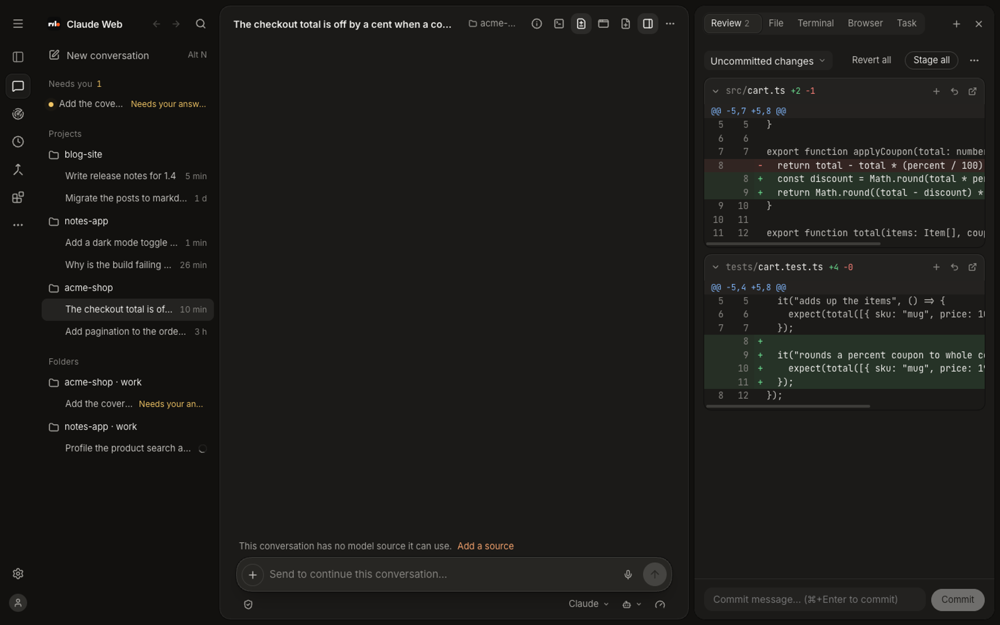

**When subagents and workflows run, you can watch them in the pixel-art Internet Café on the "Background" page**: your main conversation is the admin at the front desk, and every subagent is a guest. They boot up a PC, type code, wander off for instant noodles and games when idle, and check out at the front desk when they're done ([details](#11-background-watch-subagents-work-in-the-café)).

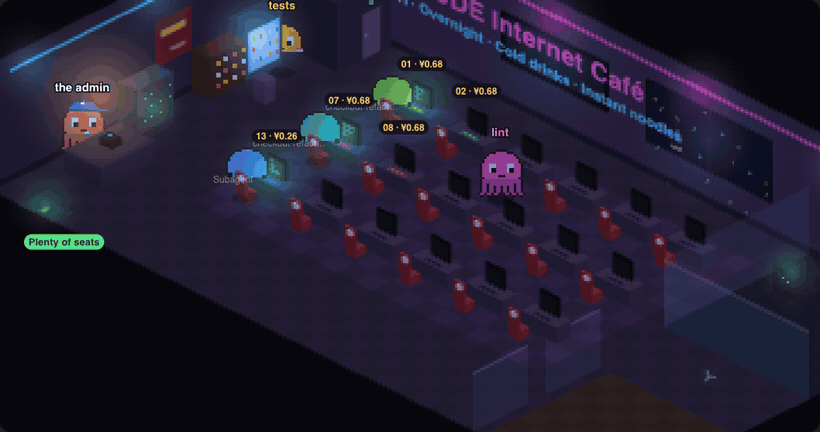

---

## Table of contents

- [What it does](#what-it-does)
- [Desktop app or web version?](#desktop-app-or-web-version)
- [Install](#install)
- [Walkthrough](#walkthrough)
  - [1. Sign in to Claude](#1-sign-in-to-claude)
  - [2. Pick a project and start your first conversation](#2-pick-a-project-and-start-your-first-conversation)
  - [3. Permission prompts and permission modes](#3-permission-prompts-and-permission-modes)
  - [4. Review changes, Git, files: the right panel](#4-review-changes-git-files-the-right-panel)
  - [5. The split-view workbench](#5-the-split-view-workbench)
  - [6. Connect a third-party API / relay](#6-connect-a-third-party-api--relay)
  - [7. Manage several conversations at once](#7-manage-several-conversations-at-once)
  - [8. Use it from your phone](#8-use-it-from-your-phone)
  - [9. Conversations on other computers](#9-conversations-on-other-computers)
  - [10. Automation: scheduled tasks, goals, orchestration](#10-automation-scheduled-tasks-goals-orchestration)
  - [11. Background: watch subagents work in the café](#11-background-watch-subagents-work-in-the-café)
- [Character themes](#character-themes)
- [Interface language](#interface-language)
- [Custom styles (custom.css)](#custom-styles-customcss)
- [Keyboard shortcuts](#keyboard-shortcuts)
- [Where your data lives](#where-your-data-lives)
- [FAQ](#faq)
- [How it works](#how-it-works)
- [Security and privacy](#security-and-privacy)
- [Running from source and development](#running-from-source-and-development)
- [Contributing](#contributing)
- [License and credits](#license-and-credits)

---

## What it does

| | |
| --- | --- |
| **Conversations** | Streaming output and thinking; a finished turn folds into one line like "Worked for 27 s · Read 2 files · Ran 1 command", and opening it shows a step-by-step timeline; Markdown / code highlighting / math / Mermaid diagrams |
| **Code changes** | A "Changed N files" card at the end of each turn; the **Review** tab in the right panel shows each file's diff (unified or side by side), and lets you stage, revert and commit |
| **Permissions** | When approval is needed, a card sits above the input box: Allow once (press Enter with the box empty) / Deny (whatever you've typed in the box becomes the reason) / Always allow; questions and plan approvals show up here too |
| **Workbench** | By default you only see the sidebar, the conversation and the right panel. When you need more: Ctrl+D to split (up to 6), tabs, groups; conversations, the editor (Monaco), diffs, terminals and the built-in browser can all go into a split |
| **Files / Git / search** | File tree, project-wide search and replace (ripgrep), Git stage / commit / branches / stash / worktree, Issue and PR boards |
| **Managing conversations** | Pin, archive, fork (start a new branch from any message), edit and resend, interject, export to HTML |
| **Needs you** | The top of the sidebar lists every conversation waiting for you to approve or answer; the Overview groups them into "Needs you / Running / Error / Idle" |
| **Background / Café** | Subagents, workflows and background commands on one page: cards, a relationship graph and an activity feed, plus a pixel-art café where every subagent is a guest who checks out at the front desk when done; characters can be "made" from a photo or a single sentence; the Stop button in the input box only stops the current turn, background work keeps running |
| **Web access** | The agent searches, opens pages, clicks, fills forms and takes screenshots in the built-in browser, with no search key needed; on Windows it can also operate specific desktop apps once you allow it |
| **Automation** | Scheduled tasks (cron), goals (give it a goal and it keeps working turn after turn), and orchestration (a job split into steps, each one a Claude conversation), all on the sidebar's "Automation" page |
| **Providers** | Each conversation can use a different provider (official account / other Claude accounts / Anthropic API or an Anthropic-compatible relay), and the model menu lists them flat as "Provider / model"; keys are stored encrypted; each model's context window can be set individually; subagents can use a different (cheaper) model |
| **Remote** | Pair by scanning a QR code and use it from your phone's browser on the same Wi-Fi; SSH tunnels to remote machines; bots for Telegram / Discord / Slack / DingTalk / Feishu |
| **Usage** | Subscription quota ring, per-turn time and cost ledger, context usage |
| **English / 中文** | The whole interface (web, the desktop app's menus and tray, the phone page, exported HTML) comes in English and Chinese; it follows your computer by default and you can change it in settings |

## Desktop app or web version?

**Use either one; the features are the same.** The only difference is the shell:

| | Desktop app | Web version |
| --- | --- | --- |
| How to open it | Installer, double-click | Run `npm start`, then open `http://127.0.0.1:3090` in a browser |
| Needs Node.js | No (built in) | Yes, Node.js 22.13+ |
| Tray / system notifications / start at login | ✅ | Browser notifications |
| Multiple windows | ✅ | Multiple browser tabs |
| Shortcuts | Ctrl (⌘ on macOS) based | Some use Alt instead, to avoid combinations the browser takes |
| Phone access | Turn it on in settings, then open it in your phone's browser; the computer is kept awake while it's on | Same; turn off sleep yourself in your system's power settings |

Both read and write the same data (`~/.claude` and `~/.claude-web`), so you can mix them.

## Install

### Desktop app (download an installer)

Download from [Releases](https://github.com/ypyik0669/claude-web/releases/latest):

| System | File |
| --- | --- |
| Windows 10 / 11 (x64) | `ClaudeWeb-<version>-win-x64.exe` (installer) or `ClaudeWeb-<version>-portable.exe` (no install needed) |
| macOS, Apple Silicon (M1 and later) | `ClaudeWeb-<version>-mac-arm64.dmg` |
| macOS, Intel | `ClaudeWeb-<version>-mac-x64.dmg` |

The `.zip`, `.yml` and `.blockmap` files are used by auto-update; you don't need to download them. For what to expect the first time you open it, see "About the installer warnings" below. For what changed in each version, see the [changelog](CHANGELOG.md).

### Web version (from source)

You need [Node.js 22.13+](https://nodejs.org/) (it uses the built-in `node:sqlite`) and Git:

```bash
git clone https://github.com/ypyik0669/claude-web.git
cd claude-web
npm install
npm run build
npm start
```

Then open <http://127.0.0.1:3090> in your browser. On Windows you can also just double-click `启动.cmd` in the repo (the Windows launcher script; its file name is in Chinese).

### Desktop app (build it yourself)

```bash
npm install
npm run build:desktop        # Windows: dist-desktop/ClaudeWeb-<version>-win-x64.exe (installer) and -portable.exe (no install needed)
npm run build:desktop:mac    # macOS: can only be built on a Mac; build arm64 and x64 on a machine with the matching chip
npm run build:desktop:linux  # Linux
```

### About the installer warnings

- **Windows**: the installer is not code-signed. When SmartScreen says "Windows protected your PC", click **More info → Run anyway**.
- **macOS**: pick the package for your chip: `mac-arm64.dmg` for Apple Silicon (M1 and later), `mac-x64.dmg` for Intel (Apple menu in the top left → About This Mac, and look at the "Chip" line). Open the dmg and drag **Claude Web** into "Applications". The installer is not signed by Apple, so the **first time you open it** you need to **right-click → Open → Open** it in "Applications"; if you get "is damaged and can't be opened", run this once in a terminal:

  ```bash
  xattr -cr "/Applications/Claude Web.app"
  ```

## Walkthrough

### 1. Sign in to Claude

Claude Web drives the Claude Code on your computer, and the login is shared with the command line (`~/.claude`).

- **Already using Claude Code in the command line**: nothing to do, just open it and go.
- **Not signed in yet**: the first-run guide has two steps: ① Connect a model (skipped automatically if you're already signed in or already have a provider) ② Choose a project folder. For sign-in, click **Sign in with Claude account** on the first step: it opens a terminal tab running Claude Code; pick a sign-in method when prompted (or type `/login`), and when you're signed in, go back to the guide and click **Already signed in? Check again**. You can also click **Skip for now**, and the top of the home page will remind you that you're not signed in.
- **No Claude subscription, using an API key or a relay**: fill in the key right there in the guide's Connect a model step, or jump to [step 6](#6-connect-a-third-party-api--relay).

### 2. Pick a project and start your first conversation

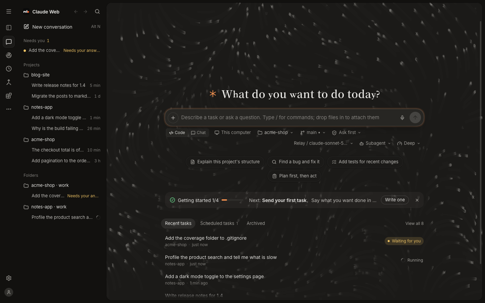

1. In the **Project** chip at the bottom left of the home page's input box, choose your project folder (recently used ones are listed first; "Open folder…" picks another). The sidebar groups conversations by project; the **+** on the "Projects" title row also adds a project; projects can be dragged to reorder (a project's ··· menu has "Move to top / Move up / Move down", which is what you use on a phone).
2. Describe the task in the input box. <kbd>Enter</kbd> sends, <kbd>Shift</kbd>+<kbd>Enter</kbd> adds a new line. Afterwards, **New conversation** in the sidebar (<kbd>Ctrl</kbd>+<kbd>N</kbd>, <kbd>Alt</kbd>+<kbd>N</kbd> in the web version) brings you back here.
3. The input box is a single row:
   - **＋**: add files, folders and images (you can also drag them in or paste a screenshot), reference another conversation, set a goal, and switch on abilities such as controlling Chrome;
   - **Project · branch** (new conversations only): switch project, switch local branch, or have it work in a separate copy (git worktree);
   - **Model**: the models of every provider are in this one menu;
   - **Subagent** (next to the model): the main task uses the main model, and subagents (the ones sent out by Task and workflows) use the model you pick here. Pick a cheaper one to save quota; the default is "Same as main model" (see [step 6](#6-connect-a-third-party-api--relay));
   - **Thinking effort** (the button next to the model, which shows the current level): Fast / Balanced / Deep / Deeper / Max, each with a one-line description; the last row, "Deep orchestration", splits a task into subtasks done at the same time by several subagents;
   - **Permissions** (see the next step); the small ring at the bottom right is context usage, and hovering shows this conversation's usage.
4. Type `/` to bring up the command list (`/compact`, `/model`, custom skills …), and press <kbd>Tab</kbd> to complete.

While the reply is in progress, each tool call (reading files, editing code, running commands) unfolds step by step; when the turn is done it folds into a one-line summary, and opening it shows the full timeline. The changes are in the "Changed N files" card at the end, and clicking a file reviews it in the right panel. While it runs you can press <kbd>Esc</kbd> to interrupt at any time, or keep typing to **interject**, and it will see your message at the next step.

### 3. Permission prompts and permission modes

When Claude wants to run a command or edit a file, a card sits above the input box (and that step in the message stream shows "Waiting for you"): **Allow once** (press <kbd>Enter</kbd> when the input box is empty), **Deny** (write the reason in the input box and press <kbd>Enter</kbd>, and it will try another way), or **Always allow** this kind of operation. An <kbd>Enter</kbd> pressed in the instant the card appears doesn't count, so you don't approve by accident. A plan card needs a button click or <kbd>Ctrl</kbd>+<kbd>Enter</kbd>.

The permission control at the bottom right of the input box decides how often you're asked (**Settings → General → Default permissions** sets the default for new conversations):

| Mode | What it does |
| --- | --- |
| Ask first | Asks you before every file edit and every command (recommended) |
| Accept edits | Edits files directly; asks you before running commands |
| Plan only | Reads code and writes a plan first, and only acts once you give the go-ahead |
| Auto | Claude decides for itself which operations need to ask you |
| Allowed only | No prompts; anything not allowed in advance is skipped |
| Allow everything | Runs everything without asking; only use it in an environment where it doesn't matter if things break |

### 4. Review changes, Git, files: the right panel

The top row of a conversation has the title, project and branch, and on the right: **+N −M** (how many lines this conversation changed; click it to open Review), the terminal, the right panel (<kbd>Ctrl</kbd>+<kbd>J</kbd>) and **···**. The right panel has five fixed tabs (when the panel is narrow, only the current one shows its name and the others are icons):

- **Review**: uncommitted changes / staged / changes from this conversation / a recent commit; view diffs file by file, stage, revert, write a commit message and commit. **Git** under ··· has branches, pull and push, history, stash and worktree, and offers a one-click fix when something goes wrong;
- **File**: the project file tree (right-click to create / rename / move to the trash) and project-wide search and replace (regex, case, whole word, include / exclude); files generated by this conversation are listed at the top;
- **Terminal**: when the panel is hidden, the terminal keeps running in the background;
- **Browser**: the built-in browser, for your own browsing, and it's also where the agent browses (see "Web access" below);
- **Task**: this conversation's background tasks (a shrunken graph, with a stop button for each task), the plan checklist and subagents.

The **＋** in the right panel also has Café, Goals, Orchestration, Usage, Details and **Issues & PRs** (a GitHub / GitLab board; it needs `gh auth login` or `glab auth login` on this computer, and can check out a PR straight into a review conversation). The **···** in the conversation header lists all the views, and the command palette (<kbd>Ctrl</kbd>+<kbd>K</kbd>) can find them too.

On the far left of the window is an **icon bar**: Conversation · Background (running subagents and workflows, see [11](#11-background-watch-subagents-work-in-the-café)) · Automation (scheduled tasks, goals, orchestration) · Extensions (connectors, Skills, plugins) · **···** (Overview, Café, Usage and ledger, Shared memory, Issues & PRs, Android, Config center; the ones you use often can be pinned to the icon bar), and at the very bottom, Settings and your account. Click "Automation" or "Extensions" and the sidebar switches to that section's own few rows, with its page in the main area; click "Conversation" to come back.

#### Web access: search and the built-in browser

In every conversation, the agent can **search the web**, and can use the **built-in browser** to open pages, read content, click, fill forms and take screenshots. Just ask: "search for the latest way to use xxx", "open this address and see what error it shows".

- **Search is done inside the built-in browser**: it opens a search site's results page (a page you can't see) and reads the results. That is the same kind of request as searching in a browser yourself, so **no key of any kind is needed** and it doesn't go through a third-party search proxy. By default it tries DuckDuckGo, Bing, Yahoo and Baidu in turn, and uses whichever gives relevant results; you can also pick one under **Settings → Web access** (Google is available there too). Which one works depends on your network; "Try it" on the same page shows you. When a site asks for verification ("prove you're not a robot"), open it in the browser in the right panel, verify once, and searching will work after that. If you'd rather use a search API, that page also takes a Brave Search key.
- The pages it opens show up in the right panel's "Browser", and the agent in each conversation uses its own tab (marked), so you can see what it's doing. When it works in a background tab it won't steal the panel you're looking at; the browser only comes to the front the first time it opens, when it needs a screenshot, or when the panel is collapsed.
- **Mouse and keyboard on web pages**: for buttons, links and inputs that can be listed on the page, the agent clicks and fills by element; for what can't be listed (canvases, maps, dragging, menus that only appear on hover, sliders) it works from screenshots by position: click, double-click, right-click, drag, scroll wheel, typing, key presses. It only acts on its own tab inside the built-in browser.
- Opening pages, clicking and typing go through permission approval just like running commands (with "Ask first", you're asked each time); only searching doesn't ask.
- Clicking, form filling, screenshots and by-position actions need the **desktop app**; in the web version and on a phone, the agent can only search and read the text of pages (and then the computer fetches the Bing / DuckDuckGo results page directly, which is easy to rate-limit).
- Web page content is handed to the model as reference material and is marked "not instructions"; but still don't let it act freely on pages where you're signed in to important accounts. With "Keep cookies" set to "Separate" under Settings → Web access (or the built-in browser's ⋯ menu), it can't see the accounts you've signed in to in the built-in browser.
- Claude Code's own built-in search is kept as well: it is executed on Anthropic's side.

#### Computer control (Windows)

When what you want to operate isn't in a web page (Notepad, File Explorer, some desktop app), use **Computer control**: the agent looks at screenshots and uses the mouse and keyboard on **the apps you allow**.

- Turn on "Computer control" in the **+** next to the input box on the welcome page before sending the first message (it's only on for that one Claude conversation; for the next new conversation, turn it on again if you need it).
- Before it uses any app, a card asks you: it shows the app's name and what it says it wants to do. **Only clicking "Allow control" on the card counts as consent**; pressing Enter doesn't count, and permission modes like "Allow everything" or "Auto" won't consent for you. If you don't want to allow it, click "Don't allow", or just tell it why in the input box.
- Once allowed: it can see a screenshot of the **whole main screen** (other windows are in the picture too), but the keyboard and mouse only go through while an app you allowed is in front; when another app is in front, the action is rejected and it's told why. Claude Web's own window can never be operated by it. The authorization is only valid for that one conversation and is taken back when the conversation ends.
- If you move the mouse or type yourself, its actions get interrupted or miss, so try not to compete with it while it works; to make it stop, click Stop in the conversation.
- For now only **Windows** is supported (it looks at the computer running Claude Web, and only the main display); on macOS and Linux that row in the `+` menu says "Not available right now". You don't need it for the web: searching, opening pages, clicking and screenshots all happen in the built-in browser.

### 5. The split-view workbench

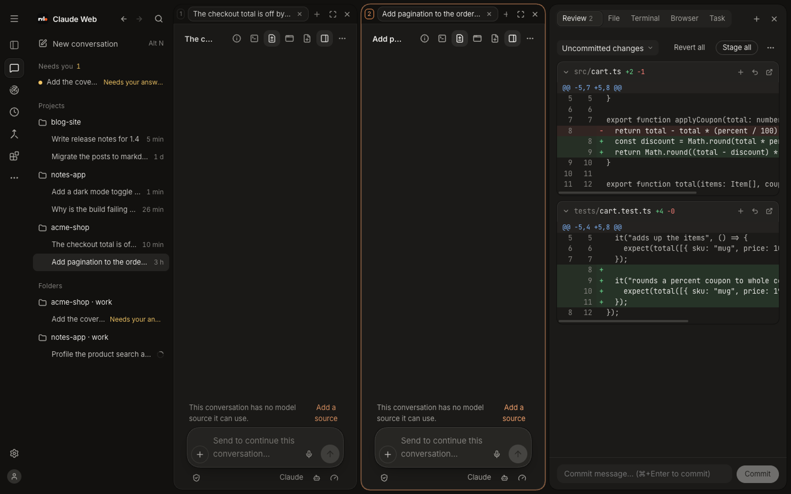

By default the interface is just the sidebar, the conversation and the right panel. Workbench tools such as splits, tabs and groups only appear when you use them:

- <kbd>Ctrl</kbd>+<kbd>D</kbd> splits to the right, <kbd>Ctrl</kbd>+<kbd>Shift</kbd>+<kbd>D</kbd> splits downward, up to 6 splits; once split, each split gets a tab strip at its top, and it folds away again when you close down to one;
- **Drag** a conversation from the left sidebar to the edge of a split to open it on that side;
- Clicking a file path in a conversation opens it in an editor tab (Monaco, autosave, <kbd>Ctrl</kbd>+<kbd>S</kbd> to save manually);
- <kbd>Ctrl</kbd>+<kbd>T</kbd> creates a group; a group is an independent set of split layouts, handy for keeping tasks apart;
- <kbd>Ctrl</kbd>+<kbd>Shift</kbd>+<kbd>Enter</kbd> maximizes the current split, and pressing it again restores it;
- To always show the tab strip, the group bar and the right panel's icon bar: **Settings → General → Show workbench tools**.

### 6. Connect a third-party API / relay

**The fastest way**: Settings → Providers → **Quick add** (the "Connect a model" step when you first open the app is the same thing). Pick a source (Relay / Anthropic API), for a relay also enter its address, paste your API key and click **Connect**. The model list is read automatically, and it's only saved once the test passes; a wrong key, insufficient balance or a wrong address is reported directly.

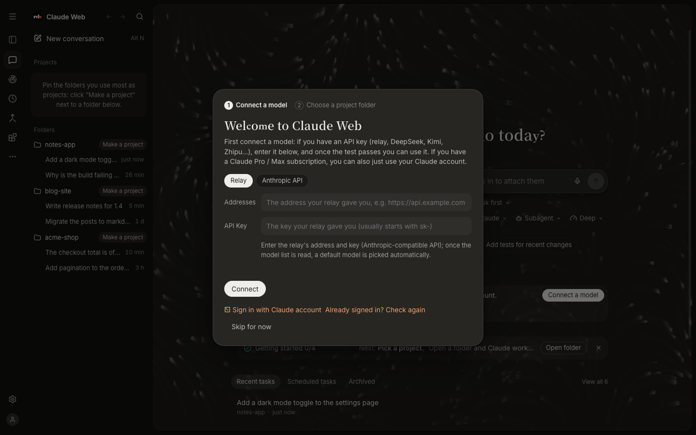

When you need more options (specifying a model mapping, cache settings), use the full form:

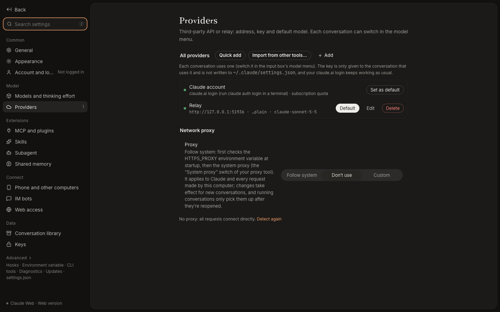

1. Open **Settings** (<kbd>Ctrl</kbd>+<kbd>,</kbd>) → **Providers** → **+ Add**;
2. Fill in **Base URL** and **API Key** (the Anthropic API or any Anthropic-compatible relay), and optionally specify models;
3. Click **Test connection**: it first fetches the model list, then really runs one round of conversation. Conversations always run on the official Claude Code, so relays that only let the official client through work too;
4. Back in the input box, click the model chip and pick one of this provider's models from the menu (the chip shows `Provider / model`). You can also switch in the middle of a conversation, and the history is kept.

The key is only injected into that conversation's own process and is never written to `~/.claude/settings.json`; it's stored encrypted locally (DPAPI on Windows, Keychain on macOS).

**Using several relays / accounts together**: the model chip is one unified menu, with every model of every provider flattened into a single list of `Provider / model` (models of the official account show just their name, like `Fable 5.1`), and picking one switches provider and model at the same time.

- At the top are the thinking effort and (on models that support it) the Deep orchestration switch; the search box filters by provider name or model name, <kbd>↑</kbd> <kbd>↓</kbd> select, <kbd>Enter</kbd> confirms, <kbd>Esc</kbd> closes;
- The star at the end of a row marks a favorite, and favorites are pinned to the top; the 5 most recently used get a section of their own;
- Each provider gets a section whose header shows the number of models and the time of the last fetch (or the error if the fetch failed); every other Claude account is a section too;
- "Refresh all models" at the bottom requests `/v1/models` once per provider (it only lists models, runs no conversation and costs no tokens), and after startup lists older than 24 hours are also refreshed in the background; "Manage models and providers…" opens **Settings → Models and thinking effort**;
- In a conversation, picking another model of the same provider just switches the model; picking another provider restarts the conversation's process invisibly (the history is kept) and uses the model you picked. Conversations on other computers can only change the model;
- If you chat a lot on a model with a big window and then switch to one with a smaller window, and the conversation is already past 80% of the new model's window, it is first compacted with the current model before switching, and the conversation gets a line saying so.

**Choosing a separate model for subagents**: the **Subagent** button next to the model in the input box (or "Subagent model" at the bottom of the model menu) opens the same kind of model menu, limited to the current provider, with "Same as main model" as the top row. The main task keeps using the main model and subagents (the ones sent out by Task and workflows) use the one you picked; for example, Sonnet for the main task and Haiku for subagents saves quite a bit of quota. Tick "New conversations on this provider all do this" at the bottom of the menu, and every new conversation you start on this provider from then on (including IM bots and scheduled tasks) uses it. When you change it on a running conversation, it restarts invisibly once the current turn finishes and then switches; subagents already sent out aren't affected.

**Several Claude accounts**: under **Settings → Account and login → Other Claude accounts**, click **Add account**. A terminal opens and runs `claude setup-token`; sign in to the account you want to add in the browser (sign out of the other one first, or use a private window) and authorize, and the token it prints at the end fills in by itself. Name it and save (saving sends one very short message as a test). Each account then has its own section in the model menu ("Work / Opus 5.5"), so every conversation can run on a different account; when one runs out of quota, pick a model of another and the conversation carries on. An account can be made the default for new conversations, and IM bots and scheduled tasks can use it too. The login in `~/.claude` stays the "Claude account".

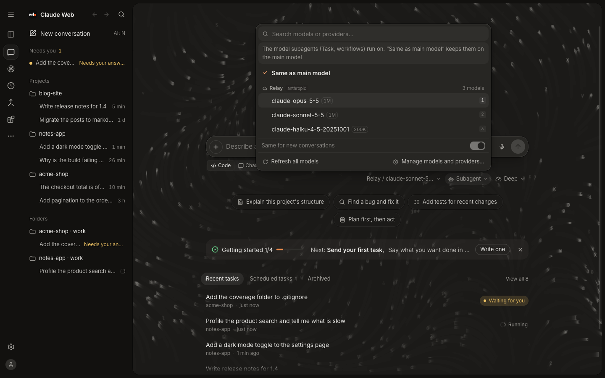

**Each model's context window**: under **Settings → Providers → Edit**, "Context window" has one row per model. Leave it empty to use the default (Claude on a relay is 1 million, Haiku 200k; if the relay's model list states a size, that's used, and an unknown model gets 200k). To change it, just type a value (`272000`, `272k` and `1m` all work). Auto-compaction and the small context ring next to the input box both use this number.

**Settings → Models and thinking effort** has two views: "By model" is a table with one row per model, listing the providers that offer it (click a provider chip to make it that provider's default model), the favorite star and the show switch; "By provider" is the grouped view. At the top is each provider's fetch status and its own refresh button.

### 7. Manage several conversations at once

**Needs you** at the very top of the sidebar lists every conversation waiting for you to approve a permission, answer a question or approve an orchestration; click one to jump to it. At the end of each conversation row is its status (Needs your answer / Running / Error / how many lines changed).

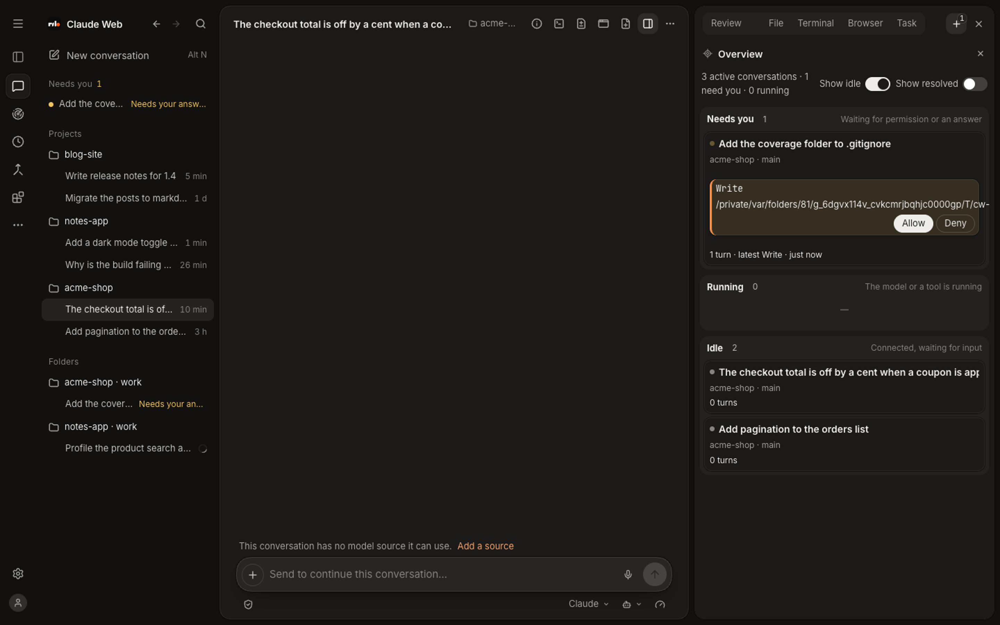

<kbd>Ctrl</kbd>+<kbd>Shift</kbd>+<kbd>M</kbd> (or "Overview" in the command palette) opens the Overview in the right panel: all open conversations grouped into **Needs you / Running / Error / Idle**; permission requests can be approved right on the card, and clicking a card jumps to that conversation.

**Conversations from claude.ai**: under **Settings → Conversation library**, "Import claude.ai data…" takes claude.ai's data export: the conversations go into the library (read-only; you can continue one in Claude) and its projects become projects here.

When the window isn't in the foreground, the desktop app pops a system notification when a conversation finishes or needs approval, and the taskbar / Dock icon shows the number of pending items.

### 8. Use it from your phone

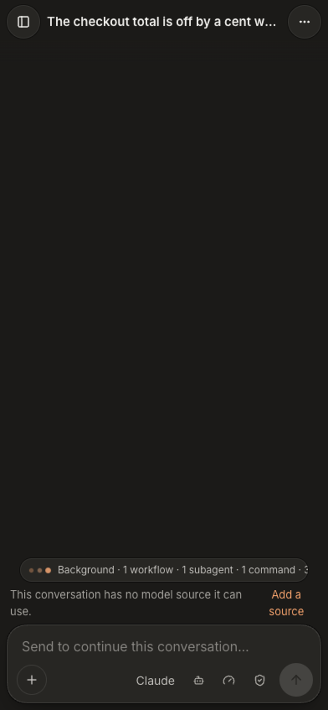

1. On your computer, open **Settings → Phone and other computers** and turn on "Local network / phone access" (default port 3091);
2. Click **Generate pairing code**, which shows a 6-digit code and a QR code (valid for 10 minutes);
3. With your phone on the same Wi-Fi, scan the code to open the page and enter the pairing code;
4. After pairing, the phone remembers this computer, and you can add it to your home screen to use it like an app. Paired devices can be renamed or revoked on the same page.

On a phone the sidebar is a drawer on the left (☰), and the right panel (Review, Terminal, Task …) is a drawer pulled up from the bottom, opened from the conversation header's ···.

This is for a phone on the same Wi-Fi only: the listener is plain HTTP, so don't turn it on on a public network. For the risks, see "Security and privacy" below. You can also set up Telegram / Feishu and other bots (**Settings → IM bots**) to get notifications, approve and give instructions from a chat app; to connect to Claude Web on another machine you can use an SSH tunnel ("More options" on the same page).

<br clear="right">

### 9. Conversations on other computers

If you have a Claude Web running at home, at the office and on a server, you can see the conversations of **all computers** in the sidebar of any one of them (with the computer's name), open them, continue them, approve permissions and interrupt them directly; you can also "Continue on this computer" with a conversation from another computer.

**Adding a computer** (Settings → Phone and other computers → Other computers → Add a computer), in one of two ways:

1. **Address + pairing code** (same local network or any address you can reach directly): on **that** computer, turn on "Local network / phone access" and click "Generate pairing code", then on **this** one enter the address it shows (such as `http://192.168.1.20:3091`) and the 6-digit code. This computer pairs on your behalf and receives a device token (stored encrypted, never shown in the interface).
2. **SSH host**: first add the host under SSH tunnels in "More options" on the same page and fill in the remote token, then pick it under "Other computers". The connection goes through an SSH tunnel, and if the tunnel drops it's reopened automatically.

Once added:

| Where | What you see |
| --- | --- |
| Sidebar | Conversations from other computers are grouped by computer in the "Other computers" section; the funnel menu gets an extra item for filtering by computer ("All computers / This computer / Office desktop …") |
| Conversation | Opening, sending messages, approving, interrupting, renaming, archiving and deleting all happen on that computer; the ··· only has the "Generated files" view, so check files / Git / search on that computer |
| Conversation menu | "Continue on this computer": reads the full history on that computer and creates a new Claude conversation on **this** computer with a briefing (it asks you for a local working folder, since that computer's path most likely doesn't exist here); the original conversation is unchanged |
| Overview | A "Running on other computers" column; open one to take over |
| Offline | When that computer is shut down / offline, its conversations show the last list greyed out (read-only), and this computer's own list isn't affected; it reconnects automatically when it's back |

In the "Other computers" list you can see the status (Online / Offline / Token expired), latency and conversation count, and rename, disable and remove. If that computer revokes this one under "Paired devices", it shows "Token expired" here; click "Re-pair" and enter a new pairing code, and the conversation ids don't change.

Notes: the connection is initiated by this computer; the only addition to what this computer exposes is that `/api/health` also returns a hash of a server id (used to recognize "did I just add myself"), and it contains no token or conversation content. Two computers can add each other, but there are no multiple hops (A can't see the C that B added). Attachments (files / folders) live on this computer, so the other computer can't read them when you send them to a conversation there; paste the content directly instead.

### 10. Automation: scheduled tasks, goals, orchestration

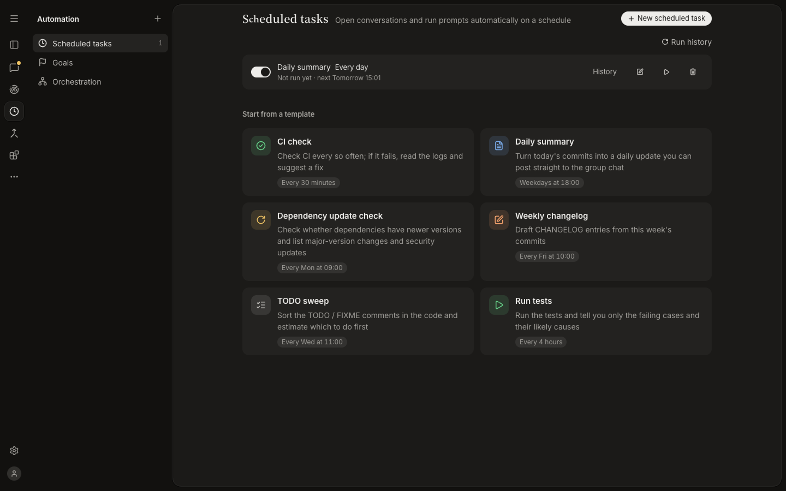

**Automation** in the sidebar opens a page (it covers the conversation; click a conversation in the sidebar or press <kbd>Esc</kbd> to go back):

- **Scheduled tasks**: automatically open a conversation and send a prompt on a cron schedule or interval (shown as "Weekdays at 09:00" and the like); "New scheduled task" at the top right, or start from a template below; "Run history" shows each run's result and its conversation;
- **Goals**: give it a one-sentence goal and it keeps going, turn after turn, until it's done or stuck (`/goal <goal>` in the input box works too); a thin strip "Goal: … · Turn N" appears below the conversation header;
- **Orchestration**: see below.

**Orchestration**: split a job into steps, each one a Claude conversation, run steps with no dependencies in parallel, and stop at key points to wait for your approval. It lives on the **Orchestration** tab of the Automation page (you can also open it from the right panel's ＋, or from the command palette's "New orchestration" and "Run orchestration…").

1. **Build a workflow**: click + to create one, or start from a template ("Plan → Implement → Review", "Fix a bug + tests"). Each node is one of two kinds:
   - **Task**: pick the permissions and workspace (the shared working folder, or a separate git worktree that's merged back automatically when done); tick "Keep going until done" and it advances turn by turn under the goal protocol until Claude reports it's finished;
   - **Approval**: stops and waits for you to approve or reject (you can write comments).
   Set the dependencies and the execution graph above previews them live. In a prompt you can use `{{input}}` (the input you fill in at run time), `{{nodes.<id>.output}}` (an upstream node's last reply) and `{{nodes.<id>.approval}}` (the approval comments); click a variable under the prompt to insert it.
2. **Run**: click ▶ and fill in this run's input. Every task node is an ordinary conversation, and shows up as usual in the sidebar, the Overview and permission approvals, and you can step in to interject or interrupt at any time.
3. **While it waits for you**: when an approval is ready, the node turns yellow, and the sidebar's "Needs you", the Overview and desktop notifications all remind you; if an IM chat is bound to one of the conversations in this run, that chat also gets the reminder, and you can click "Approve / Reject" right there (other chats don't get it and can't approve).
4. **Merging back**: when a task that worked in its own worktree is done, its branch is merged into the branch the run started from. **Orchestration won't wreck your stuff**: if you have a merge / rebase in progress, or changes in the staging area, it refuses outright; on a merge conflict it only undoes its own merge; if the merge doesn't succeed, the worktree and branch are kept as they were, and once you've sorted it out, "Merge again" on the node merges it and the run carries on.
5. **Failure / restart**: a failed node can be "Retry"-ed on its own, and the skipped downstream nodes are redone with it; a retry uses a new worktree (the name gets a suffix such as `-attempt2`) and the old ones are all kept. If the service restarts while a run is in progress, that run is marked "Interrupted by a service restart", and clicking "Resume" continues from the nodes that weren't finished (completed outputs are kept). When you delete a run record you can choose to "also clean up worktrees and branches": it only deletes the clean, merged ones and lists the rest for you.

Worktrees live outside the repository, in `~/.claude-web/worktrees/<repo name>-<hash>/` (so your tests and builds don't scan them and they don't appear in git status), and branch names are `cw/<run id>/<node>-<agent>`. The number of nodes that run at the same time is set under **Settings → General → More options → Orchestration concurrency limit** (default 3).

### 11. Background: watch subagents work in the café

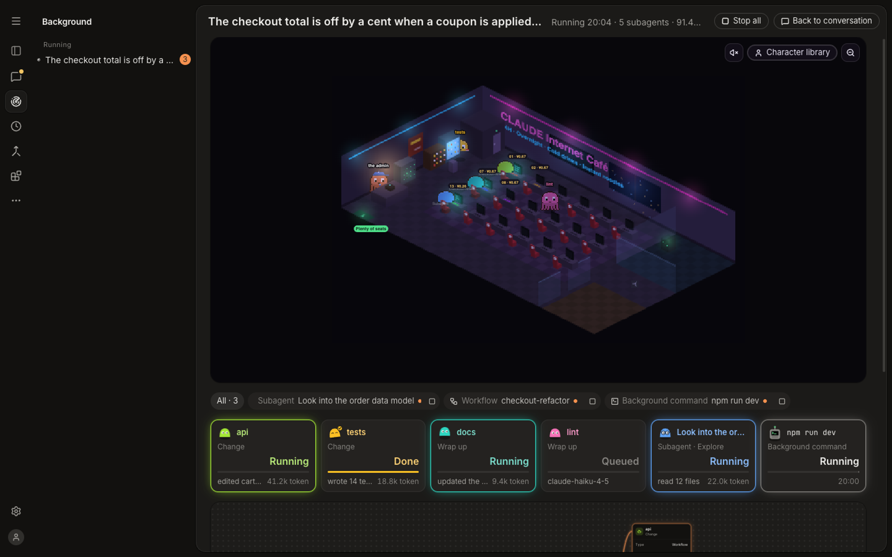

When a conversation sends out subagents, runs a workflow (turn on "Deep orchestration" in the thinking effort button next to the input box, and a bigger task will write its own workflow and hand it out to several subagents), or starts a background command, a small pill like "Background · 1 workflow · 2 running" appears above the input box; click it to open **Background** (it's on the icon bar too).

- **The café**: the main conversation is **the admin** at the front desk; while it runs it types at the counter, and when idle it wanders around and shouts a couple of things. Each subagent is a **guest**:
  - On arrival it goes to the front desk to boot up a PC, then sits down at its own seat (the seat sign shows the PC number and the fee);
  - While working, code scrolls on its screen and the step it just did pops up above its head ("Read src/auth/login.ts");
  - If nothing's happened for a while, it goes off to eat instant noodles, have a drink, play a game, go to the toilet, visit the smoking area or borrow a power bank, and goes straight back to its seat as soon as there's work;
  - When done it walks to the front desk to **check out**, and a little receipt pops up: how long it was on the PC, the fee, how many tokens it used and roughly how much money, and then it leaves. One that fails gets a blue screen, and one you stop is "called off" the PC by the admin.
  
  The fee is just for fun, and the rate is set under **Settings → General** ("Café fee (per hour)"); hover over a guest to see the real tokens and estimated cost. Click a guest and its own conversation opens next to it: what it read, which commands it ran, what it changed. Drag the view to pan, scroll to zoom, double-click for the full view; the top right switches sound effects on and off ("Check-out sound" under Settings → General).
- **Below the café** is one card per subagent (its phase, running / queued / done / failed, what it's doing, how many tokens it used), today's bill, a relationship graph and an activity feed. On the left are all the conversations that have background activity, and you can also look back at workflows this conversation has finished before.
- **The right panel's** "More" has a small café too, which follows the current conversation.
- **Stop**: the Stop button in the input box **only stops the current turn**; background workflows, subagents and commands keep running. To stop them, stop them individually on the Background page, on a card, or in the right panel's "Task" tab. A conversation that still has background work after its turn ends won't be closed by idle cleanup; when a workflow finishes, the result starts a turn by itself to tell you.

#### Making a character

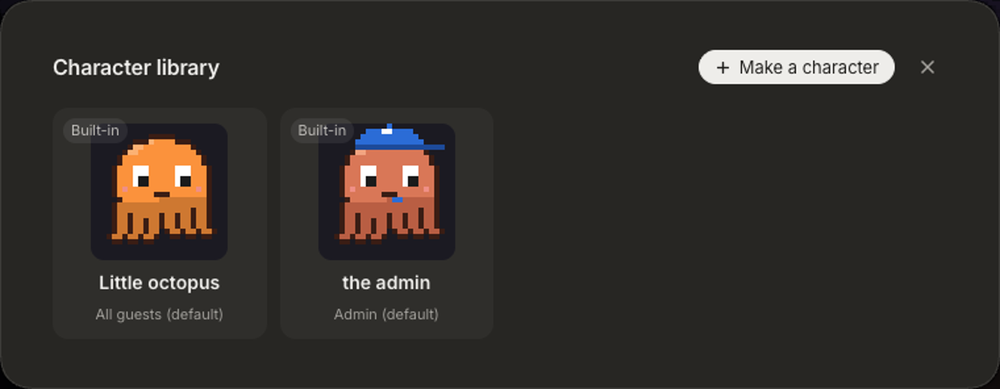

By default guests are little octopuses, and the admin wears a blue cap. In the café, top right **Character library → Make a character**, give it a photo or describe what you want ("a programmer in black-framed glasses and a blue hoodie"), and Claude draws a 24×24 pixel character and shows you a few frames: front, back, walking, sitting, typing:


If you're not happy, keep talking ("bigger eyes", "switch to a red shirt"); once you like it, save it and assign it to the admin, all guests, a type of subagent (such as Explore), or a subagent with a particular name. You can also just say "make me a café character that looks like this photo" in any conversation: this is a skill that ships with the app. Characters are stored in `~/.claude-web/characters/`, one JSON file per character.

## Character themes

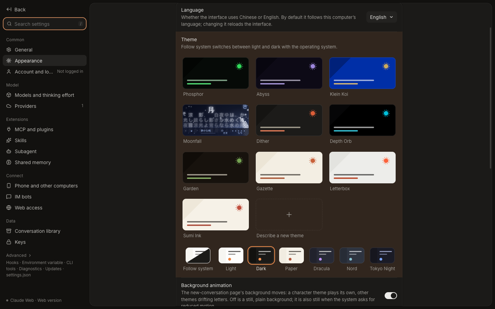

Besides the classic colour themes there are ten **character themes**: each one brings its own colours, a living ASCII-art backdrop and its own set of little animations for what Claude is doing. **Settings → Appearance** shows them as cards; point at a card and it comes alive, click it to put it on (or **Character themes…** in the account menu at the bottom of the sidebar).

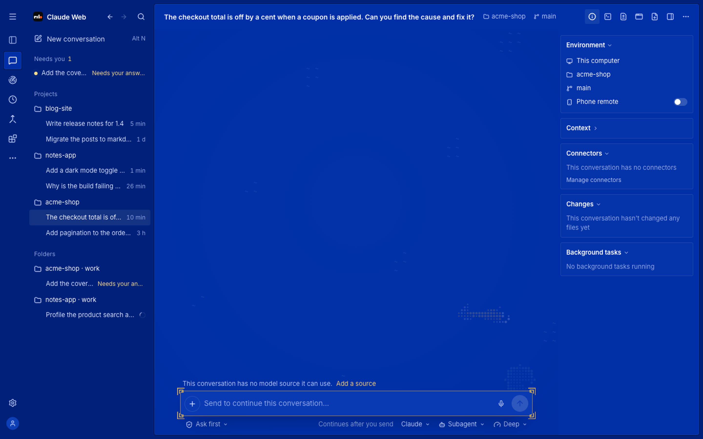

- **The ten**: Phosphor (green terminal rain), Abyss (a halftone jellyfish in deep water), Klein Koi (koi in a blue pond), Moonfall (character rain under the moon), Dither (a ringed planet in four dithering algorithms), Depth Orb (a cloud of points with a lens split), Garden (your projects grow as plants: one per project folder, sized by how many conversations it has), Gazette, Letterbox and Sumi Ink (the three light ones).
- **The backdrop** fills the start page, follows the pointer, answers clicks and typing, and reacts to what Claude is doing (thinking, reading, running agents…). In a conversation it is faint, or switch it off there: **Settings → General → Conversation display → Faint background in conversations**. With "reduce motion" on in your system, it draws one still picture.
- **Animations instead of spinners**: every step has its own: editing is a pen writing, thinking really thinks, reading turns pages, tests fill in one by one, git commits line up… sixteen of them, drawn differently by each theme.

**Make your own by describing it.** Click **＋ Describe a new theme** (or just say "make me a character theme: …" in any conversation): Claude writes the theme, checks it (format, contrast, every animation), **runs it once in your window** and looks at a picture of the result before showing you, and you keep talking until you like it. Right-click one of your themes for **Change it** or **Delete**. Themes live in `~/.claude-web/themes/<id>/` (`theme.json`, `backdrop.js`, `theme.css`); a backdrop that is not built in runs in a sandbox with no network, and is taken down (back to the default) if it throws errors or gets too slow.

## Interface language

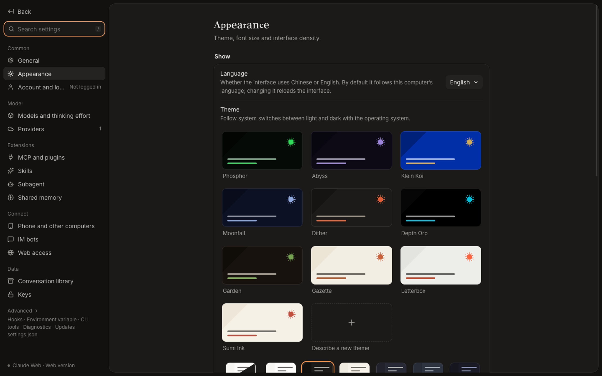

The whole interface comes in **Chinese** and **English**, and **by default it follows your computer's language**: English if your computer is English, Chinese if it's Chinese (other languages are shown in English for now). To change it: **Settings → Appearance → Language**, and pick "Follow system / 中文 / English"; the interface reloads once.

- The web version follows the browser's language and the desktop app follows the system language; the language you pick is stored on this computer (`~/.claude-web/meta.json`), and all windows on the computer and the phone page switch together.
- The desktop app's menus, tray and update prompts, and a small part of the server's text (fixed at startup), only change after you restart the app.
- Which language Claude replies in within a conversation is up to you and the model and has nothing to do with the interface language; exported HTML follows the interface language at the time of export.

## Custom styles (custom.css)

Put your own CSS in `~/.claude-web/custom.css`. It's loaded after the built-in styles in every window (desktop app, browser, phone), a save shows up at once without a restart, and the desktop app's updates never overwrite it. **Settings → Appearance → Custom styles** creates the file (with a list of the hooks you can rely on), opens it in the editor, and switches it off if something breaks.

The hooks stay the same in later versions: `html[data-theme]` and `html[lang]`, `.chat[data-state]` (starting / running / waiting / idle / history / closed / error), every plan's `data-done` / `data-total` and `--progress`, each plan item's `data-status`, the plan's title row `.tasks-plan .plan-head` and its bar `.plan-prog`, and the colour / radius variables (`--accent`, `--ink-1`…`--ink-4`, `--surface-0`…`--surface-3`, `--r-sm` / `--r-md` / `--r-lg`). For example, a thicker plan progress bar:

```css
.tasks-plan .plan-prog { height: 6px; }
.tasks-plan .plan-prog > i { background: var(--accent); }
```

## Keyboard shortcuts

On the desktop app, <kbd>Ctrl</kbd> is <kbd>⌘</kbd> on macOS. Press <kbd>F1</kbd> (<kbd>?</kbd> in the web version) for the full list.

| Action | Desktop app | Web version |
| --- | --- | --- |
| New conversation | Ctrl+N | Alt+N |
| Command palette / full-text search | Ctrl+K | Ctrl+K |
| Settings | Ctrl+, | Ctrl+, |
| Send / new line | Enter / Shift+Enter | Enter / Shift+Enter |
| Interrupt the current turn | Esc | Esc |
| Find in conversation | Ctrl+F | Ctrl+F |
| Sidebar | Ctrl+B | Ctrl+B |
| Split right / down | Ctrl+D / Ctrl+Shift+D | Same |
| Close tab | Ctrl+W | Alt+W |
| New group | Ctrl+T | Alt+T |
| Switch group | Ctrl+Tab | Alt+PageDown |
| Maximize / restore split | Ctrl+Shift+Enter | Same |
| Zoom the whole interface in / out / reset | Ctrl+= / Ctrl+- / Ctrl+0 (remembered; Settings → Appearance → Interface zoom) | The browser's own zoom |
| Terminal | Ctrl+` | Ctrl+` |
| Right panel | Ctrl+J | Ctrl+J |
| Conversation / Steps view | Alt+J | Alt+J |
| Overview | Ctrl+Shift+M | Ctrl+Shift+M |

## Where your data lives

| Location | Contents |
| --- | --- |
| `~/.claude/` | Claude Code's own data: login state, settings, conversation records (shared with the command line) |
| `~/.claude-web/` | This app's data: the project list, pins / archive, providers (keys encrypted), drafts, scheduled tasks, the usage ledger, attachments, the shared memory database, the conversation library index (`library.db`) and delete backups (`library-trash/`), orchestration workflows (`meta.json`), café characters (`characters/`), run records (`orchestra/`) and worktrees (`worktrees/`), and settings for other computers (`meta.json`, keys encrypted) |
| Desktop app logs | Windows: `%APPDATA%\claude-web\`; macOS: `~/Library/Application Support/claude-web/` (`server.log`, `main.log`) |

**Settings → Advanced → Diagnostics** packs the logs and a redacted copy of your config in one click, to make troubleshooting easier.

## FAQ

**macOS says "is damaged and can't be opened"**
This is caused by the missing Apple signature. Run `xattr -cr "/Applications/Claude Web.app"` and then open it again.

**It says you're not signed in / sending a message does nothing**
In the notice at the top of the home page, click **Sign in with Claude account** (or press <kbd>Ctrl</kbd>+<kbd>`</kbd> to open a terminal and type `/login`); **Settings → Account and login** shows the sign-in state, and "More options" there has the runtime's version and doctor, so you can see the exact error.

**A relay says "client version too old"**
Conversations always run on the official Claude Code that ships with the app, so just update to the latest Claude Web (the bundled Claude Code is upgraded along with it).

**On macOS, git / gh and other commands can't be found**
At startup the app reads the PATH of your login shell (zsh / bash). If a command is installed somewhere unusual, add it to the PATH in `~/.zshrc` and restart the app.

**The interface language isn't the one I want**
Under **Settings → Appearance → Language**, pick "中文" or English (the default is "Follow system"). The desktop app's menus and tray only change after you restart the app.

**The window is black / flickers**
That's a graphics driver issue. Turn on **Settings → General → More options → Software rendering (desktop version)** and restart; after two crashes in a row the app also switches by itself.

**Auto-update**
The desktop app checks this repository's GitHub Releases for a new version after it starts and every 4 hours (under **Settings → Advanced → Update** you can check manually, or turn off the automatic check). The Windows installer version and the macOS app download in the background and then pop up a window asking whether to restart and update; choose "Later" and it installs by itself the next time you quit. The macOS app updates itself only when it's in "Applications" and opened from there (not straight from the dmg or Downloads); when it can't, and for the Windows portable version, a window gives you a download link when there's a new version: on macOS, download the new dmg and drag the app into "Applications" to replace it, and for the portable version, swap in the new exe. A version marked "must update" can't be skipped. If you built the package yourself from source, after `git pull` just run `npm install && npm run build:desktop` again and install over it. None of your data is lost. See the [changelog](CHANGELOG.md) for what changed in each version.

## How it works

- One Node process (`server/`) drives the Claude Code on your computer with the [Claude Agent SDK](https://github.com/anthropics/claude-agent-sdk-typescript), and pushes all messages to the React frontend (`web/`) over a single WebSocket; the desktop app (`desktop/`) is just an Electron shell, running the same server and web page inside.
- The **runtime** is always the official Claude Code that ships with the Agent SDK (bundled in the desktop installer; installed by `npm install` when you run from source). A provider (the Anthropic API, an Anthropic-compatible relay or another Claude account) only changes the address and key injected into that conversation's process.
- Conversation records are still Claude Code's own (`~/.claude/projects`), so the command line and Claude Web can take turns on the same conversation.

For more detail on the architecture, protocols and the pitfalls hit along the way, see [CLAUDE.md](CLAUDE.md) and the [docs/notes/](docs/notes/) it indexes.

## Security and privacy

- The service **only listens on `127.0.0.1` by default**. Local-network / phone access has to be turned on by hand in settings, and every device has to exchange a one-time pairing code for a device token, which you can revoke at any time.
- Provider keys, IM bot tokens and device tokens are all **stored encrypted** (DPAPI on Windows, Keychain on macOS) and always masked in the interface and logs; a key is only injected into the process of the conversation that uses it, and isn't written to the CLI's own config such as `~/.claude/settings.json`.
- **Claude Web itself doesn't collect or report any data.** Model requests go directly from your machine to the provider you chose; Claude Code's own telemetry behavior follows its settings.
- If you find a security issue, report it privately through GitHub's **Security → Report a vulnerability**, and please don't open a public issue.

## Running from source and development

```bash
npm install
npm run site:install     # install the site's separate dependencies (also needed for typecheck and tests)
npm run dev              # dev mode: server hot reload + Vite (http://localhost:5173)
npm run typecheck        # type-check server + web + desktop + site
npm test                 # unit tests
npm run build:all        # build server / web / desktop
npm run e2e              # end-to-end checks (temp folder, mock agent, costs no tokens)
npm run desktop          # start the desktop app from source
npm run build:desktop    # build the Windows installer (on Windows)
npm run build:desktop:mac  # build the macOS installer (on macOS only)
```

On every push, GitHub Actions runs type checks, unit tests, builds and end-to-end checks on Windows, macOS and Linux. Pushing a `v*` tag (such as `git tag v0.2.0 && git push origin v0.2.0`) builds the Windows, macOS arm64 and x64 installers, **really launches the installer once as a smoke test**, and then publishes them to Releases.

There's also a UI smoke test: `npm run build:all && node scripts/ui-smoke.cjs`. It uses Electron in a temp folder to click through almost every entry point, and any console error counts as a failure. The built-in browser has its own: `node scripts/browser-smoke.cjs` (a real `<webview>` plus a small local website, running through every kind of web action the agent can do).

For the architecture, protocols and the pitfalls hit along the way, see [CLAUDE.md](CLAUDE.md) (for people writing code with an AI agent: `AGENTS.md` points to the same file).

```
server/   Node service: session driving, conversation library, providers, files / Git, remote, IM, orchestration…
web/      React frontend (Vite + zustand); the core of conversation rendering is a pure-function reducer: web/src/model/conversation.ts
desktop/  Electron shell
scripts/  e2e, UI smoke tests, English-interface check (i18n/), README screenshots (readme-shots.cjs), packaging helpers
docs/     Design docs and implementation plans (docs/superpowers/), notes (docs/notes/), README screenshots (docs/images/en, docs/images/zh)
```

## Contributing

Issues and PRs are welcome. Please run this before you submit:

```bash
npm run typecheck && npm test && npm run e2e
```

- Before changing interface wording, look at `web/src/ui/terms.ts` (the glossary) and `wording.test.ts` (implementation words like "profile / engine / pane", in their Chinese forms, must not appear in the default interface);
- Every piece of text a user can see goes through `tr('<Chinese source text>')` (the Chinese original is the key), and the English goes in `web/src/i18n/en.ts` (the server's `server/src/i18n/en.ts`, the desktop app's `desktop/src/en.ts`); `npm test` checks for anything left untranslated, and `node scripts/i18n-smoke.cjs` walks through the whole English interface looking for any Chinese left over;
- Before changing conversation rendering, run `npm test -w web`; `conversation.test.ts` replays recorded real message streams;
- Don't put real keys in tests, fixtures or docs.

## License and credits

The code of this project is open source under the [MIT License](LICENSE).

Some of the components it depends on have their own license terms; please follow them separately when you use and redistribute it (especially the packaged installers, which include them):

- [@anthropic-ai/claude-agent-sdk](https://github.com/anthropics/claude-agent-sdk-typescript) and the Claude Code it ships with: Anthropic's terms (see that package's README);
- The fonts in the interface are distributed with the app and are all under the [SIL Open Font License 1.1](https://openfontlicense.org/): [Inter](https://github.com/rsms/inter) (interface text), [JetBrains Mono](https://github.com/JetBrains/JetBrainsMono) (code), [Noto Serif SC](https://github.com/notofonts/noto-cjk) (only the few dozen characters used in headings were taken). The full licenses are in `web/public/licenses/`;
- Icon shapes come from [Lucide](https://lucide.dev) (ISC license; part of it derives from Feather, MIT);
- The remaining dependencies (Electron, React, Monaco, node-pty, xterm.js …) are under MIT and other common open-source licenses.

Thanks to these projects.
