# Claude Web

**简体中文** · [English](README.md)

**Claude Code CLI 的可视化工作台。** 把命令行里的 Claude Code 搬进一个图形界面：对话、每一轮折叠成一行的工具调用、代码 diff 审阅、权限审批、文件 / Git / 编辑器、分屏、手机远程访问，全部在一个窗口里。

同一套程序有两种用法：**桌面应用**（Windows / macOS）和**浏览器网页**（本机起一个服务，用浏览器打开）。功能完全一样，数据互通。除了 Claude Code，也能用同一个界面驱动 Codex、Gemini CLI、Qwen Code、Kimi、OpenCode 等 CLI agent。界面有**中文和英文**两种，默认跟着这台电脑的语言（[怎么换](#界面语言)）。

> **非官方项目。** Claude Web 是社区开发的开源工具，与 Anthropic 没有任何关联，也没有得到 Anthropic 的认可。「Claude」「Claude Code」是 Anthropic 的商标。使用它需要你自己的 Claude Code 登录（Claude 订阅）或第三方 API / 中转的密钥，费用和用量按你自己的账号计算。

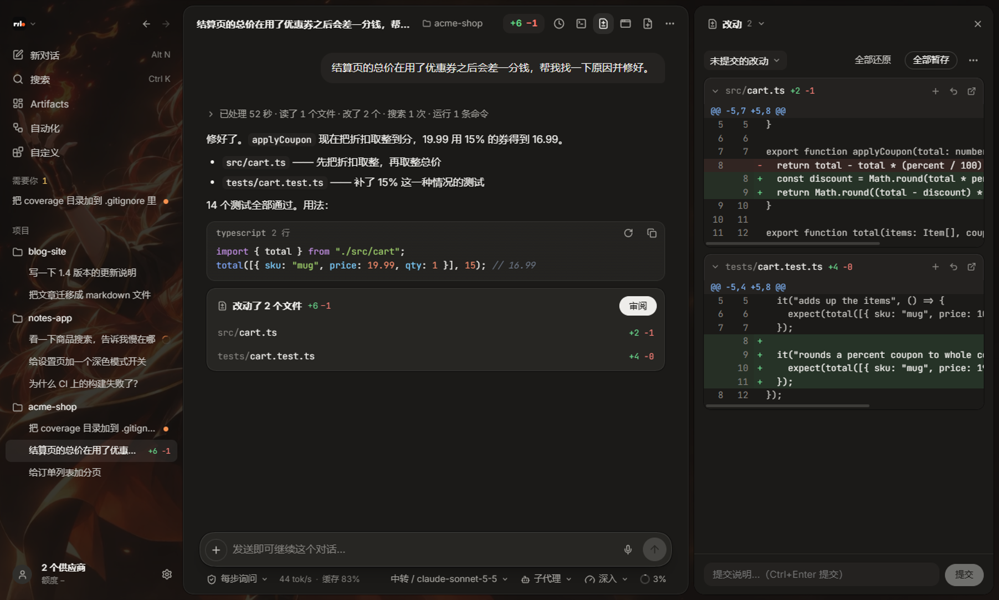

**子代理和工作流跑起来，在「自动化 › 运行中」的 3D 网吧里看得见**：主对话是前台后面的网管，每个子代理是一位客人，进门、坐到电脑前敲代码、空了去沙发和零食架那边转转，做完到前台结账（[详细](#15-运行中看子代理在网吧里干活)）。

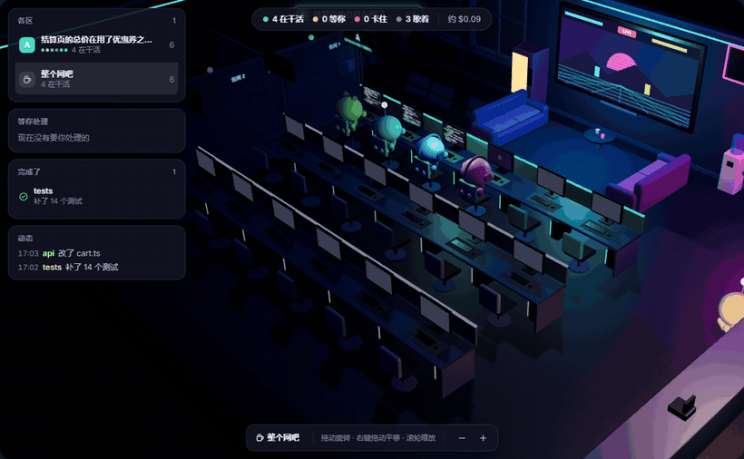

---

## 目录

- [能做什么](#能做什么)
- [桌面版还是网页版？](#桌面版还是网页版)
- [安装](#安装)
- [上手教程](#上手教程)
  - [1. 登录 Claude](#1-登录-claude)
  - [2. 选一个项目，开始第一个对话](#2-选一个项目开始第一个对话)
  - [3. 权限审批与权限模式](#3-权限审批与权限模式)
  - [4. 改动、Git、文件：右侧面板](#4-改动git文件右侧面板)
  - [5. 分屏工作台](#5-分屏工作台)
  - [6. 接入第三方 API / 中转](#6-接入第三方-api--中转)
  - [7. 同时管理多个对话](#7-同时管理多个对话)
  - [8. 用手机访问](#8-用手机访问)
  - [9. 其它 CLI Agent（Codex / Gemini …）](#9-其它-cli-agentcodex--gemini-)
  - [10. 本机其它 agent 的对话](#10-本机其它-agent-的对话)
  - [11. 模型网关（多账号故障转移 / 协议转换）](#11-模型网关多账号故障转移--协议转换)
  - [12. 其它 agent 的配置（MCP / 说明文件 / 模型）](#12-其它-agent-的配置mcp--说明文件--模型)
  - [13. 其它机器上的对话](#13-其它机器上的对话)
  - [14. 自动化：定时任务、Bot、目标、多 agent 编排](#14-自动化定时任务bot目标多-agent-编排)
  - [15. 运行中：看子代理在网吧里干活](#15-运行中看子代理在网吧里干活)
- [字符画主题](#字符画主题)
- [开场动画（桌面版）](#开场动画桌面版)
- [界面语言](#界面语言)
- [自定义样式（custom.css）](#自定义样式customcss)
- [快捷键](#快捷键)
- [数据存在哪里](#数据存在哪里)
- [常见问题](#常见问题)
- [工作原理](#工作原理)
- [安全与隐私](#安全与隐私)
- [从源码运行与开发](#从源码运行与开发)
- [参与贡献](#参与贡献)
- [许可证与致谢](#许可证与致谢)

---

## 能做什么

| | |
| --- | --- |
| **对话** | 流式输出、思考过程；做完的一轮折成一行「已处理 27 秒 · 读了 2 个文件 · 运行 1 条命令」，点开是逐步的时间线；Markdown / 代码高亮 / 公式 / Mermaid 图 |
| **代码改动** | 每轮末尾「改动了 N 个文件」卡片，右侧面板的「改动」逐文件看 diff（上下或并排）、暂存、还原、提交 |
| **权限** | 需要授权时卡片停在输入框上方：允许一次（空着按 Enter）/ 拒绝（输入框里的字就是理由）/ 总是允许；提问、计划审批也在这里 |
| **工作台** | 默认只有侧栏 · 对话 · 右侧面板；需要时 Ctrl+D 分屏（最多 6 个）、开标签页、分组；对话、编辑器（Monaco）、diff、终端、内置浏览器都能放进分屏 |
| **文件 / Git / 搜索** | 文件树、全文搜索替换（ripgrep）、Git 暂存 / 提交 / 分支 / stash / worktree、Issue 与 PR 看板 |
| **对话管理** | 置顶、归档、分叉（从任意一条消息开新分支）、编辑重发、插话、导出 HTML |
| **需要你** | 侧栏顶上列出所有等你确认 / 回答的对话；每一行对话末尾只写它的状态：等你、运行中、出错，或者改了多少行 |
| **运行中** | 「自动化 › 运行中」看所有对话在后台跑的子代理、工作流、后台命令：按对话分组的列表，或者一间 3D 网吧——每个子代理是一位客人，做完到前台结账；「跑过的」回头看跑完的；角色可以用照片或一句话「捏」出来；输入框的停止只停这一轮，后台的照样跑 |
| **联网** | Agent 在内置浏览器里搜索、打开网页、点击、填表、截图，不用搜索密钥；Windows 上还能在你允许后操控指定的桌面应用 |
| **自动化** | 侧栏「自动化」一页五个标签：运行中、定时任务（cron）、Bot（住在你电脑里的值班队友）、目标（给一个目标让它自己多轮推进）、多 agent 编排 |
| **自定义** | Skills、连接器（MCP）、插件、Artifact 类型，在侧栏「自定义」一页里 |
| **供应商** | 每个对话可选不同的供应商（官方账号 / Anthropic 兼容中转 / OpenAI / Gemini …），模型菜单里「供应商 / 模型」平铺一列；密钥加密保存；每个模型的上下文窗口可以单独设；子代理可以用另一个（更便宜的）模型 |
| **多 Agent** | 除 Claude 外还能驱动 Codex、Gemini、Qwen、Kimi 等 CLI agent，界面一致 |
| **远程** | 扫码配对后用手机浏览器访问，不在家里 Wi-Fi 也能连；SSH 隧道连远程机器；Telegram / Discord / Slack / 钉钉 / 飞书机器人 |
| **用量** | 订阅额度环、每轮耗时与费用账本、上下文占用 |
| **中文 / English** | 整个界面（网页、桌面版的菜单和托盘、手机页面、导出的 HTML）有中英两种语言，默认跟着这台电脑，设置里可以换 |

## 桌面版还是网页版？

**两种都可以用，功能一样。** 区别只在外壳：

| | 桌面版 | 网页版 |
| --- | --- | --- |
| 怎么开 | 安装包，双击打开 | `npm start` 后浏览器打开 `http://127.0.0.1:3090` |
| 需要 Node.js | 不需要（已内置） | 需要 Node.js 22.13+ |
| 托盘 / 系统通知 / 开机自启 | ✅ | 浏览器通知 |
| 多窗口 | ✅ | 多个浏览器标签 |
| 快捷键 | Ctrl（macOS 为 ⌘）系列 | 部分改用 Alt，避开浏览器占用的组合 |
| 手机访问 | 在设置里开启后，手机用浏览器访问；开着时不让电脑睡眠 | 同左；睡眠要自己在系统电源设置里关 |

两者读写同一份数据（`~/.claude` 与 `~/.claude-web`），可以混着用。

## 安装

### 桌面版（下载安装包）

到 [Releases](https://github.com/ypyik0669/claude-web/releases/latest) 下载：

| 系统 | 文件 |
| --- | --- |
| Windows 10 / 11（x64） | `ClaudeWeb-<版本>-win-x64.exe`（安装版）或 `ClaudeWeb-<版本>-portable.exe`（免安装） |
| macOS，Apple Silicon（M1 及以后） | `ClaudeWeb-<版本>-mac-arm64.dmg` |
| macOS，Intel | `ClaudeWeb-<版本>-mac-x64.dmg` |

`.zip`、`.yml`、`.blockmap` 是自动更新用的，不用下载。第一次打开的提示见下面「安装包的提示」。每个版本改了什么见 [更新日志](CHANGELOG.zh-CN.md)。

### 网页版（从源码）

需要 [Node.js 22.13+](https://nodejs.org/)（用到内置的 `node:sqlite`）和 Git：

```bash
git clone https://github.com/ypyik0669/claude-web.git
cd claude-web
npm install
npm run build
npm start
```

然后浏览器打开 <http://127.0.0.1:3090>。Windows 上也可以直接双击仓库里的 `启动.cmd`。

### 桌面版（自己打包）

```bash
npm install
npm run build:desktop        # Windows：dist-desktop/ClaudeWeb-<版本>-win-x64.exe（安装版）和 -portable.exe（免安装）
npm run build:desktop:mac    # macOS：只能在 Mac 上打，arm64 / x64 各在对应芯片的机器上打
npm run build:desktop:linux  # Linux
```

### 安装包的提示

- **Windows**：安装包没有代码签名，SmartScreen 提示「已保护你的电脑」时点 **更多信息 → 仍要运行**。
- **macOS**：按芯片选包，Apple Silicon（M1 及以后）是 `mac-arm64.dmg`，Intel 是 `mac-x64.dmg`（左上角  → 关于本机，看「芯片」一栏）。打开 dmg，把 **Claude Web** 拖进「应用程序」。安装包没有 Apple 签名，**第一次打开**需要在「应用程序」里对它 **右键 → 打开 → 打开**；如果提示「已损坏，无法打开」，在终端执行一次：

  ```bash
  xattr -cr "/Applications/Claude Web.app"
  ```

## 上手教程

### 1. 登录 Claude

Claude Web 驱动的就是本机的 Claude Code，登录状态和命令行共用（`~/.claude`）。

- **已经在命令行里用过 Claude Code**：什么都不用做，打开就能用。
- **还没登录**：首次打开的引导只有两步——① 接一个模型（已经登录或已经有供应商就自动跳过）② 选一个项目文件夹。要登录 Claude 账号，在第一步点 **用 Claude 账号登录**：会开一个终端标签，里面就是 Claude Code，按提示选登录方式（或输入 `/login`），登录好回到引导点 **已经登录了？重新检查**。也可以 **先跳过**，以后首页会提示你还没登录。
- **没有 Claude 订阅、用 API Key 或中转**：在引导的「接一个模型」这一步直接填 Key，或跳到 [第 6 步](#6-接入第三方-api--中转)。

### 2. 选一个项目，开始第一个对话

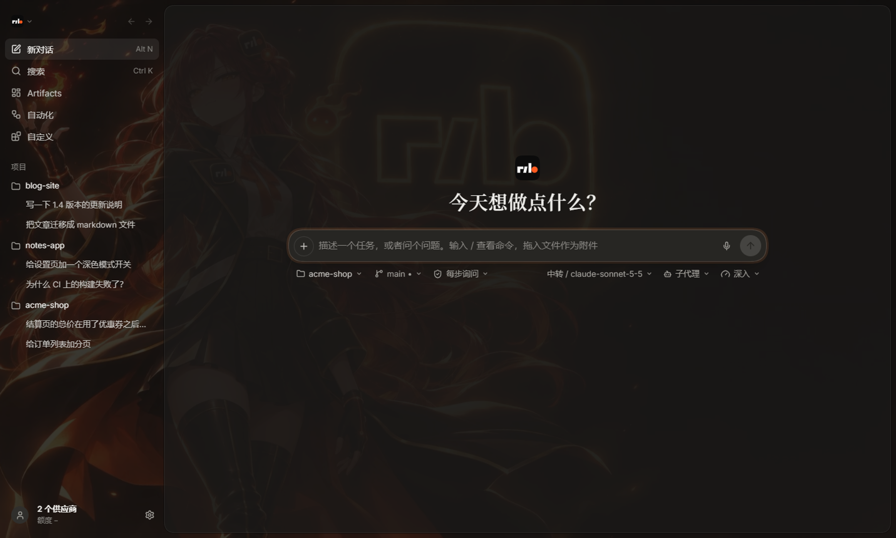

首页只有 Claude Web 的标志、「今天想做点什么？」、输入框和它下面一行。项目里还没有对话时会出几条起手建议，入门清单只在第一次出现；最近任务、定时任务、已归档的对话在侧栏和「自动化」里。用过旧版界面的人，框下面会出一张一次性的「东西搬到哪了」卡片，告诉你每样东西去了哪。

1. 框下面那一行最左边的 **文件夹** 选你的项目文件夹（最近用过的列在最上，「打开文件夹…」选别的）。侧栏按项目归类对话；「项目」标题行的文件夹按钮也能加项目；项目可以拖动调顺序（项目的右键菜单里有「移到最上面 / 上移 / 下移」，手机上长按项目标题）。
2. 在输入框里描述任务，<kbd>Enter</kbd> 发送，<kbd>Shift</kbd>+<kbd>Enter</kbd> 换行。之后侧栏顶上的 **新对话**（<kbd>Ctrl</kbd>+<kbd>N</kbd>，网页版 <kbd>Alt</kbd>+<kbd>N</kbd>）回到这里。
3. 框里左边是 **＋**、右边是发送，其它的都在框下面那一行：
   - **＋**：添加文件、文件夹、图片（也可以直接拖进来或粘贴截图），引用另一个对话，设定一个目标，「只聊天」（这个新对话不给任何工具），以及控制 Chrome 等能力开关；
   - **文件夹 · 分支**（只在新对话里）：切项目、切本地分支，或让它在独立副本（git worktree）里做；
   - **权限**（见下一步）；
   - **模型**（右边）：全部供应商的模型都在这一个菜单里；
   - **子代理**（只有 Claude 的对话有）：主任务用主模型，子代理（Task、工作流派出去的）用这里选的模型，可以选个便宜的省额度，默认「跟主模型一样」（见 [第 6 步](#6-接入第三方-api--中转)）；
   - **智能程度**（按钮上写着当前那一档）：快 / 均衡 / 深入 / 更深 / 极限，每档一句说明；最后一行「深度编排」是把任务拆给多个子任务同时做。

   对话里这一行是：左边权限，然后是这个对话的轮数、步数、速度、缓存命中；右边模型、子代理、智能程度和一个小环。小环是上下文占用的百分比，悬停（手机上点一下）看本对话的用量。
4. 输入 `/` 会弹出命令列表（`/compact`、`/model`、自定义 skill …），<kbd>Tab</kbd> 补全。

回复在进行时逐步展开每个工具调用（读文件、改代码、跑命令）；这一轮做完就折成一行摘要，点开是完整的时间线。改动在末尾的「改动了 N 个文件」卡片里，点卡片上的 **审阅** 或某个文件，就在右侧面板的「改动」里打开。运行中可以随时 <kbd>Esc</kbd> 中断，或者继续输入**插话**，它会在下一步看到。

### 3. 权限审批与权限模式

Claude 要执行命令或改文件时，输入框上方会停一张卡片（消息流里那一步显示「等你确认」）：**允许一次**（输入框空着时按 <kbd>Enter</kbd>）、**拒绝**（在输入框里写原因再按 <kbd>Enter</kbd>，它会换个做法），或者**总是允许**这一类操作。卡片刚出现的一瞬间按下的 <kbd>Enter</kbd> 不算数，免得误批。计划卡要点按钮或 <kbd>Ctrl</kbd>+<kbd>Enter</kbd>。

框下面那一行的权限决定多久问你一次（输入框空着时 <kbd>Shift</kbd>+<kbd>Tab</kbd> 换到下一种，「完全放开」除外；**设置 → 对话 → 默认权限** 设新对话的默认值）：

| 模式 | 说明 |
| --- | --- |
| 每步询问 | 改文件、运行命令之前都先问你（推荐） |
| 自动改文件 | 直接改文件；运行命令之前问你 |
| 只做计划 | 先读代码、写方案，你点头后才动手 |
| 自动判断 | Claude 自己判断哪些操作需要问你 |
| 只做已允许的 | 不弹确认；没事先允许的操作一律跳过 |
| 完全放开 | 什么都不问直接执行，只在可以随便弄坏的环境里用 |

### 4. 改动、Git、文件：右侧面板

对话顶上一行是标题、项目、分支，右边是 **+N −M**（这个对话改了多少行，点它打开「改动」）、右侧面板的五个工具按钮 **任务 · 终端 · 改动 · 浏览器 · 文件**（桌面版 <kbd>Ctrl</kbd>+<kbd>1</kbd>–<kbd>5</kbd>，两个版本都认 <kbd>Ctrl</kbd>+<kbd>Shift</kbd>+<kbd>1</kbd>–<kbd>5</kbd>）和 **⋯**。右侧面板一次只显示一个（<kbd>Ctrl</kbd>+<kbd>J</kbd> 开关）；左上角的下拉在这五个、这个对话的 Artifacts、你开着的其它面板和「更多面板」（目标、编排、用量、详情、Issue 与 PR、网吧）之间切换：

- **改动**（以前叫「审阅」）：未提交的改动 / 已暂存 / 本次对话改动 / 最近某次提交，逐文件看 diff，暂存、还原、写提交说明并提交；面板 ··· 里的 **Git** 是分支、拉取推送、历史、stash、worktree，报错时给出一键修复；
- **文件**：项目文件树（右键新建 / 重命名 / 移到回收站）和全项目搜索替换（正则、大小写、全词、包含 / 排除），本对话生成的文件列在最上；
- **终端**：隐藏面板时终端照常在后台运行；
- **浏览器**：内置的浏览器，自己上网用，Agent 上网也在这里（见下面「联网」）；
- **任务**：这个对话的后台任务（缩小的关系图，每个任务一个停止按钮）、计划清单和子代理。

对话头的 **⋯** 里是：重命名、分叉、导出…、步骤视图、更多（旁聊、思考用的语言、查看模式、本对话用量、后台任务、保持电脑唤醒、置顶、在资源管理器 / VS Code 打开、结束进程、引用到输入框、复制 ID…），然后是对话信息栏（<kbd>Ctrl</kbd>+<kbd>I</kbd>）、**Issue 与 PR**（GitHub / GitLab 看板，需要本机 `gh auth login` 或 `glab auth login`，能直接检出 PR 开一个审查对话）和 Android 屏幕，再往下是交给其它 Agent…、归档、删除。命令面板（<kbd>Ctrl</kbd>+<kbd>K</kbd>）也都能搜到。

侧栏顶上是五个入口：**新对话** · **搜索**（命令面板：对话、Artifacts、命令和设置）· **Artifacts**（Claude 在最近的对话里做出来的网页、文档、图片和数据）· **自动化**（运行中、定时任务、Bot、目标、编排，见 [14](#14-自动化定时任务bot目标多-agent-编排) 和 [15](#15-运行中看子代理在网吧里干活)）· **自定义**（Skills、连接器、插件、Artifact 类型）。左上角的标志是应用菜单。账号行在侧栏最下面，它的菜单里有设置、用量与账本、语言 ›、主题 ›、键盘快捷键、帮助与反馈 ›、更新内容，以及登录 / 退出 Claude 账号。想按旧版里的名字找东西（后台、扩展、配置中心、总览…）？在 <kbd>Ctrl</kbd>+<kbd>K</kbd> 里直接输入那个名字。

#### 联网：搜索和内置浏览器

每个对话里的 Agent（Claude、Codex、Gemini 都一样）可以**搜索网页**，也可以用**内置浏览器**打开网页、读内容、点击、填表、截图。直接说就行：「搜一下 xxx 的最新用法」「打开这个地址看看报什么错」。

- **搜索就是在内置浏览器里搜**：打开搜索网站的结果页（一个你看不见的页面），把结果读出来——和你自己在浏览器里搜是同一种请求，所以**不用任何密钥**，也不经过第三方的搜索代理。默认依次试 DuckDuckGo、Bing、Yahoo、百度，哪个给出对题的结果就用哪个；也可以在 **设置 → 联网与浏览器** 里指定一家（还有 Google）。哪一家能用和你的网络有关，同一页的「试一下」能看到。某家要求验证（「请证明你不是机器人」）时：在右侧面板的浏览器里打开它、验证一次，之后就能搜了。想用搜索接口的话，那一页也能填 Brave Search 的密钥。
- 它打开的网页在右侧面板的「浏览器」里，每个对话的 Agent 用自己的一个标签页（带标记），你看得到它在做什么；它在后面的标签页里干活时不会抢走你正在看的面板，只有第一次打开、要截图、或者面板被收起时才把浏览器带到前面。
- **在网页上用鼠标键盘**：页面上列得出来的按钮、链接、输入框，Agent 按元素去点、去填；列不出来的（画布、地图、拖动、悬停才出现的菜单、滑块）它会看着截图按位置操作——点击、双击、右键、拖动、滚轮、打字、按键。只作用在内置浏览器里它自己的那个标签页上。
- 打开网页、点击、输入这些操作和运行命令一样走权限审批（「每步询问」时逐次问你）；只是搜索不问。（这是 Claude 的对话；Codex、Gemini 等按它们自己的审批规则。）
- 点击、填表、截图、按位置操作要**桌面版**；网页版和手机上 Agent 只能搜索和读网页的文字（这时搜索由电脑直接去取 Bing / DuckDuckGo 的结果页，容易被限流）。
- 网页上的内容是当作资料交给模型的，并且标明了「不是指令」；但不要让它在你登录着重要账号的网页上随便操作。设置 → 联网与浏览器（或内置浏览器的 ⋯ 菜单）里的「保留 Cookie」选「分开」后，它看不到你在内置浏览器里登录过的账号。
- 模型手里只有上面这一个搜索工具（运行内核自带的那个要经过别人托管的搜索代理，这里不用它）。例外：对话跑在官方 Claude Code 上时（供应商勾了「只认官方二进制」等），它自带的搜索是 Anthropic 那边执行的，照旧可用。

#### 操控电脑（Windows）

要操作的东西不在网页里——记事本、资源管理器、某个桌面软件——用 **操控电脑**：Agent 看屏幕截图，用鼠标键盘操作**你允许的那几个应用**。

- 在首页输入框的 **＋** 里打开「操控电脑」再发第一条消息（只对这一个 Claude 对话开；下一个新对话要用得再开一次）。
- 它要用哪些应用，会先弹一张卡片问你：写着应用的名字和它说要做的事。**只有点卡片上的「允许操控」才算同意**——按回车不算；「完全放开」「自动判断」这些权限模式也不会替你同意。不想给就点「不允许」，或者直接在输入框里说为什么。
- 允许之后：它能看到**整个主屏幕**的截图（别的窗口也在画面里），但键盘鼠标只在你允许的应用位于最前面时才发得出去；别的应用在前面时，动作会被拒绝并告诉它原因。Claude Web 自己的窗口永远不能被它操作。授权只对这一个对话有效，对话结束就收回。
- 你自己动鼠标键盘时它的动作会被打断或落空，所以它干活时尽量别抢；想让它停，点对话里的停止。
- 现在只支持 **Windows**（看的是运行 Claude Web 的那台电脑，只看主显示器）；macOS、Linux 上 `+` 里那一行写着「暂不可用」。上网不需要它：搜索、打开网页、点击、截图都在内置浏览器里。

### 5. 分屏工作台

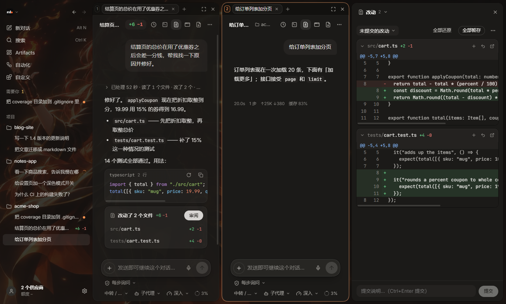

默认界面只有侧栏 · 对话 · 右侧面板，分屏、标签页、分组这些工作台工具用到时才出现：

- <kbd>Ctrl</kbd>+<kbd>D</kbd> 向右分屏，<kbd>Ctrl</kbd>+<kbd>Shift</kbd>+<kbd>D</kbd> 向下分屏，最多 6 个分屏；分屏后每个分屏顶上出现标签条，关到只剩一个又收起来；
- 从左侧栏把对话**拖到**分屏边缘，就在那一侧打开；
- 点对话里的文件路径会在编辑器标签里打开（Monaco，自动保存，<kbd>Ctrl</kbd>+<kbd>S</kbd> 手动保存）；
- <kbd>Ctrl</kbd>+<kbd>T</kbd> 新建分组，一个分组就是一套独立的分屏布局，适合按任务分开；<kbd>Ctrl</kbd>+<kbd>Alt</kbd>+<kbd>1</kbd>–<kbd>9</kbd> 跳到某个分组；
- <kbd>Ctrl</kbd>+<kbd>Shift</kbd>+<kbd>Enter</kbd> 把当前分屏放大，再按一次还原；
- 想让标签条、分组栏和右侧的面板图标栏一直显示：**设置 → 通知与窗口 → 显示工作台工具**。

### 6. 接入第三方 API / 中转

**最快的方法**：设置 → 模型 → 来源 → **快速添加**（首次打开时的「接一个模型」也是它）。选来源（中转站 / DeepSeek / Kimi / 智谱 / 通义 / 硅基流动 / OpenRouter / Gemini），中转站再填个地址，粘上 API Key，点 **连接**。模型列表和接口格式会自动读出来，测试通过才保存；Key 不对、余额不足、地址不对都会直接说明。

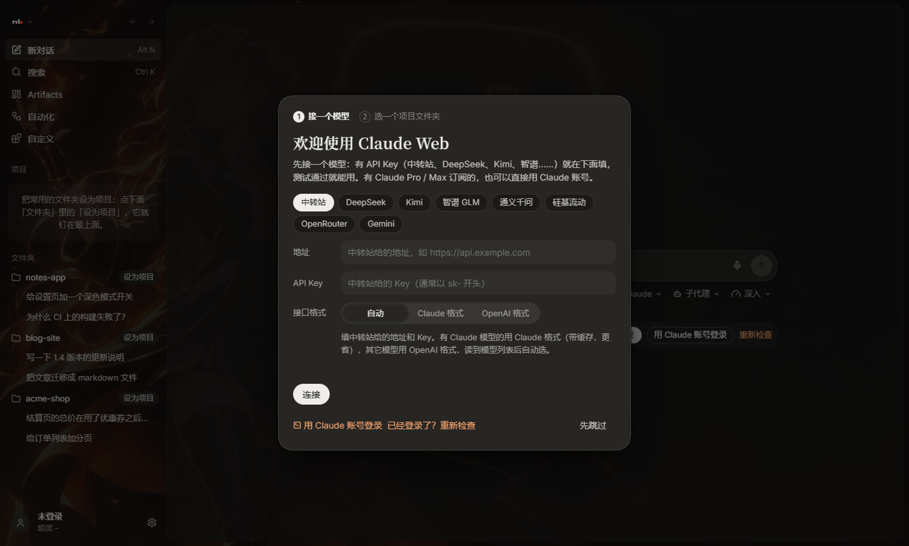

需要更多选项（指定模型映射、运行方式、缓存设置）时用完整表单：

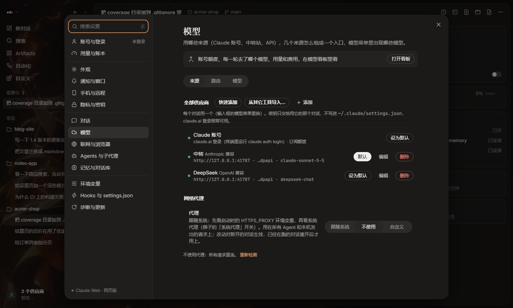

设置（<kbd>Ctrl</kbd>+<kbd>,</kbd>，或侧栏最下面的账号菜单）是一个弹窗，四组 14 页：账号与登录、用量与账本 · 外观、通知与窗口、手机与远程、隐私与密钥 · 对话、模型、联网与浏览器、Agents 与子代理、记忆与对话库 · 环境变量、Hooks 与 settings.json、诊断与更新。顶上的搜索框能搜到任何一项设置。手机上它是单独的一整页。「模型」有三个标签：**来源**（Claude 账号、供应商和中转、网络代理）、**路由**（本机模型网关，见 [11](#11-模型网关多账号故障转移--协议转换)）和 **模型**（模型菜单里列哪些模型）；页顶的「打开看板」打开完整的模型看板（账号额度、每一轮去了哪个模型、用量和费用）。

1. 打开 **设置**（<kbd>Ctrl</kbd>+<kbd>,</kbd>）→ **模型** → **来源** → **＋ 添加**；
2. 选类型（Anthropic 兼容 / OpenAI / Gemini …），填 **Base URL** 和 **API Key**，可选指定模型；
3. 点 **测试连接**：会先拉模型列表，再真实跑一轮对话。如果中转只放行官方 Claude Code 客户端，它会自动让这个供应商改用官方 Claude Code 运行；
4. 回到输入框，点模型芯片，在菜单里选这个供应商的某个模型（芯片显示为 `供应商 / 模型`）。对话进行中也可以切，历史保留。

密钥只注入到该对话自己的进程，不会写进 `~/.claude/settings.json`；本地保存时加密（Windows 用 DPAPI，macOS 用钥匙串）。

**多个中转 / 账号一起用**：模型芯片是一个统一菜单，所有供应商的所有模型摊平成 `供应商 / 模型` 一列（官方账号的模型直接显示名字，如 `Fable 5.1`），选一项就同时切换供应商和模型：

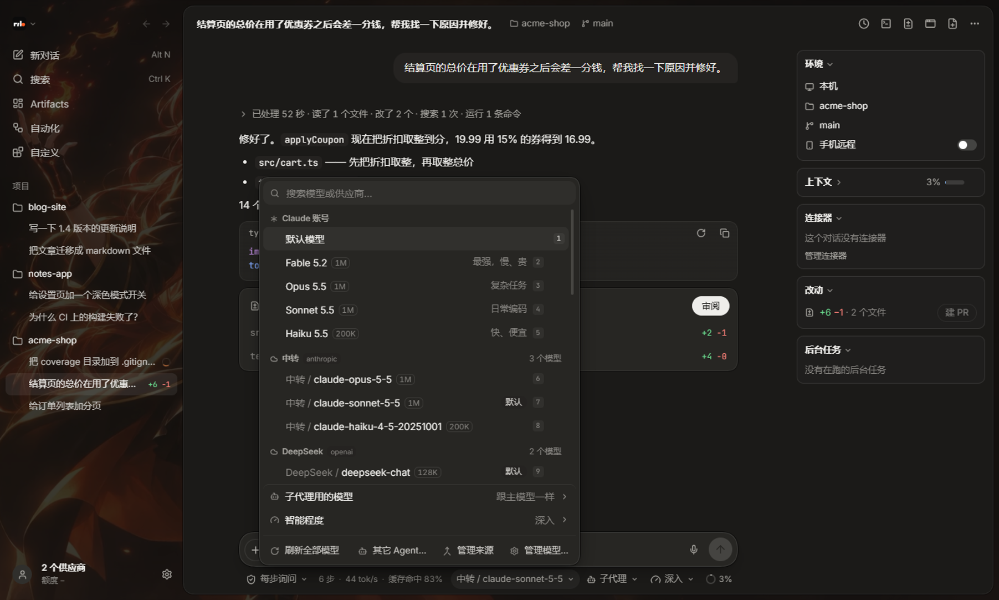

- 顶上的搜索框按供应商名或模型名过滤，<kbd>↑</kbd> <kbd>↓</kbd> 选择、<kbd>Enter</kbd> 确认、<kbd>Esc</kbd> 关闭；
- 行尾的星标收藏，收藏的模型置顶；最近用过的 5 个单独一节；
- 每个供应商一节，节头显示模型数和上次拉取时间，拉取失败时显示错误；其它 agent（Codex、Gemini …）也各是一节；
- 靠下的「子代理用的模型 ›」「智能程度 ›」打开那两个菜单（它们也是模型旁边的两个按钮）；
- 底部「刷新全部模型」对每个供应商请求一次 `/v1/models`（只列模型，不跑对话、不花 token），启动后也会在后台刷新超过 24 小时的列表；「管理来源」打开 **设置 → 模型 → 来源**，「管理模型…」打开它的 **模型** 标签；
- 菜单只列当前 agent 能用的供应商：Claude Code 全部类型都行，Codex 和其它 ACP agent 用 OpenAI 兼容 / 模型网关，Gemini CLI 用 Gemini / 模型网关；
- 对话里选同一供应商的模型直接切模型；选别的供应商会无感重启对话进程（历史保留）并直接用选中的模型；选另一个 agent 的模型就是把对话交给它继续。其它机器上的对话只能换模型；
- 在大窗口的模型上聊了很多，再换到小窗口的模型时，如果对话已经超过新模型窗口的 80%，会先用现在的模型把对话压缩好再换过去，对话里写一行说明。

**给子代理单独选模型**：框下面那一行模型旁边的 **子代理** 按钮（或者模型菜单靠下的「子代理用的模型 ›」），打开的是同一种模型菜单，最上面一行「跟主模型一样」，哪个供应商的模型都能选。主任务继续用主模型，子代理（Task、工作流派出去的）用你选的，比如主任务用 Sonnet、子代理用 Haiku，额度能省不少。打开菜单底下的「新对话都这样」，以后新开的对话（包括 IM 机器人和定时任务）的子代理都用它，不管主对话用哪个供应商。正在跑的对话改了以后，会在这一轮跑完时无感重启一下再换，已经派出去的子代理不受影响。

**同时用几个 Claude 账号**：**设置 → 账号与登录 → 其它 Claude 账号**，点 **添加账号**。会开一个终端运行 `claude setup-token`，浏览器里登录要添加的那个账号（当前浏览器登着别的账号就先退出，或者用无痕窗口）并授权，终端最后打出来的令牌会自动填进去。起个名字保存（保存时会发一条很短的消息测试）。之后模型菜单里每个账号一组（「工作号 / Opus 5.5」），每个对话可以用不同的账号；一个额度用完了，选另一个账号的模型，对话接着聊。账号可以设成新对话的默认，IM 机器人和定时任务也能用。`~/.claude` 里原来的登录照常是「Claude 账号」。

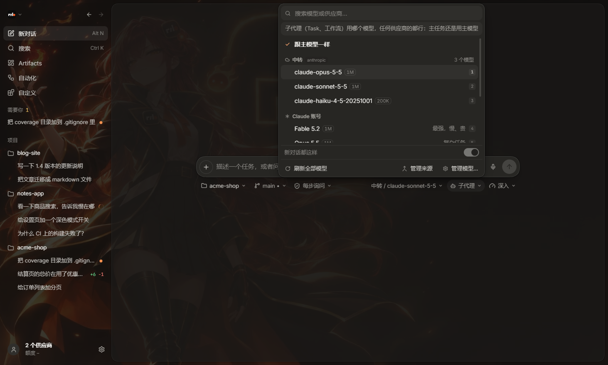

**每个模型的上下文窗口**：**设置 → 模型 → 来源 → 编辑** 里的「上下文窗口」每个模型一行，空着就用默认（中转上的 Claude 是 100 万，Haiku 20 万，GPT 27.2 万，Gemini 约 105 万，中转的模型列表里写了大小的按它写的，不认识的模型 20 万），想改直接填（`272000`、`272k`、`1m` 都行）。自动压缩和输入框旁边的上下文小环都按这个数来。

**设置 → 模型** 的 **模型** 标签有两种视图：「按模型」是一张表，每个模型一行，列出提供它的供应商（点供应商芯片可把它设为该供应商的默认模型）、收藏星标和显示开关；「按供应商」是分组视图。顶部是每个供应商的拉取状态和单独刷新按钮。

### 7. 同时管理多个对话

侧栏顶上五个入口下面的 **需要你**，列出所有在等你确认权限、回答问题或审批编排的对话，点一下就过去。每一行对话的末尾只写它的状态：等你的是橙点，出错是红点，运行中是转圈，或者 +N −M 表示改了多少行（最后更新的时间在这一行的提示里）。

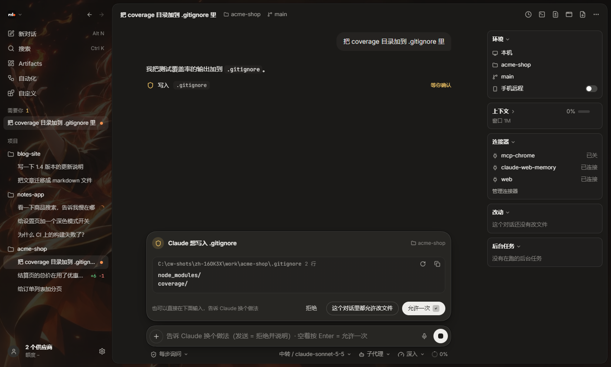

各个对话在后台跑的东西（子代理、工作流、后台命令）在 **自动化 › 运行中** 里看，见 [15](#15-运行中看子代理在网吧里干活)。

列表本身：

- 鼠标停在项目标题上会出现 **显示** 和 **＋**（在这个项目里新建对话）。「显示」有六行：分组方式 ›（文件夹、项目、日期、不分组）、排序 ›（最近更新、创建时间、名称）、显示 ›（已归档的对话、其它 Agent 的对话、每组几条、来源 ›、机器 ›）、新建分区、恢复默认、查看全部；
- 右键项目标题是项目菜单（手机上长按）：在这里新建对话或在独立副本里新建、在这里开终端、移到最上面 / 上移 / 下移、项目页…、重命名、在资源管理器 / VS Code 打开、从侧栏移除；
- 分叉出来的对话缩进一层，挂在它来自的那个对话下面；超过三个时收在行首的箭头后面；
- 要一次处理几个对话：按住 Shift 点，或者在行菜单（右键，或者悬停时行尾的 ···；手机上长按）里点 **选择**；
- 在侧栏里按 <kbd>/</kbd> 就地筛选列表；<kbd>Ctrl</kbd>+<kbd>K</kbd> 什么都能搜。

以前的总览（Mission Control）还在，想用的话：<kbd>Ctrl</kbd>+<kbd>Shift</kbd>+<kbd>M</kbd>，或命令面板里的「总览」，在右侧面板打开它（所有打开的对话按 需要你 / 运行中 / 出错 / 空闲 分列，权限请求可以直接在卡片上批准）。

桌面版在窗口不在前台时，对话完成或需要审批会弹系统通知，任务栏 / Dock 图标显示待处理数量。

### 8. 用手机访问

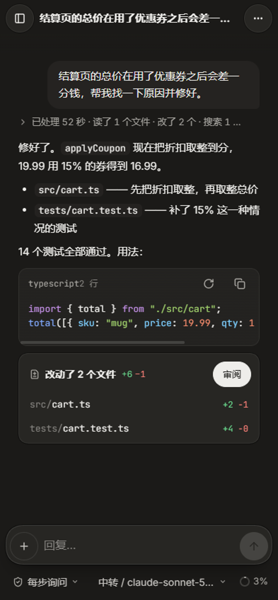

1. 电脑上打开 **设置 → 手机与远程**，打开「局域网 / 手机访问」（默认端口 3091）；
2. 点 **生成配对码**，会显示一个 6 位码和二维码（10 分钟内有效）；
3. 手机连同一个 Wi-Fi，扫码打开页面，输入配对码；
4. 配对后这台手机就记住了，可以添加到主屏幕当 App 用。已配对设备可以在同一页改名或吊销。

手机上对话头只有 ☰ · 标题 · ⋯。☰ 打开侧栏抽屉（最上面是搜索框）。⋯ 打开一张单子：六宫格面板（改动 · 任务 · 终端 · 文件 · 浏览器 · Artifacts），加上重命名、分叉、导出…、查看模式 ›、更多 ›；面板从底部拉起（拉到顶就是全屏）。长按一条消息，可以复制、编辑、重跑、分叉或朗读。新对话页的项目单里也能选分支。手机上不显示键盘提示。

**在外面也能用**：同一页的「在外面也能用」打开后（远程访问打开时默认开），二维码默认是「在哪都能用」的那张。手机扫码打开一个网页（手机页面），配对一次，以后手机用流量、在别的 Wi-Fi 下也能连上这台电脑，不用装 App、不用注册：

- 两边经公共的牵线服务器（MQTT）找到对方，消息都加密；能直连就直连，打不通（手机流量下常见）就改走慢速转发：文字、审批都能用，文件预览和上传不能用，手机上会写明。
- 电脑得开着、Claude Web 得在运行。桌面版默认「不让电脑睡眠」，笔记本合盖照样会睡。
- iPhone 想从主屏幕图标用：先在 Safari 里「添加到主屏幕」，再从主屏幕图标打开配对（主屏幕和 Safari 的存储是分开的）；也可以在电脑上点「复制配对链接」，粘贴到手机页面的「粘贴配对链接」。
- 原来的局域网二维码还在（「只在局域网（不用联网）」），没联网时照样用。

风险见下面「安全与隐私」。也可以配置 Telegram / 飞书等机器人（**设置 → 手机与远程** 里的机器人那一块），在聊天软件里收通知、审批、发指令；连另一台机器上的 Claude Web 可以用 SSH 隧道（同一页的「更多选项」）。

<br clear="right">

### 9. 其它 CLI Agent（Codex / Gemini …）

**设置 → Agents 与子代理 → 其它 Agent** 里能看到 Codex、Gemini、Qwen、Kimi 等是否已安装和登录，一键打开终端完成安装 / 登录。之后在模型菜单里选它们的模型即可（每个 agent 一节），对话、工具卡片、权限审批都和 Claude 一样。对话进行中也能把它**交接**给另一个 agent（对话头的 ⋯ →「交给其它 Agent…」），已完成的内容会整理成摘要带过去。

### 10. 本机其它 agent 的对话

如果你在这台电脑上也用过 Codex、OpenCode 等 CLI（或它们的桌面版 / 插件），Claude Web 可以把它们自己的对话记录也放进侧栏，和 Claude 的对话一起浏览、搜索、续聊。

**加入是可选的。** 启动时只做轻量检测（是否安装、数据目录是否存在），不会启动任何进程，也不会读你的记录。检测到后侧栏底部、账号行上面会出一行「把 Codex 里的对话也列在这里？」（第一屏不出：等这台电脑上有了对话才出现）：

- 点**列出来**：才开始读取这个 agent 的对话列表、建立全文索引；
- 点 **×**（以后再说）：不再提示；
- 随时可以在 **设置 → 记忆与对话库** 里加入或移出。**移出**只是不在这里显示，不会删除 agent 自己的任何记录。

加入之后能做的事：

| 操作 | 说明 |
| --- | --- |
| 浏览 / 续聊 | 点开就能看到完整历史和工具卡片；直接发消息就是在**原来的对话**里继续，新的一轮也写回 agent 自己的记录，回到命令行里照样能接着用 |
| 搜索 | <kbd>Ctrl+K</kbd> 全文搜索所有来源（中文也可以）；`agent:codex` 只搜某个 agent，`in:<目录片段>` 按工作目录过滤 |
| 筛选 | 项目标题上的 **显示**：显示 › 来源 ›（或机器 ›）筛选，显示 › 已归档的对话 把归档的也列出来；按住 Shift 点，或者行菜单里的「选择」，可以选多个 |
| 重命名 / 归档 / 删除 / 分叉 | 右键对话（或悬停时行尾的 ···；手机上长按）。只提供 agent 官方接口支持的操作：Codex 全都支持；OpenCode 只能删除；其它 agent 只读 |
| 子任务 | 子代理、分叉出来的对话缩进一层，挂在根对话下面（超过三个时收在行首的箭头后面） |
| 引用 / 交给其它 agent | 右键「引用到输入框」把另一个对话的内容带进当前对话；「交给其它 Agent 继续」用另一个 agent 接着做 |

**删除之前会先备份**：完整历史导出到 `~/.claude-web/library-trash/<对话 id>.json`，备份写成功才会真正删除，备份保留 30 天。删除有二次确认；批量操作默认是归档而不是删除。

对话 id 的规则：Claude 的对话保持原 UUID，其它来源是 `<agent>-<原生 id>`，例如 `codex-01a0…`、`opencode-ses_…`。

### 11. 模型网关（多账号故障转移 / 协议转换）

本机的一个 HTTP 网关：对 agent 同时提供 **Anthropic**、**OpenAI**（Chat Completions 与 Codex 用的 Responses）和 **Gemini** 三种接口，后面接你添加的供应商和账号。用途：

- **多账号自动切换**：同一个中转的主号、备用号放进一个组，主号限流（429）、额度用尽、报 5xx 或连不上时自动换下一个；限流的号按 `retry-after` 冷却到重置时间，没有提示就从 60 秒开始翻倍（最长 30 分钟）；密钥失效（401/403）的号停用，修好后点「恢复」。
- **协议转换**：让 Codex 用 Claude、让 Claude Code 用 OpenAI 兼容的模型等。支持的方向：Anthropic 入 → OpenAI / Gemini 出，OpenAI 入 → Anthropic / Gemini 出，Codex（Responses）入 → Anthropic 出，Gemini 入 → Anthropic 出；同协议则原样透传（中转的客户端指纹检查照样通过）。
- **Claude 订阅账号**：添加 `sk-ant-oat…` 令牌或 Claude Code 的 OAuth JSON，请求会按 Claude Code 的形状发（Bearer + OAuth beta + Claude Code 系统前缀）。账号行上能看到健康、额度、冷却、单独的代理和每天请求上限。
- **Gemini 网页 / WorkBuddy 账号**：Gemini 可以粘贴 cookie（每行一个，支持批量），WorkBuddy 可以粘贴 cockpit JSON 或扫码登录。两个家族各自在本机跑一个固定版本的 MIT sidecar —— 第一次用时下载并校验 SHA256（安装包里带了就直接用）—— 自动监督、健康检查和重启。它们的模型会出现在 `/v1/models`，账号池也能作为网关成员，和 Claude 账号、供应商一起故障转移。
- **「每日任务」管理账号日常**（在来源的详情里）：签到、保活、成长任务、猫咪旅行、抽奖、活动、刷新额度和账号检查，按 cron 或间隔执行，可立即执行并查看历史；错过的会在 7 天内补跑一次。

使用步骤：

1. **设置 → 模型 → 路由**，打开「启用本机模型网关」（首次启用会生成网关密钥）。地址（`…/v1`）和密钥（带「复制」，给别的应用用）就在这里。
2. 账号在模型看板里加（同一个标签上的「打开上游」，或「设置 → 模型」页顶的「打开看板」）：**添加来源** → 登录账号（Claude 订阅账号、Gemini cookie 或 WorkBuddy 登录）或填写 API 地址。每个来源是一张卡片，点开看它的账号、每日任务和诊断。新账号会自动进默认组，不用先建池子、组和密钥。
3. **设置 → 模型 → 来源** 新建一个供应商，类型选「模型网关」并选组。之后新对话（Claude、Codex、Gemini 等都可以）在模型菜单里选它的模型即可，地址和密钥在开对话时自动注入。
4. 需要多账号策略、对外分享或局域网时，看板里都有：账号池和故障转移顺序、「智能路由」卡片（分组与路由）、「共享」抽屉（密钥和密钥组、局域网监听）和活动记录。「测试」会发一条最小请求并显示实际走了哪个成员。

说明：

- 网关默认只接受本机回环连接；可选的局域网监听器只对「密钥组允许局域网 + IP 在白名单里」的密钥开放 `/v1` 和 `/v1beta`。密钥落盘是哈希、界面上是掩码，只在「复制」时取出明文，不出现在日志里。
- **密钥组**可以限制能用哪些组、哪些模型（glob 允许 / 拒绝）、来源 IP、RPM、并发和每天 token 预算。
- 流式回复一旦开始向 agent 输出就不会再切换成员（半路出错如实报错）。
- Codex、Gemini CLI 即使登录了自己的账号，用网关开的对话也会强制走网关（不改它们自己的配置文件）；Qwen Code 等其它 ACP agent 只注入环境变量，在 OAuth 登录状态下可能仍走自己的账号。
- 「测试」按钮发的请求不带 Claude Code 指纹：只认官方客户端的中转可能拒绝测试，但真实的对话能通过。
- 重新生成网关密钥后，运行中的对话需要重开。
- 每次请求在账本里记一行（侧栏底部账号行 → **用量与账本** → 账本，「来源」选「网关」可单独看），包括实际成员、切换次数、首字节延迟和 token；看板里的请求记录每行只有 12 个字段，不含正文和密钥。
- **订阅登录只有你在这里添加时才会用**：应用不会偷偷读取本机 Claude Code / ChatGPT / Google 客户端的登录状态；Claude 账号是显式添加的，Gemini 网页的登录只存在它自己的 sidecar 里。
- 网关本身不走系统代理（`HTTPS_PROXY`）；Claude 账号可以单独配 `http(s)://` 或 `socks5://` 代理，需要代理才能访问的中转请改用可达的地址 / 私有网络。

### 12. 其它 agent 的配置（MCP / 说明文件 / 模型）

**设置 → Agents 与子代理 → 其它 Agent**，在 Codex、Gemini、Qwen、OpenCode 的卡片上点**配置文件**：

| 区块 | 能做什么 |
| --- | --- |
| 说明文件 | 全局与当前工作区的 `AGENTS.md` / `GEMINI.md` / `QWEN.md` 以及配置文件本身，点「打开」在编辑器标签里改；不存在的一键创建 |
| MCP 服务器 | 列出、添加（可从常用目录填入）、删除。Codex / Gemini / Qwen 走它们自己的 `mcp add / remove` 命令（用户级），OpenCode 没有非交互命令，直接改 `opencode.json` 的 `mcp` 键 |
| 同步到多个 agent | 来源选 Claude Code 里已配置的 MCP 服务器或常用目录里的条目，勾选要同步到的 agent，逐个报告成功 / 失败原因；同名默认不覆盖，勾「覆盖同名」才替换 |
| 设置 | 只开放实测存在的键：Codex 的模型 / 推理强度 / 审批策略 / 沙箱，Gemini 的模型 / 默认审批模式，Qwen 与 OpenCode 的模型。改完立即写入，只改这一个键，注释和其它内容保持原样 |
| 备份 | 每次写入前都会把原文件备份到 `~/.claude-web/config-backups/<agent>/`，这里可以一键恢复 |

列表里 env / header 的值一律显示为 `••••••`；从 Claude 同步时，密钥由服务端直接读原配置写过去，不经过浏览器。Codex 只支持 stdio 与 HTTP（不支持 SSE），自定义 header 会在 `codex mcp add` 之后写进 `[mcp_servers.<名字>.http_headers]`。

### 13. 其它机器上的对话

家里、办公室、服务器上各跑着一个 Claude Web 时，可以在任意一台的侧栏里看到**所有机器**的对话（带机器名），直接打开、续聊、审批权限、中断；也可以把另一台机器上的对话交给本机的 Agent 继续。

**加入一台机器**（设置 → 手机与远程 → 其它机器 → 加入一台机器），两种方式：

1. **地址 + 配对码**（同一局域网或任何能直连的地址）：在**那台**机器上打开「局域网 / 手机访问」并点「生成配对码」，然后在**这台**填它显示的地址（如 `http://192.168.1.20:3091`）和 6 位码。这台机器会代为配对，拿到一个设备令牌（加密保存，界面上不显示）。
2. **SSH 主机**：先在同一页「更多选项」里的 SSH 隧道添加主机并填好远端令牌，然后在「其它机器」里选它。连接走 SSH 隧道，隧道断了会自动重开。

加入之后：

| 在哪 | 看到什么 |
| --- | --- |
| 侧栏 | 其它机器的对话在「其它电脑」一节里按机器分组；「显示」菜单里多一项 显示 › 机器 ›，按机器筛选（「所有机器 / 本机 / 办公室台式机 …」） |
| 对话 | 打开、发消息、审批、中断、改名、归档、删除都在那台机器上执行；对话头的工具只有任务和浏览器，文件 / Git / 搜索请在那台机器上看 |
| 对话菜单 | 对话头 ⋯ 里的「交给本机的 Agent 继续…」：读那台机器上的完整历史，在**本机**新建一个对话并带上交接说明（问你本机的工作目录，因为那台机器的路径在这里多半不存在）；原对话不变 |
| 总览（<kbd>Ctrl</kbd>+<kbd>Shift</kbd>+<kbd>M</kbd>） | 「其它机器上运行中」一栏，点开就能接管 |
| 离线 | 那台机器关机 / 断网时，它的对话显示上次的列表并置灰（只读），本机的列表不受影响；恢复后自动重连 |

在「其它机器」列表里可以看状态（在线 / 离线 / 令牌失效）、延迟、对话数，改名、停用、移除。那台机器在「已配对设备」里吊销了本机后，这里会显示「令牌失效」，点「重新配对」填一个新配对码即可，对话 id 不变。

说明：连接是本机主动发起的；本机对外只多了一处：`/api/health` 会多返回一个服务器 id 的哈希（用来识别「加的是不是自己」），不含令牌或对话内容。两台机器可以互相加入，但不做多跳（A 看不到 B 加入的 C）。附件（文件 / 文件夹）存在本机，发给另一台机器上的对话时对方读不到，请直接粘贴内容。

### 14. 自动化：定时任务、Bot、目标、多 agent 编排

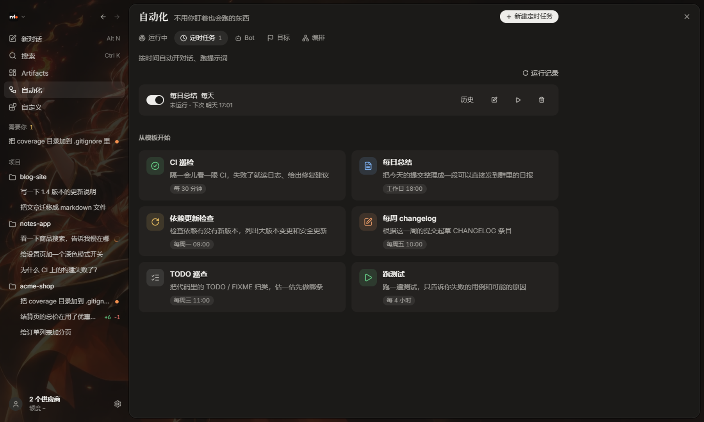

侧栏的 **自动化** 打开一页，五个标签（盖在对话上，点侧栏里的对话或按 <kbd>Esc</kbd> 回去）。打开时停在你上次用的那个标签；侧栏「自动化」上的数字是那里等你处理的（Bot 收件箱、等你审批的编排）：

- **运行中**：所有对话在跑的子代理、工作流、后台命令，见 [15](#15-运行中看子代理在网吧里干活)；
- **定时任务**：按 cron 或间隔自动开对话、发提示词（「工作日 09:00」这样显示）；右上角「新建定时任务」，或从下面的模板开始；「运行记录」看每次的结果和它的对话；
- **Bot**：住在你电脑里的值班队友，有一个收件箱放它们带给你的东西；它们的设置（同时运行几个、每天的预算、默认来源、不开窗口也值班…）在 Bot 列表标题旁的 ⚙ 里；
- **目标**：给一句话目标，让它一轮接一轮做下去，直到完成或卡住（输入框里 `/goal <目标>` 也行）；对话头下面会出现「目标：… · 第 N 轮」细条；
- **编排**：见下。

**多 agent 编排**：把一件事拆成几步，每一步交给你选的 agent（Claude / Codex / Gemini / OpenCode / 任意 ACP agent），没有依赖关系的步骤并行跑，关键节点停下来等你审批。在自动化页的 **编排** 标签里（也可以在右侧面板左上角下拉的「更多面板」里打开，或命令面板里的「新建编排」「运行编排…」）。

1. **建一个工作流**：点 + 新建，或从模板开始（「计划 → 实现 → 审查」「三方比选」「修 bug + 测试」）。每个节点有三种：
   - **任务**：选 agent、权限、工作区（共享工作目录，或独立 git worktree，完成后自动合并回来），勾「一直做到完成」就按目标协议一轮轮推进直到 agent 报告完成；
   - **比选**：同一个提示词分给几个 agent，各自在自己的 worktree 里做，可以再指定一个「裁判」agent 先给推荐；
   - **审批**：停下来等你通过或驳回（可以写意见）。
   选好依赖关系，上方的执行图会实时预览。提示词里可以用 `{{input}}`（运行时填的输入）、`{{nodes.<id>.output}}`（上游节点的最后回复）、`{{nodes.<id>.approval}}`（审批意见），点提示词下方的变量就能插入。
2. **运行**：点 ▶，填这次的输入。每个任务节点都是一个普通对话，侧栏、权限审批里照常出现，随时可以点进去插话或中断。
3. **等你的时候**：审批和比选完成时，节点会变成黄色，侧栏的「需要你」（还有「自动化」上的数字）和桌面通知都会提醒；如果某个 IM 聊天绑定了这次运行里的某个对话，那个聊天也会收到提醒，审批可以直接点「通过 / 驳回」（其它聊天不会收到，也不能审批）。
4. **比选**：几个候选并排显示回复、改动统计和完整 diff，点「选它合并」后，先把胜者 worktree 里新的改动提交，再用 `merge --no-ff` 合并到运行开始时的分支。**编排不会毁掉你的东西**：你手上有进行中的 merge / rebase、或者暂存区有改动时会直接拒绝；合并冲突只撤销它自己的这次合并；合并没成功时节点回到「等你选」，所有 worktree 和分支原样保留。合并成功后，只删除没有未提交改动的 worktree、以及没被人动过的落选分支，有改动的都保留并在节点上列出来。
5. **失败 / 重启**：失败的节点可以单独「重试」，被跳过的下游会一起重来；重试用新的 worktree（名字带 `-attempt2` 等后缀），旧的都保留。服务重启时正在跑的运行会标记为「服务重启中断」，点「续跑」从没完成的节点接着做（已完成的输出保留）。删除运行记录时可以选择「同时清理 worktree 与分支」：只删干净、已合并的，其余列出来给你。

worktree 放在仓库外面的 `~/.claude-web/worktrees/<仓库名>-<hash>/`（不会被你的测试、构建扫到，也不出现在 git status 里），分支名 `cw/<运行 id>/<节点>-<agent>`。同时运行的节点数在 **设置 → 对话 → 更多选项 → 编排并发上限** 里调（默认 3）。

### 15. 运行中：看子代理在网吧里干活

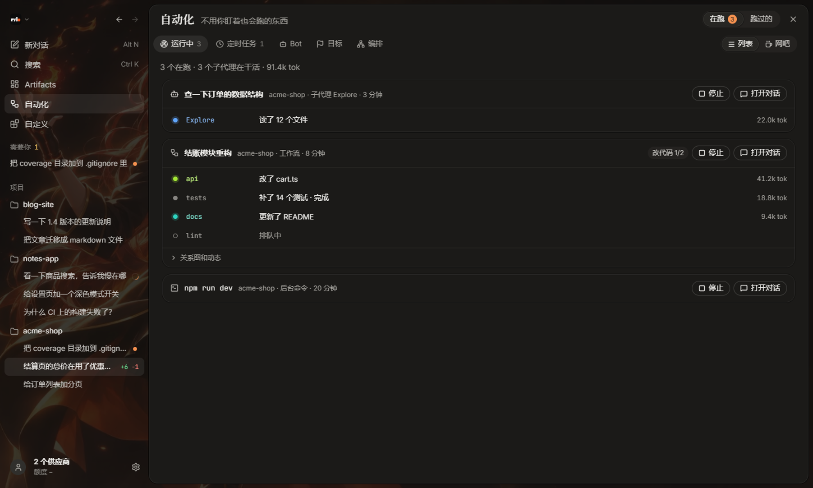

对话派出子代理、跑工作流（模型旁边的「智能程度」里打开「深度编排」后，大一点的任务会自己写工作流分给几个子代理）、开后台命令时，输入框上方会出现一个「后台 · 1 个工作流 · 2 个在跑」的小胶囊，点它打开这个对话的 **自动化 › 运行中**。标签下面一行是总数（「3 个在跑 · 3 个子代理在干活 · 91.4k tok」这样），标签行右端的开关切换两种看法（会记住你的选择）：

- **列表**：对话跑的每一样东西一组：一个工作流（每个子代理一行：在做什么、用了多少 token）、一个单独的子代理、一条后台命令。每一组都有「停止」和「打开对话」，工作流的「关系图和动态」展开是它的节点图和动态。点子代理那一行，旁边打开它自己的对话：它读了什么、跑了什么命令、改了什么。
- **网吧**：同样的东西放进一间 3D 网吧。每个有后台任务的对话是一个区（一排电脑），它的主对话是前台后面的**网管**，每个子代理是一位**客人**：
  - 新来的客人从门口走进来，坐到一台电脑前；干活时屏幕上滚代码，头顶冒着点；
  - 一阵子没动静，就去沙发、窗边或者零食架那边转转，一有活马上回座位；
  - 等你处理的客人举手、头顶一个「!」，卡住的屏幕蓝屏；
  - 做完走到前台**结账**（弹一张小票，写着大概花了多少钱），然后出门；
  - 后台命令在旁边的玻璃包间里跑。

  拖动旋转、右键拖动平移、滚轮缩放；左边列着各区，右上角是白天 / 夜里和角色库。点一位客人看它的卡片：状态、用时、费用、工具调用、最近几步，还有「打开对话」和「停止」。
- **跑过的**（页面右上角的「在跑 / 跑过的」）：所有对话跑完的工作流、子代理、后台命令，按天列出、能搜；跑完的一次可以在关系图里或网吧里回放。
- **右侧面板**也有一个小网吧（下拉的「更多面板」里的「网吧」），跟着当前对话。
- **停止**：输入框的停止键**只停这一轮**，后台的工作流、子代理、命令继续跑。要停它们，在运行中那一组上、客人的卡片上，或者右侧面板的「任务」里单独停。一轮结束了后台还在跑的对话，闲置回收不会把它关掉；工作流跑完，结果会自己开一轮告诉你。

#### 捏角色

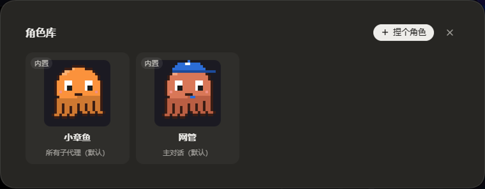

客人默认是小章鱼，网管戴一顶蓝帽子。网吧右上角 **角色库 → 捏个角色**，给一张照片或者说说想要的样子（「戴黑框眼镜、蓝色卫衣的程序员」），Claude 会画一个 24×24 的像素角色，给你看正面、背面、走路、坐下、打字的几帧：


不满意就接着说（「眼睛大一点」「换成红衣服」），满意了存下来，指定给网管、所有客人、某一类子代理（比如 Explore）或者某个名字的子代理。在任何对话里直接说「帮我做个像这张照片的网吧角色」也行：这是一个随应用带的 skill，Claude 和 ccb 两种运行内核都能用。角色存在 `~/.claude-web/characters/`，一个角色一个 JSON 文件。

## 字符画主题

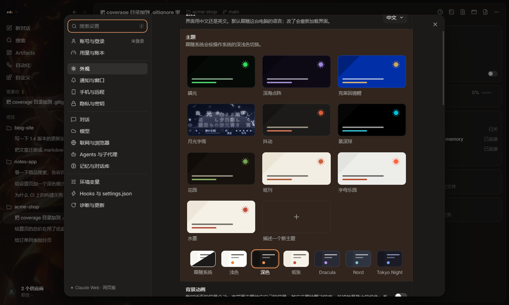

除了经典的几种配色，还有十套**字符画主题**：每套有自己的颜色、一幅会动的 ASCII 字符画背景，和一组表示 Claude 正在做什么的小动画。**设置 → 外观**里一套一张卡片，指针停上去就动起来，点一下换上（侧栏底部的账号菜单里 **主题 › 字符画主题…** 也能到这里）。

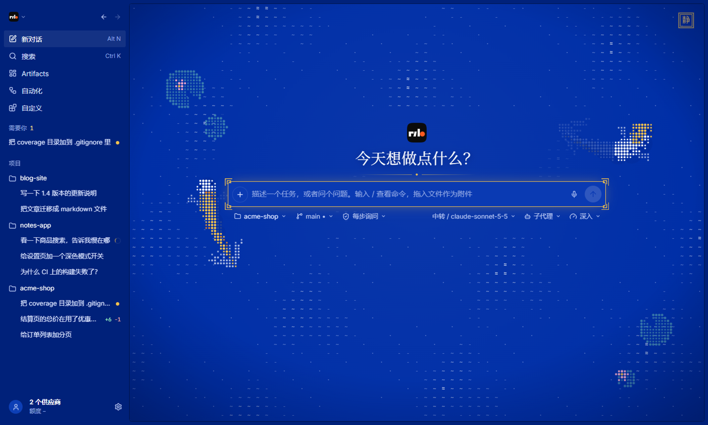

- **十套**：磷光（绿色终端字雨）、深海点阵（深水里的半色调水母）、克莱因锦鲤（蓝池里的锦鲤）、月光字雨、抖动（一颗带环的行星，四种抖动算法轮流画）、景深球（点云和镜头色散）、花园（你的项目长成植物：一个项目文件夹一株，对话越多长得越大）、纸刊、字母乐园、水墨（后三套是亮色）。
- **背景**铺满首页，跟着指针走，对点击和打字有反应，也跟着 Claude 在做的事变化（思考、读文件、派子代理……）。首页上要打开 **设置 → 外观 → 背景动画** 才有（默认关，这时首页是静止的纯色）。对话里它很淡，也可以关掉：**设置 → 外观 → 对话里的淡背景**。系统开了「减少动态效果」时只画一张静止的图。
- **不再是转圈圈**：每一步有自己的动画：改文件是一支笔在写，思考是真的在想，读文件是在翻书，测试一格一格亮起来，git 提交一个个串起来……一共十六种，每套主题画法都不一样。

**描述一下就能做一套自己的。**点 **＋ 描述一个新主题**（或在任何对话里直接说「帮我做一个字符画主题：……」）：Claude 写好主题、先检查（格式、对比度、每个动画），**在你的窗口里试跑一遍**、看过截图再拿给你，不满意就接着说。自己的主题右键有**改一改**和**删除**。主题存在 `~/.claude-web/themes/<id>/`（`theme.json`、`backdrop.js`、`theme.css`）；不是内置的背景在没有网络的沙箱里跑，出错或太慢会被换下（换回默认）。

## 开场动画（桌面版）

桌面版打开时放一段开场（默认每天第一次放；其它时候是 1.6 秒的老开场）。在 **设置 → 外观 → 开场和背景** 里选：

- **内置**：**Claude Web 娘**（默认：约 10 秒的片子，再在黑里点亮标志）、**点火**、**星图**、**字符雨**（画出来的，不用视频，约 4 秒）和 **网吧开门**（3D 的网吧，要 WebGL）。指针停在卡片上会放小样；「试放一次」在你的窗口里放一遍。
- **自己的**：放自己的视频，从文件夹导入动画包（视频，或者在沙箱里离线跑的网页），**从 GitHub 安装**（装之前给你看作者、许可和大小），或者 **让 Claude 做一个**（开一个带 opening-pack skill 的新对话，Claude 每做一版都先在你的窗口里放一遍、看过再拿给你）。
- **放完留作背景**：放完以后开场可以留在应用后面：Claude Web 娘站着的那段循环从首页和空白处透出来（「浓淡」调多少），星图留下慢慢飘的星星，字符雨留下落着的字符，其它的是火星。窗口最小化或切到别的程序时停下。
- 「什么时候放」（每次打开 / 每天第一次 / 不放）、「长度」（完整 / 简短）、「声音」（默认关）也在这一页。网页版不放开场，但背景照样有。

## 界面语言

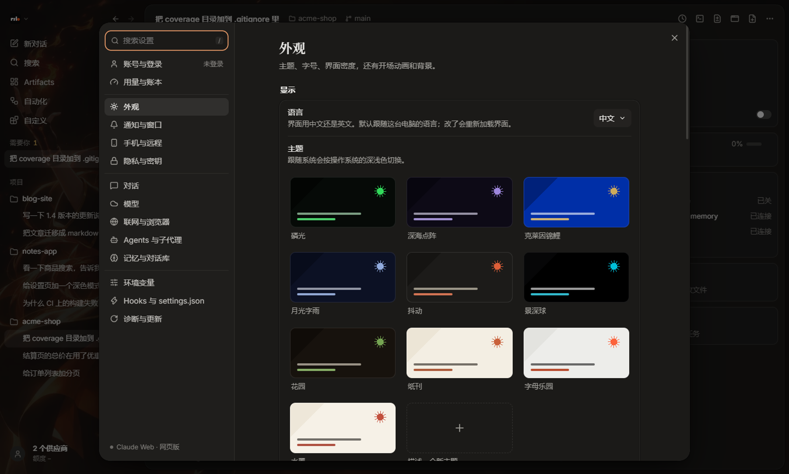

整个界面有**中文**和 **English** 两种，**默认跟着这台电脑的语言**：电脑是英文就是英文，是中文就是中文（其它语言暂时按英文显示）。要换：**设置 → 外观 → 语言**（或侧栏底部账号菜单里的 **语言 ›**），选「跟随系统 / 中文 / English」，界面会重新加载一次。

- 网页版跟着浏览器的语言，桌面版跟着系统语言；选定的语言存在本机（`~/.claude-web/meta.json`），电脑上的所有窗口、手机页面一起换。
- 桌面版的菜单、托盘、更新提示，和服务端的一小部分文字（启动时就定好的），要重启应用才会换。
- 对话里 Claude 的回复用什么语言，由你和模型决定，和界面语言无关；导出的 HTML 跟着导出时的界面语言。

## 自定义样式（custom.css）

在 `~/.claude-web/custom.css` 里写自己的 CSS。它在每个窗口（桌面版、浏览器、手机）里都在内置样式之后加载，保存后立即生效、不用重启，桌面版自动更新也不会覆盖它。**设置 → 外观 → 自定义样式** 里能新建这个文件（里面列好了可以放心用的钩子）、在编辑器里打开，改坏了一键关掉。

这些钩子以后的版本保持不变：`html[data-theme]` 和 `html[lang]`，`.chat[data-state]`（starting / running / waiting / idle / history / closed / error），每份计划上的 `data-done` / `data-total` 和 `--progress`，计划每一项的 `data-status`，右侧面板「任务」里计划的标题行 `.tasks-plan .plan-head` 和它的进度条 `.plan-prog`，以及颜色、圆角的变量（`--accent`、`--ink-1`…`--ink-4`、`--surface-0`…`--surface-3`、`--r-sm` / `--r-md` / `--r-lg`）。比如把计划的进度条加粗、换个颜色：

```css
.tasks-plan .plan-prog { height: 6px; }
.tasks-plan .plan-prog > i { background: var(--accent); }
```

## 快捷键

桌面版的 <kbd>Ctrl</kbd> 在 macOS 上是 <kbd>⌘</kbd>。完整列表按 <kbd>Ctrl</kbd>+<kbd>/</kbd>（或 <kbd>F1</kbd>；网页版也可以按 <kbd>?</kbd>），或在账号菜单里点「键盘快捷键」查看。

| 操作 | 桌面版 | 网页版 |
| --- | --- | --- |
| 新对话 | Ctrl+N | Alt+N |
| 命令面板 / 全文搜索 | Ctrl+K | Ctrl+K |
| 设置 | Ctrl+, | Ctrl+, |
| 发送 / 换行 | Enter / Shift+Enter | Enter / Shift+Enter |
| 中断当前轮 | Esc | Esc |
| 在对话中查找 | Ctrl+F | Ctrl+F |
| 侧栏 | Ctrl+B | Ctrl+B |
| 向右 / 向下分屏 | Ctrl+D / Ctrl+Shift+D | 同左 |
| 关闭标签 | Ctrl+W | Alt+W |
| 新分组 | Ctrl+T | Alt+T |
| 切换分组 | Ctrl+Tab | Alt+PageDown |
| 跳到分组 1–9 | Ctrl+Alt+1–9 | Ctrl+Alt+1–9 |
| 放大 / 还原分屏 | Ctrl+Shift+Enter | 同左 |
| 放大 / 缩小 / 还原整个界面 | Ctrl+= / Ctrl+- / Ctrl+0（会记住；设置 → 外观 → 界面缩放） | 浏览器自己的缩放 |
| 右侧面板：显示 / 隐藏 | Ctrl+J | Ctrl+J |
| 右侧面板：任务 · 终端 · 改动 · 浏览器 · 文件 | Ctrl+1–5（Ctrl+Shift+1–5 也行） | Ctrl+Shift+1–5 |
| 终端 | Ctrl+` | Ctrl+` |
| 对话信息栏 | Ctrl+I | Ctrl+I |
| 对话 / 步骤视图 | Alt+J | Alt+J |
| 总览（Mission Control） | Ctrl+Shift+M | Ctrl+Shift+M |

## 数据存在哪里

| 位置 | 内容 |
| --- | --- |
| `~/.claude/` | Claude Code 自己的数据：登录状态、设置、对话记录（与命令行共用） |
| `~/.claude-web/` | 本应用的数据：项目列表、置顶 / 归档、供应商（密钥加密）、草稿、定时任务、用量账本、附件、共享记忆库、对话库索引（`library.db`）与删除备份（`library-trash/`）、编排工作流（`meta.json`）、网吧角色（`characters/`）、运行记录（`orchestra/`）与 worktree（`worktrees/`）、其它 agent 配置文件的备份（`config-backups/`）、模型网关与其它机器的设置（`meta.json`，密钥加密） |
| 桌面版日志 | Windows：`%APPDATA%\claude-web\`；macOS：`~/Library/Application Support/claude-web/`（`server.log`、`main.log`） |

**设置 → 诊断与更新**（或账号菜单里的 **帮助与反馈 › 导出诊断包…**）可以一键打包日志和脱敏后的配置，方便排查问题。

## 常见问题

**macOS 提示「已损坏，无法打开」**
没有 Apple 签名导致的，执行 `xattr -cr "/Applications/Claude Web.app"` 后再打开。

**提示未登录 / 发消息没反应**
首页的提示里点 **用 Claude 账号登录**（或按 <kbd>Ctrl</kbd>+<kbd>`</kbd> 打开终端，输入 `/login`）；**设置 → 账号与登录** 能看到登录状态，「更多选项」里是运行内核的版本和 doctor，看具体报错。

**中转报「客户端版本过低」或「请求可能被第三方中转改写」**
在 **设置 → 模型 → 来源** 里点这个供应商的「编辑」，再点「测试连接」，它会自动改用官方 Claude Code 运行。版本过低时更新到最新版本的 Claude Web 即可（内置的 Claude Code 跟着版本升级）。

**macOS 上找不到 git / gh / codex 等命令**
应用启动时会读取登录 shell（zsh / bash）的 PATH。如果命令装在不常见的位置，把它加进 `~/.zshrc` 的 PATH，然后重启应用。

**界面语言不是我想要的**
**设置 → 外观 → 语言** 里选「中文」或 English（默认是「跟随系统」）。桌面版的菜单和托盘要重启应用才会换。

**窗口黑屏 / 闪烁**
显卡驱动问题。**设置 → 通知与窗口 → 更多选项 → 软件渲染（桌面版）** 打开后重启；连续崩溃两次时应用也会自动切换。

**自动更新**
桌面版启动后和每 4 小时会到本仓库的 GitHub Releases 检查一次新版本（在 **设置 → 诊断与更新** 里可以手动检查，也可以关掉自动检查）。Windows 安装版和 macOS 版会在后台下载好，然后弹窗问你要不要重启更新；选「稍后」就在下次退出时自动装好。macOS 版要放在「应用程序」里、从那里打开才能自己更新（直接从 dmg 或「下载」里打开的不行）；做不到的时候和 Windows 免安装版一样，有新版本时弹窗给出下载链接：macOS 下载新的 dmg 把应用拖进「应用程序」替换，免安装版换成新的 exe。标成「必须更新」的版本不能跳过。自己从源码打的包，`git pull` 之后重新 `npm install && npm run build:desktop` 覆盖安装即可。数据都不会丢。每个版本的变化见 [更新日志](CHANGELOG.zh-CN.md)。

## 工作原理

- 一个 Node 进程（`server/`）用 [Claude Agent SDK](https://github.com/anthropics/claude-agent-sdk-typescript) 驱动本机的 Claude Code，通过一条 WebSocket 把所有消息推给 React 前端（`web/`）；桌面版（`desktop/`）只是 Electron 外壳，里面跑的是同一个 server 和网页。
- **运行内核**默认用我们自己的引擎 claude-web-engine（桌面版安装包里自带；从源码安装时 `npm install` 会从本仓库的 [引擎 Release](https://github.com/ypyik0669/claude-web/releases/tag/engine-v2.8.4-cw.8) 下载，不需要任何账号）：在 [claude-code-best](https://github.com/claude-code-best/claude-code)（ccb，Claude Code 的社区构建，额外支持 OpenAI / Gemini / Grok 接口）2.8.4 上改的，让「智能程度」「深度编排」「自动判断」在每种接口、每个模型上都生效；找不到时自动退回 Agent SDK 自带的官方 Claude Code。只放行官方客户端的中转会被自动识别，对应的供应商改用官方 Claude Code 运行。
- Codex 走 `codex app-server`（JSON-RPC），Gemini / Qwen / Kimi 等走 [ACP](https://agentclientprotocol.com/)，它们的事件都被归一成同一种消息格式，所以界面、工具卡片、权限审批、账本对所有 agent 都一样。
- 对话记录仍然是各个 CLI 自己的（`~/.claude/projects`、`~/.codex/sessions` …），命令行和 Claude Web 可以交替使用同一个对话。

更细的架构、协议和踩过的坑见 [CLAUDE.md](CLAUDE.md) 和它索引的 [docs/notes/](docs/notes/)。

## 安全与隐私

- 服务**默认只监听 `127.0.0.1`**。局域网 / 手机访问要在设置里手动打开，而且每台设备都要用一次性配对码换取设备令牌，可以随时吊销。
- 供应商密钥、IM 机器人令牌、设备令牌都**加密保存**（Windows 用 DPAPI，macOS 用钥匙串），界面和日志里一律打码；密钥只注入到用它的那个对话的进程，不写进 `~/.claude/settings.json` 等 CLI 自己的配置。
- 模型网关只接受本机回环连接。
- **在外面也能用**：
  - 牵线和慢速转发经过公共 MQTT 服务器，它们看得到哈希过的频道名、加密后数据的大小和时间、双方的 IP，看不到内容；直连前还会问公共 STUN 服务器，它们看得到双方的 IP。这些服务都不是给本项目用的，可能限流或下线，列表可以在「更多选项」里换（换过的列表写在二维码里，手机扫码时拿到；换了之后已经配对的手机要重新扫码）。
  - **一台手机上配对的每台电脑，都能读到这台手机上其它电脑的访问令牌**：「在哪都能用」的手机页面只有一个网址，配对过的几台电脑的界面都在它里面运行，共用手机浏览器给这个网址的存储。所以只把互相信任的电脑配对到同一台手机上。用「只在局域网」二维码配对的不受影响（每台电脑各是一个网址）。手机页面自己的文件在缓存里被改过的话不会被使用（每个文件的 SHA-256 写在手机页面的 Service Worker 里，对不上就重新从站点取）；但令牌挡不住，各台电脑缓存在手机上的界面文件也没有这样的核对：一台被动了手脚的电脑可以改掉另一台电脑的界面缓存。怀疑哪台电脑时，在手机上删掉它（手机会同时清掉所有电脑的界面缓存，下次连接时重新取），再在其它电脑上吊销这台手机、重新配对。
  - 手机页面默认放在项目维护者自己的服务器上（`https://cw.y0p66y9.me/`，国内不用翻墙也能打开），用一个只给它用的域名，没有别的页面和它共用网站源（origin）。同一台服务器上还有一个 MQTT 服务器（`wss://cw.y0p66y9.me/mqtt`），和公共的那几个一样只传加密后的数据。原来的 `https://claude-web-shell.github.io/` 还在，可以在「更多选项 → 手机页面地址」里换回去。
  - 剩下的风险是手机页面被换掉：换掉它的人能偷走手机上存的设备令牌，从外面连上你的电脑。能换掉它的是这台服务器的管理者（项目维护者）和能登录它的人，以及构建时用到的 npm 包。
  - 手机页面不加载任何第三方脚本，被缓存后只在新版本时更新，但更新时拿到的就是站点上的那一份。不放心的话，可以自己部署一份（`deploy/shell-site/` 有步骤），在「更多选项 → 手机页面地址」里换成它（已配对的手机要在新地址上重新配对）。自己部署时可以去掉部署流程里每天的自动运行，只在看过某个版本之后手动发布那个 tag。
  - 发现令牌可能泄露时，在电脑上吊销那台设备，它已经连着的通道会立刻断开。
- **Claude Web 自己不收集、不上报任何数据**。模型请求直接从你的机器发往你选的供应商；各个 CLI（Claude Code、Codex …）自身的遥测行为以它们的设置为准。
- 发现安全问题请用 GitHub 的 **Security → Report a vulnerability** 私下报告，不要公开开 issue。

## 从源码运行与开发

```bash
npm install
npm run site:install     # 安装官网的独立依赖（类型检查和测试也需要）
npm run dev              # 开发模式：server 热重载 + Vite（http://localhost:5173）
npm run typecheck        # server + web + desktop + site 类型检查
npm test                 # 单元测试
npm run build:all        # 构建 server / web / desktop
npm run e2e              # 端到端检查（临时目录，mock agent，不花 token）
npm run desktop          # 用源码启动桌面版
npm run build:desktop    # 打 Windows 安装包（在 Windows 上）
npm run build:desktop:mac  # 打 macOS 安装包（只能在 macOS 上）
```

每次推送，GitHub Actions 会在 Windows、macOS、Linux 上跑类型检查、单元测试、构建和端到端检查。推送 `v*` 标签（如 `git tag v0.2.0 && git push origin v0.2.0`）会构建 Windows、macOS arm64 与 x64 安装包，**真实启动一次安装包做冒烟测试**，然后发布到 Releases。

还有一个界面冒烟测试：`npm run build:all && node scripts/ui-smoke.cjs`。它用 Electron 在临时目录里把几乎所有入口点一遍，任何 console 错误都算失败。内置浏览器另有一个：`node scripts/browser-smoke.cjs`（真的 `<webview>` + 本机一个小网站，把 Agent 的每种网页操作走一遍）。

架构、协议和踩过的坑见 [CLAUDE.md](CLAUDE.md)（给用 AI agent 写代码的人：`AGENTS.md` 指向同一份说明）。

```
server/   Node 服务：对话驱动、对话库、供应商 / 模型网关、文件 / Git、远程、IM、编排…
web/      React 前端（Vite + zustand），对话渲染的核心是纯函数 reducer：web/src/model/conversation.ts
desktop/  Electron 外壳
scripts/  e2e、界面冒烟测试、英文界面检查（i18n/）、README 截图（readme-shots.cjs）、打包辅助
docs/     设计文档与实施计划（docs/superpowers/）、笔记（docs/notes/）、README 截图（docs/images/en、docs/images/zh）
```

## 参与贡献

欢迎提 issue 和 PR。提交前请跑一遍：

```bash
npm run typecheck && npm test && npm run e2e
```

- 改界面文案请先看 `web/src/ui/terms.ts`（术语表）和 `wording.test.ts`（默认界面里不出现「档案 / 引擎 / 窗格」这类实现词）；
- 用户看得见的字都要走 `tr('中文')`（中文原文就是 key），英文写在 `web/src/i18n/en.ts`（服务端 `server/src/i18n/en.ts`、桌面版 `desktop/src/en.ts`、手机壳 `web/src/shell/en.ts`）；`npm test` 会查有没有漏翻的，`node scripts/i18n-smoke.cjs` 把整个英文界面走一遍，找还剩的中文；
- 改对话渲染先跑 `npm test -w web`，`conversation.test.ts` 会回放录下来的真实消息流；
- 不要在测试、fixture 或文档里放真实密钥。

## 许可证与致谢

本项目的代码以 [MIT 许可证](LICENSE) 开源。

它依赖的一些组件有自己的许可条款，使用和再分发（尤其是打包后的安装包，里面包含它们）时请分别遵守：

- [@anthropic-ai/claude-agent-sdk](https://github.com/anthropics/claude-agent-sdk-typescript) 及其自带的 Claude Code：Anthropic 的条款（见该包的 README）；
- [claude-code-best](https://github.com/claude-code-best/claude-code)（以及在它上面改的 claude-web-engine）：以该项目的说明为准；
- 界面里的字体随应用一起分发，都是 [SIL Open Font License 1.1](https://openfontlicense.org/)：[Inter](https://github.com/rsms/inter)（界面文字）、[JetBrains Mono](https://github.com/JetBrains/JetBrainsMono)（代码）、[思源宋体 / Noto Serif SC](https://github.com/notofonts/noto-cjk)（只取了标题用到的几十个字）。许可证全文在 `web/public/licenses/`；
- 图标的形状来自 [Lucide](https://lucide.dev)（ISC 许可证；其中一部分源自 Feather，MIT）；
- 其余依赖（Electron、React、Monaco、node-pty、xterm.js …）是 MIT 等常见开源许可证。

感谢这些项目，以及 Codex、Gemini CLI、Qwen Code、OpenCode、Agent Client Protocol 等开放的 agent 生态。
